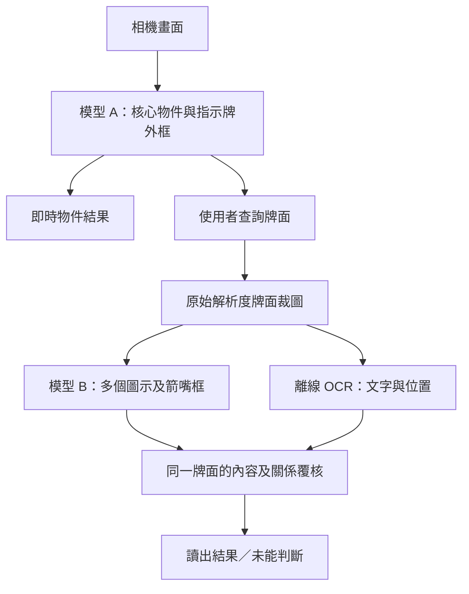

# 領路通 PathGuide Dataset 與模型訓練方案

更新日期：2026 年 10 月 22 日

同日後續討論：按 Backend 組員「COCO 已有類別不再於 Official define 重複登記」的回饋，新增 [類別及字典討論稿](CLASS-DICTIONARY-DISCUSSION.zh-HK.md)。新建議以 COCO 六類加自訂十七類形成 A 的 23 類候選，B 仍為十二類；把原 `road_vehicle` 訓練類改為四個 COCO 類別的播報群組。以下 20 類表格保留作較早方案對照，最新候選以討論稿為準，尚未定案或寫入 OneDrive 正式字典。現用九類模型沒有改動。

本文件說明類別規劃、物件／圖示／文字的模型分工、標註邊界、資料收集與切分、個人微調，以及扶手電梯方向研究。手機操作見 [前端方案](FRONTEND-DESIGN.zh-HK.md)，雲端與覆核流程見 [後端方案](BACKEND-DESIGN.zh-HK.md)，帳號及資料歸屬見 [帳號註冊與個人模型流程](ACCOUNT-REGISTRATION.zh-HK.md)。

**本輪建議：以香港街道、天橋及商場設施為首輪範圍，下一版以 20 類基礎候選為規劃目標；常駐物件偵測配合按需圖示偵測及離線 OCR。** 原先 18 類經原始清單覆核後，補入道路車輛及固定細柱兩個覆蓋項目；逐類取捨見 [類別來源與刪減審核](DATASET-CLASS-REVIEW.zh-HK.md)。可移動路障合併，固定圍欄另分，材質保留作屬性；新版將上／落樓梯合併為樓梯，方向另行記錄及驗證。

目前只有九類 YOLO11n 已打包。20 類、圖示、OCR、照片上傳、個人再訓練及扶手電梯方向均屬後續規格，本輪沒有修改程式、類別字典、標註或模型。下文將現況證據、設計決定及待驗證目標分開描述。

## 1. 目前有甚麼，而不是字典列了甚麼

### 1.1 已打包的九類模型

版本 `2026-10-19.hk9.1`，Float32 TFLite，輸入 640 × 640。模型本地索引與專案 ID 是兩套編號，須依版本清單映射，不能套用 COCO／Firebase 字典索引。

| 模型本地索引 | 原始資料集名稱 | App 中文標籤 | 專案 ID |
|---:|---|---|---:|
| 0 | bicycle | 單車 | 11 |
| 1 | bin | 垃圾桶 | 7 |
| 2 | bollard | 護柱 | 8 |
| 3 | downstairs | 落樓梯 | 50 |
| 4 | escalator | 扶手電梯 | 49 |
| 5 | person | 行人 | 6 |
| 6 | traffic_cone | 交通錐 | 9 |
| 7 | upstairs | 上樓梯 | 51 |
| 8 | wet_floor_sign | 小心地滑 | 24 |

依據：[打包模型清單](../app/assets/models/detector.json)、[模型說明](MODELS.md)。PyTorch 評估及歷史三類模型的數字不能當成目前手機端表現。

### 1.2 類別字典不等於模型能力

[類別字典](../configs/classes.json)目前為 v6，登記 ID 0–51 共 52 個物件類別，另有 `crop_classifier` 及 `ocr_only` 規劃。這不代表目前模型辨認到 52 類，亦不代表全部項目都已有足夠資料。

使用者已確認原始 Dictionary 只是初期可能訓練類別的構想，並未由該清單完成訓練。因此可按需要重新刪減及命名；不能從登記項目、舊 ID 或工作表狀態推斷已有標註、模型或必須保留的需求。現用九類模型屬另一項已核對的實作事實。

字典已有共用 `escalator`，也保留室內／室外扶手電梯、一般／室內玻璃門，以及泛稱障礙物等項目；訓練時全部一起使用會帶來同一實物的分類歧義。下一版按任務重新定義有效集合，本文件暫列現有 ID 方便對照；未使用的候選項目無須永久保留。若重整正式編號，已使用的九類映射與確實存在的標註須一併遷移。`app/lib/vision/labels.dart` 是由字典產生的檔案，日後工程遷移須從來源字典處理。

原始資料夾雖名為 `pathguide-hk-8classes`，其 [data.yaml](../../pathguide-hk-8classes/data.yaml)實際列出九類。2026 年 10 月 22 日直接統計原始標註文字檔，train／valid／test 分別為 9,554／1,374／620 份，合共 11,548 份；物件標註實例共 20,163 個。這是來源資料盤點，未證明場景獨立、標註完整或沒有近似圖片洩漏，也不是最終資料準備程式輸出的數量。

### 1.3 原始需求、後端字典及 App 字典分開核對

本輪已直接讀取 [原始物件工作表](../../labelObject_workload%2020260920-2.xlsx)的 `Object!A1:H55` 及 [FYP 原文](../../FinalYearProject-3.docx)。App 52 類是原始需求經分流、合併及工程追加後的結果，並非把工作表序號直接當 ID。後端 [class_dictionary.json](../../firebaseCode-2/store/class_dictionary.json)則實際包含 COCO 80 項及一項 Official 垃圾桶；其 Official 宣告 50 項與實際內容不符，不能視為完整清單或直接接到 App。

既有九類、App 專案 ID、後端字典 ID 與將來個人新增類別必須各有版本映射；不同名字的同義物件不因此重開一類。完整來源、17 個保留項目、11 個合併項目及其餘取捨見審核文件。原始工作表及現有字典本輪均保持不變。

## 2. 一個可用版本需要多少類

沒有適用所有輔助 App 的最低 class 數。九類可支援限定範圍的辨識原型；增加到數十類，仍不能代表可以辨認所有障礙或判斷通行安全。本專案應按使用任務、逐類品質及手機表現決定是否發佈。資料收集與標註亦應由具體目標及一致定義出發。[Ultralytics 資料指引](https://docs.ultralytics.com/guides/data-collection-and-annotation/)

**20 類是本輪審核後的候選目標，並非研究證明的可用門檻。** 計算方式為現有九類合併樓梯後的八類，加上十二類設施／環境物件；相對原先 18 類方案，新增道路車輛及固定細柱。先驗證八類新架構，再分批加入其餘類別；未達驗收條件的類別留待下一版，不為湊數而發佈。這二十個基礎類別與日後每人最多二十個新增類別名額是不同規劃。

### 2.1 下一版主物件模型 A：20 類候選

下表是目標集合，不是現有模型的本地索引次序。「沿用」只代表已有專案 ID，並不代表已訓練。

| 編號 | 建議訓練名稱 | 中文名稱 | 專案 ID／狀態 | 第一版標註範圍 |
|---:|---|---|---|---|
| 1 | pedestrian | 行人 | 6，沿用 | 真實人物；不從外觀推斷性別或身分 |
| 2 | bicycle | 單車 | 11，沿用 | 單車本體；騎乘者另標行人 |
| 3 | bin | 垃圾桶 | 7，沿用 | 可辨識的垃圾桶本體 |
| 4 | bollard | 護柱 | 8，沿用 | 用作限制通行的柱狀設施；不含所有直柱 |
| 5 | traffic_cone | 交通錐 | 9，沿用 | 獨立交通錐；不併入一般可移動路障 |
| 6 | caution_slippery | 小心地滑告示 | 24，沿用 | 獨立地滑告示本體；不是偵測到地面濕滑 |
| 7 | stairs | 樓梯 | 1，沿用；合併舊 50／51 | 一段連續梯級；上／落另作屬性 |
| 8 | escalator | 扶手電梯 | 49，沿用 | 室內外共用；不由單張圖判斷運行方向 |
| 9 | temporary_barrier | 可移動路障 | 新增待登記 | 水馬、臨時硬式路障及可搬動圍網；不含錐筒／護柱 |
| 10 | fence | 固定圍欄 | 26，沿用 | 固定欄杆／圍欄；材質不另分 class |
| 11 | push_cart | 手推車 | 13，沿用 | 本輪只含一般載貨平台／籠式推車；其他型號先覆核 |
| 12 | step | 單級台階 | 14，沿用 | 獨立單級高度變化，不逐級標整段樓梯 |
| 13 | elevator | 升降機入口 | 3，沿用 | 可由門、門框及周邊設施確認的入口；不含升降機圖示 |
| 14 | ramp | 斜道 | 4，沿用 | 可見坡面區域；不等於已確認無障礙可通行 |
| 15 | tactile_paving | 盲道 | 15，沿用 | 可見引導／警示觸覺鋪面，類型作屬性 |
| 16 | zebra_crossing | 斑馬線 | 16，沿用 | 可見斑馬線區域；不判斷是否可以過馬路 |
| 17 | door | 一般出入口門 | 18，沿用 | 一般門／門洞；玻璃作屬性，升降機門不重標 |
| 18 | sign_pictogram | 設施／方向指示牌 | 20，沿用 | 有設施圖示或導向文字的實體牌面；不是所有廣告 |
| 19 | road_vehicle | 道路車輛 | 新增待登記 | 汽車、貨車、巴士及電單車等道路機動車輛；不含單車、滑板車、手推車、軌道車輛及玩具 |
| 20 | fixed_pole | 固定細柱 | 新增待登記 | 路燈柱、標誌桿及相近人工固定細柱的柱身；不與護柱重標，不含一般樹木 |

如沿用現有正式字典，`temporary_barrier` 不直接改用水馬 ID 10，`fixed_pole` 也不直接改寫路燈或標誌桿的舊定義；新類別追加登記，目前下一個可用值為 52。本輪不預先占用。若決定重新設計正式字典，可另建版本並遷移已使用的映射，無須為未使用的候選項目保留空位。

首輪範圍不涵蓋所有車型、交通燈、行人過路燈、坑洞、所有工程物料及所有可撞物，亦不分析車速或過路時機。天橋入口、其他車種等已登記項目亦非全數納入。App 必須如實說明支援範圍，沒有框只代表暫未找到支援的物件，不能播報「前面安全」。盲道與斑馬線屬地面區域，需另作場景分層及任務驗收，不由物件框直接推出可行走路線。

### 2.2 舊資料如何遷移

- 舊 `person`、`wet_floor_sign` 分別映射到專案 `pedestrian` 6、`caution_slippery` 24；保留原始來源名稱。
- `upstairs` 51／`downstairs` 50 在新版匯出中合併成 `stairs` 1，保留原標籤供追溯。舊名稱只記作 `legacyLabel`，不能自動當成已核實的方向答案。
- 樓梯新增 `viewpoint=lower_landing/upper_landing/side/unknown`、`travelDirectionFromView=up/down/unknown` 等覆核欄位。只有足夠幾何證據才填方向；這些屬性不會因主模型合併類別而自動具備推理能力。
- 扶手電梯統一用 49；室內／室外 ID 2／19 不同時加入此訓練版本。玻璃門 ID 17／21 經覆核可映射到一般門 18，原始資料及 ID 不覆寫。
- 水馬 10、工程圍網 27 須逐張判斷是否屬可移動路障；固定結構歸 26，不能確認則待覆核。天橋欄杆 5 如引入此版，也須按固定圍欄規則覆核。
- 不同手推車 ID 13／39／40 不直接整批合併；先依第 11 類範圍判斷。新增車種若有不同使用意義，再另作版本決定。
- 路燈 45／標誌桿 46 的柱身經重新覆核後可加入新固定細柱；若原框包含燈頭或牌面，不能直接換類沿用框。細柱不逐根自動播報，也不等於可以從訓練目標完全刪走；播報時機另由任務與驗證結果決定。

保留舊九類模型及其清單。新版另建 taxonomy／資料集／模型版本；任何個人模型都須與其所屬基礎模型及類別映射一致，不能混合九類與新版權重的輸出解碼。

## 3. 模型分工：兩個自訓模型，另用 OCR 能力

不建議按「街道／商場」各訓練一個大模型，因為單車、垃圾桶、門等會跨場景出現，模型選擇亦可能不明確。建議按任務分工：

| 模組 | 處理內容 | 執行方式 | 本輪訓練／資料工作 |
|---|---|---|---|
| A：核心物件偵測 | 表列 20 類物件／區域與牌面外框候選 | 即時辨識任務中運作 | 先沿用 YOLO11n 路線，按新 taxonomy 再訓練及驗證 |
| B：牌內圖示偵測 | 同一牌面的多個設施圖示及箭嘴 | 使用者查詢時，對牌面裁圖啟動 | 小型多物件偵測模型；獨立標註及評估 |
| C：文字 OCR | 繁體中文、英文、數字、路名及樓層 | 使用者查詢時啟動，優先離線 | 先評估現成 OCR，不為每個路名新增 class |
| D：扶手電梯方向研究 | 同一設備的幾何、標誌與連續運動 | 明確的方向查詢任務 | 獨立時間序列資料；不由 A／B 的靜態類別代替 |

因此是「兩個自行訓練的偵測模型＋現成 OCR 流程」，不保證整個 App 只有兩個模型檔；系統 OCR 可包含其本身的文字定位及辨識模型。D 的實作亦未定，不能先承諾只需再加一個模型。

牌面裁圖從原始相機影像取出並保留邊界，不從已縮成 640 × 640 的張量再放大。座標須轉正並可還原到原圖，避免切掉中文字或箭嘴。A 漏檢牌面時，仍須容許使用者按需對目前畫面啟動文字／圖示查詢，不能將「A 找不到牌」直接當成「沒有內容」。B／C 的查詢不會自行開啟上傳。

### 3.1 為何男女廁所牌不只用整張圖片分類

一般單標籤圖片分類回答整張圖的一個類別，沒有每個物件的位置；同一塊牌可以同時有男性、女性、無障礙圖示及不同箭嘴，所以本專案選擇牌內偵測，再處理位置關係。這是針對複合牌面的設計判斷。[Ultralytics 分類任務說明](https://docs.ultralytics.com/tasks/classify/)

現有字典的 `crop_classifier` 曾規劃七個類別。新方案保留「先找牌面再分析」的方向，但改為可輸出多個框；若日後已有可靠的單圖示切割，才評估切割後的小分類器。不能把每塊複合牌硬塞成一個類別。

### 3.2 模型 B 的首輪 12 類目標

以下為獨立 `sign-icon-v1` 命名空間，不直接當成主模型的專案 ID 或主模型新增十二類：

| 組別 | 建議類別 | 標註規則 |
|---|---|---|
| 洗手間／無障礙，4 類 | `male_symbol`、`female_symbol`、`wheelchair_symbol`、`toilet_symbol` | 各圖示各一框；男女並列就標兩個；只辨識標誌，不判斷真人性別 |
| 設施／出口，4 類 | `lift_symbol`、`escalator_symbol`、`stairs_symbol`、`exit_symbol` | 限實際圖示；純文字「EXIT」「洗手間」交 OCR；出口圖示本體與另畫的箭嘴分開 |
| 畫面箭嘴，4 類 | `arrow_left`、`arrow_right`、`arrow_up`、`arrow_down` | 依轉正後牌面的二維朝向，不直接換成升／降樓層或身體轉向 |

舊規劃 `signage_forward` 與 `signage_up` 若外觀同為向上箭嘴，不分成兩個純視覺 class；「直行」或「上樓」是結合文字及牌面語境後的解讀。斜箭嘴、回轉、其他標誌先記錄待擴充，不硬套四個方向。

男性／女性／輪椅圖示旁的箭嘴，需用 `parentSignId` 及牌面分區／行列關係連結。例：「男士、左箭嘴；女士、右箭嘴」不能合併成「所有洗手間向左」。同一指示牌的圖示可指不同位置，只有關係清楚才讀出配對；否則分別讀出可確認內容及「未能確認方向」。輪椅標記只證明看見標記，並未驗證設施可用。

不使用一個包羅所有未知圖示的 `unknown` 訓練類別；保留範圍外圖示及其他樣式測試資料，以門檻及拒答作處理。屬於十二類但外觀未見過的樣式仍標真正類別，用來測泛化；真正範圍外者另記範圍外真值，不硬塞已知類。低分不是未知物件的保證，高分亦可能誤認。

入口燈號、紅色禁止進入、可變通行標誌另屬扶手電梯方向研究，未包含在這十二類。四個普通箭嘴不能代替設備運行或准入狀態。

### 3.3 路牌文字與離線 OCR

「彌敦道」「旺角」「男士」「女士」、店名及樓層不各設一個 YOLO class。OCR 保存文字區域、原文、候選／信心及閱讀次序，再做地名或設施詞彙匹配；不能把詞彙匹配結果覆寫成相機真的讀到的字。

iPhone 首輪評估 Apple Vision `VNRecognizeTextRequest`，目標繁體中文加英文；按系統、request revision 及辨識模式查詢支援語言，不能假設所有支援的 iOS 都有相同語言能力。Apple 提供語言清單查詢及優先語言設定。[文字辨識 API](https://developer.apple.com/documentation/vision/vnrecognizetextrequest)、[支援語言查詢](https://developer.apple.com/documentation/vision/vnrecognizetextrequest/supportedrecognitionlanguages())

Android 保留相同任務，另評估可在裝置上執行的繁體中文 OCR；本輪不承諾兩平台共用權重。兩平台都須在斷網下驗證支援範圍、首次使用依賴及回應時間；不支援時清楚提示，不能自動轉為雲端傳圖。中文辨識與粵語播報是不同工作，OCR 不需另建「粵語字形」類別。

首輪以香港實景測試既有 OCR，不從零訓練。保留文字框／多邊形及人工逐字答案；只有錯誤分析顯示需要且有足夠資料，才另行規劃 OCR 微調。菜單可重用 OCR 能力，但其類別、價格、行列及菜名配對須用另一組版面資料驗證。

## 4. 如何避免重疊與重複播報

### 4.1 同一實物的語意重疊

每個訓練任務中，同一實例只選一個規範物件類別；材質、場所、方向等不再產生一套重複物件類別。標註手冊須附正例、反例及邊界案例。

| 容易混淆的情況 | 統一規則 |
|---|---|
| 水馬、臨時圍網、固定圍欄 | 依設施用途與安裝型態分「可移動路障／固定圍欄」；塑膠、金屬、網布作屬性，不能單憑材質判斷可否移動 |
| 錐筒／護柱與可移動路障 | 明確符合錐筒／護柱者用專門類別，不再標路障；串連錐筒不額外標一個泛稱路障大框 |
| 樓梯／上下樓梯／台階 | 整段連續樓梯一框；不重標上／落類別或逐級台階；獨立單級才用 `step` |
| 升降機門／一般門／玻璃門 | 可確認升降機入口時只標 `elevator`；一般門用 `door`，玻璃作材質；無法確認用途先覆核 |
| 室內／室外扶手電梯 | 同用 `escalator`；場所與運行方向分開記錄 |
| 天橋欄杆／一般固定圍欄 | 此版統一 `fence`，位置及用途作屬性；不加重疊父子框 |
| 泛稱 `obstacle` 與所有具體物件 | 此版不訓練 ID 48 的泛稱障礙物，避免所有物件又多一個父類框 |
| 地滑告示／一般設施牌 | 獨立地滑告示在 A 只標 `caution_slippery`；不再標 `sign_pictogram` |
| 廣告上的人物／廁所圖示 | A 的行人只標真人；B 的人物圖示限設施標誌，廣告人物作干擾樣本 |

無法由影像確認的可移動性、用途或方向，標為待覆核／屬性未知；不能要求標註員猜測。未確定目標的圖像不直接當成已完成負樣本。

### 4.2 合理的框重疊需要保留

騎單車的人與單車、站在門前的人與門，本來就是不同實物，框可以相交。A 的整塊牌面框包住 B 的多個圖示框亦屬跨任務關係；不能為了不重疊而刪掉真實物件。

目前 [iOS 解碼](../app/ios/Runner/VisionPlugin.swift)及 [Android 解碼](../app/android/app/src/main/kotlin/hk/pathguide/pathguide/VisionPlugin.kt)的 NMS 只抑制相同類別的重疊框。調整 NMS 不能代替類別定義；不全面改成跨類別抑制，以免刪掉人與門等有效結果。

推理後以同一實例追蹤及任務關係整理播報：A 已交給牌面查詢時，不把「指示牌」及所有 B／C 結果當成互不相關的重複提示；普通物件仍按時效與冷卻規則輸出。不同模型的分數不可直接當成同一尺度比較。

### 4.3 資料重複與切分洩漏

完全重複、相近連拍、同一影片相鄰影格、同一塊實體牌面的不同裁圖，以及其增強版本須放在同一組。先分 train／validation／test，再裁圖及增強；A 的來源原圖與 B／OCR 衍生裁圖共用 split，不可各自隨機切分。

以實體設備／牌面、拍攝工作階段及相近場景建立群組；泛化測試再保留未見場地與圖示樣式。可先以約 70／15／15 作分組切分起點，但不為比例拆散群組；逐類檢查每個 split，資料不足就補拍或延後，不複製同一來源到測試集。

## 5. Dataset 要保存甚麼

以完整原圖、覆核標註及版本化 JSON 中繼資料為主，不只保留 YOLO 的文字標籤。標準偵測 TXT 保存類別及正規化框，不包含文字逐字答案或牌內關係，這些須另存並在匯出後核對。[YOLO 偵測資料格式](https://docs.ultralytics.com/datasets/detect/)

| 資料產品 | 必要標註 | 用途 |
|---|---|---|
| A：實景物件資料 | 規範專案 ID、框、實例 ID、遮擋／品質及必要屬性 | 20 類候選物件偵測 |
| B：牌面與牌內圖示資料 | 原圖及裁圖關係、每個圖示框、圖示命名空間、`parentSignId`、行列／箭嘴配對或未知 | 多圖示定位及牌面理解 |
| C：文字評估資料 | 文字框／多邊形、逐字原文、可讀性、語言、閱讀次序及與圖示的關係 | 評估 OCR、文字與方向配對 |
| D：方向研究短片 | 設備、時間序列、端點、運動、實際方向及獨立覆核證據 | 扶手電梯方向研究 |

共同保存 `sourceId`、來源授權用途、`ownerUid`（私人資料適用）、`sessionId`、`sceneGroupId`、實體設備／牌面識別、`annotationVersion`、`taxonomyVersion`、split 及原始雜湊。設備識別可由研究覆核分組，不要求前端另外收集 GPS。

整張圖的目標需完整覆核；圖示裁圖保留四周脈絡及所有目標，不能只標第一次找到的男士圖示而漏掉女士及箭嘴。工具匯出如遺失屬性、文字或關係，必須從中繼資料補回，不能假設任意格式互轉都會保留。

舊九類照片重用於擴類訓練前，須補查當次啟用的全部目標。例如原圖已有門、路障、車輛或細柱，舊標籤沒有框不代表它們不存在。尚未補標的圖片標為部分標註，不能直接加入標準 YOLO 全類訓練，否則新類別會被當成背景；本輪亦不規劃以特殊損失函數繞過完整覆核。

多邊形可按現有準備流程轉為物件框，但 OCR 的文字多邊形仍需保留。匯出檢查類別範圍、零面積、越界、孤立標籤、圖像方向及來源關係。

## 6. 收集多少資料、怎樣分批

下列是安排首輪收集的工作預算，並非可用／安全的學術門檻。達到數量後仍須依獨立測試、錯誤類型及學習曲線決定補拍；多框可在同一張圖出現，實例數不等於照片數。

| 資料 | 首輪收集／標註起點 | 獨立評估起點 |
|---|---|---|
| A 的每個新增或重新定義類別 | 約 300–500 個經覆核的真實實例，分散於不同物件、視角及場地；先盤點可重用資料 | 每類盡量至少 100 個未參與訓練的實例，涵蓋約 10 個獨立群組；不足則標示限制 |
| B 的每個圖示類別 | 約 200–300 個實例，包含真實複合牌、不同設計、尺寸及背景 | 保留未見牌面／設計樣式，逐類計數；不以印出同一圖示補足多樣性 |
| C 的 OCR 評估 | 先約 300 塊實景牌面，包含中英混排、樓層及複合方向牌 | 場地／牌面分組，單列細字、反光、斜拍及無法讀取案例 |

既有九類不一律由零補到同一數量；例如原始 train 中交通錐有 4,277 個框，扶手電梯只有 535 個框，仍須檢查有效場地及同物件重複率，不能只依框數判斷是否足夠。

先重新覆核樓梯及八類基線，再優先加入可移動路障、固定圍欄、單級台階、手推車、道路車輛及固定細柱，之後加入升降機、斜道、一般門及指示牌；盲道與斑馬線另驗證地面區域用途。每個類別仍按資料與逐類結果決定實際加入次序。圖示／OCR 可使用另批牌面資料做原型，但不得未經驗證就併入日常播報。

收集涵蓋街道、天橋及商場的不同時段、背光、陰影、反射、遮擋、遠近及一般持機晃動；困難案例須保留，不只拍正面清晰物件。背景負樣本包括廣告、普通立柱、地面條紋及其他易誤認物件，並由人工確認沒有漏標目標。

增強只用訓練集，不能增加「獨立樣本數」。牌面／OCR 分支首輪關閉水平及垂直翻轉，避免鏡像文字及錯誤箭嘴；含方向屬性的其他資料亦須同步變換屬性或關閉變換。色彩變換不可破壞需保留的燈號語意。這是本專案根據增強效果作出的限制，不是工具的預設保證。[Ultralytics 增強設定](https://docs.ultralytics.com/guides/yolo-data-augmentation/)

## 7. 候選照片與每人獨立微調

基本離線辨識可訪客使用。使用者以手機短訊驗證碼登入，另外同意後才啟動照片收集；收集預設關閉。低信心候選、少量場景抽樣與手動回報均只產生待覆核影像，低信心不等於新類別，沒有框及高信心誤認亦可能漏掉未知物件。限額、冷卻與 Wi-Fi 預設依前端／後端方案，本文件不擴大擷取頻率或用途。

先以現有 PyTorch 模型批次預標註，再由組員在 Roboflow 補漏、修框及覆核整張圖。保留原始預測與人工答案，模型猜測不能直接當訓練真值。品質差可拒絕，證據不足留待確認；只有人工確認完全沒有目標的圖片可作背景負樣本。新類別先核准定義及登記，不能臨時猜一個 ID。

私人照片、標註、資料集及工作都綁定由認證取得的 Firebase `ownerUid`。每人微調只使用該 UID 已核准的照片及允許使用的基礎資料，不混用別人的私人照片，也不自動把私人照片回灌共用基礎模型。

**首輪個人化限模型 A。** B 圖示及系統 OCR 先採共用、經獨立驗證的能力，不因使用者上傳一張牌面就聲稱已更新其 OCR。私人照片如供 B／C 評估或日後訓練，亦須保留同一 UID、授權用途及版本限制，不能默認擴大用途。

按 UID 建立可追溯資料集快照，混合核准個人資料與基礎資料，再由組員覆核後手動啟動 Colab 批次微調。上傳一張照片不觸發一次 GPU 訓練；資料不足或無法有效評估時保留基礎／舊個人模型。新增類別須先有 App 支援及新的基礎 taxonomy，私人微調不能自行擴充輸出 class。

現有準備程式已有完全重複圖片檢查，但未完成近似圖片及場景洩漏評估；須加入第 4.3 節的群組切分。凍結測試資料不因來源是使用者照片就改成訓練資料。

## 8. 訓練、評估與手機驗證

現有 [資料準備](../../pathguide-colab/colab_prepare.py)、[訓練](../../pathguide-colab/colab_train.py)、[測試](../../pathguide-colab/colab_test_best.py)及 [匯出](../../pathguide-colab/colab_export_app.py)包含九類名稱、既有 run 路徑、權重 SHA256 或張量形狀等固定檢查。擴類工程必須版本化修改設定、映射及相應一致性檢查，不能把新資料直接塞進舊流程，亦不能刪除檢查來遷就不相容輸出。

| 對象 | 必須評估的內容 |
|---|---|
| A 物件偵測 | 逐類 precision／recall、AP、混淆、漏檢、重複框；按場景、遮擋及尺寸分層 |
| A 樓梯遷移 | 舊 50／51 在共同測試集映射為 1 後比較樓梯定位；上／落方向另評，不將合併後分數誤作方向能力 |
| B 圖示 | 逐類偵測、複合牌漏圖示、未知樣式誤認、箭嘴與設施配錯率及拒答比例 |
| C OCR | 逐字錯誤、整行／關鍵字正確率，尤其路名、數字、樓層；包含牌面漏檢及錯誤配對的端到端結果 |
| 手機與播報 | TFLite 轉換前後差異、類別映射、實際播報門檻下的誤報／漏報，同機延遲、記憶體、幀率、耗電及語音協調 |

不能只報全類平均 mAP；逐類指標及 precision／recall 能顯示被平均值掩蓋的問題。[Ultralytics 評估指標](https://docs.ultralytics.com/guides/yolo-performance-metrics/)

用 validation 選門檻，test 凍結作最終比較；反覆看 test 調參後，須另建獨立保留集。新增類別前後使用共同測試樣本比較舊類，另測陌生場地，避免只記住常用商場。測到退化要查原因，不以「新增類別更多」解釋為自動可接受。

圖示及 OCR 在使用者查詢時才啟動，須實測與 A 的相機／推理資源競爭，必要時暫停或降低 A 頻率。沒有真機結果前，不承諾指定 FPS、準確率、延遲或耗電。PyTorch 測試只是來源模型結果，不能當成 TFLite 或使用者任務成功率。

## 9. 扶手電梯方向資料：另作時間序列研究

照片能改善扶手電梯及標誌定位，不能靠單張照片的 up／down class 學到可靠實際運動。方向查詢須結合同一設備追蹤、上下端幾何及經相機移動補償的梯級運動；普通箭嘴或准入標誌亦不能單獨證明上行／下行。

### 9.1 來源及標註

首階段由研究團隊在受控場景另行取得授權拍攝短片。使用者查詢的連續影像預設只留本機記憶體，不自動錄影／上傳；照片收集同意不涵蓋影片，第一版後端不接收此類影片。

| 標註項目 | 內容 |
|---|---|
| 場地、設備及工作階段 | 同一實例識別、來源及分組切分 |
| 時間與有效影格 | 真實次序、時間戳及掉幀，不當作無順序照片集合 |
| 觀察端點 | 上端、下端或無法確認 |
| 同一設備區域 | 梯級、固定結構、標誌及遮擋，避免混入相鄰設備 |
| 相對運動 | 朝向／離開觀察端，或未能可靠觀察 |
| 實際方向及變化 | 經獨立確認的上行／下行、啟停或改向時間 |
| 標誌及設備關係 | 實際內容、所屬設備及清晰度；包含准入／禁入的研究標註 |
| 不可判斷原因 | 晃動、反光、遮擋、取樣不足、目標不明及證據衝突 |

真值不能由待評估的光流／模型自己產生。無法由研究人員及獨立證據確認時保留未知；未觀察到移動亦不等於停機。

### 9.2 幾何關係與評估

| 已確認觀察端 | 梯級沿梯身相對移動 | 可推導方向 |
|---|---|---|
| 下端 | 從此端離開 | 向上 |
| 下端 | 朝此端移動 | 向下 |
| 上端 | 從此端離開 | 向下 |
| 上端 | 朝此端移動 | 向上 |
| 端點或運動不明 | 任意 | 未能判斷 |

這不是畫面垂直像素位移的正負值；端點需物理幾何證據。方法背景見 [OpenCV 光流說明](https://docs.opencv.org/4.x/d4/dee/tutorial_optical_flow.html)及 [The Escalator Problem 預印本](https://arxiv.org/abs/2508.07989)，兩者均非本專案已可靠判斷方向的證明。完整裝置端流程及現場使用限制見前端方案。

按設備、場地及工作階段切分，報告錯報方向率、拒答／無法判斷比例、回應時間及過期結果清除，不只報正確率。受控測試中證據不足、衝突或目標不明須拒答；出現錯報先修正重測。有限測試零錯誤不代表部署安全，正式開放仍需視障使用者與定向行動專業人士共同評估；不輸出「可以安全踏上」指令。

## 10. 發佈、交接與驗收清單

主模型清單至少包含版本、檔案、雜湊、輸入／輸出規格、完整 `modelClassIds` 及 taxonomy 版本；圖示另附圖示命名空間與映射，OCR 記錄 API／系統版本、語言及設定。資料集快照記錄來源、授權、標註、群組及各 split 清單，模型與報告引用同一快照。

個人發佈包另含 `ownerUid`、基礎模型及資料集版本、相容 App／taxonomy、相符權重與評估紀錄。只授權本人下載，下載後核對 UID、SHA256、映射及相容性；使用者在暫停推理時明確切換，訓練完成不能背景自動啟用。未通過驗證就保留內置基礎／舊個人版本。

- [ ] 已區分現用九類、已登記 52 項與候選 20 類；52 項均有取捨及來源，沒有宣稱新增能力已完成。
- [ ] 樓梯遷移、路障／圍欄、門／升降機及其他邊界有正反例，待確認資料不混入完整負樣本。
- [ ] 只匯出核准完整標註；原始預測與人工真值分開，舊 ID 不重排／挪用。
- [ ] 原圖、裁圖、近似照片、影片及增強來源按組切分；測試集有未見實例／場地。
- [ ] A、B、OCR 各有相符標註及版本；複合牌配對及無法判斷有測試案例。
- [ ] 新舊類別、逐類門檻、TFLite 及 iPhone 斷網實測均有可追溯紀錄；未有數據明確標待驗證。
- [ ] 私人資料只供所屬 UID 與獲准用途，首輪個人化限 A，不自動加入共用基礎訓練。
- [ ] 匯出及訓練副本可按 UID 追溯清理；刪除中帳號不能重新啟動工作或發佈產物。
- [ ] 照片同意沒有擴大成影片收集；方向能力有獨立資料及驗收。

工程次序為：凍結新類別手冊及映射 → 重新覆核並建立分組基線 → 分批驗證 20 類候選 → 圖示／OCR 按需原型 → TFLite、讀屏及真機驗收 → UID 照片與私人微調整合。扶手電梯時間序列另作受控研究，不作前述基礎辨識交付的完成宣稱。

相關文件：[方案索引](INTEGRATED-DESIGN.zh-HK.md)、[專案背景](PROJECT-OVERVIEW.zh-HK.md)、[無障礙研究與操作設計](ACCESSIBILITY-RESEARCH.zh-HK.md)。
