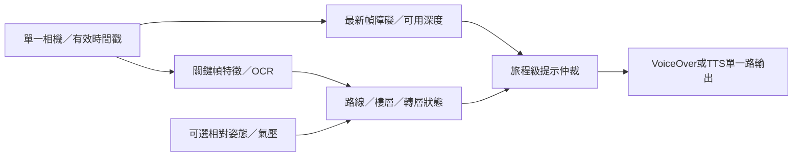
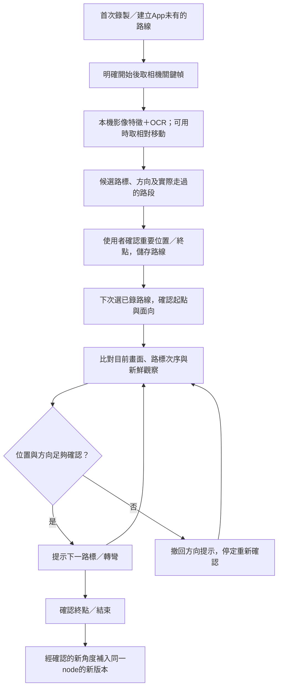
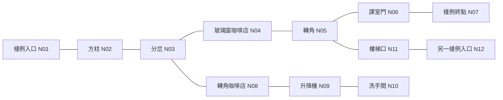

# Frontend：PathGuide 整體流程、規格與裝置端

更新：2026年11月6日。此文件是整體規格入口；產品介紹、Backend及Dataset各自維護所屬內容。
**2026-11-05執行責任更新：使用者已改由Codex直接開發及驗收，取代下方較早的DSH全實作限制。DSH三輪失敗證據保留，不再派模型。Codex相機協調器及lease／一次回覆助手已通過30項獨立工程情境；Vision／Depth／Menu及P2-C原生錄路來源已接入，45項原生Simulator測試、435項Flutter測試及analyze通過。P2-D Flutter入口已接入，1.5.0+9簽署建置通過；已推送不可變tag／prerelease並核對遠端，iPhone安裝及啟動成功；使用者已回報基本操作及旁白無問題；逐項邊界及實地導航未當作已驗收。本輪按使用者確認整理UI，442項Flutter、analyze、兩項獨立覆核及簽署建置通過；1.5.1+10不可變tag／prerelease先推送核對，iPhone安裝及啟動成功，新UI人工回饋待收。**


規格快照及待定事項：[整體規格 #13](https://github.com/actiondarr/pathguide/issues/13)。既有導航P2–P5仍由[總票 #2](https://github.com/actiondarr/pathguide/issues/2)及其子票追蹤；本次重整不改寫其範圍或狀態。

| 文件 | 負責內容 |
|---|---|
| [完整產品介紹](APP-FEATURES.zh-HK.md) | 使用者可以完成甚麼、整體流程與主要工具；不記交付狀態 |
| [Frontend／整體規格](FRONTEND-DESIGN.zh-HK.md) | 產品問題、使用者故事、操作／導航、實作決策、驗收及裝置端證據 |
| [Backend](BACKEND-DESIGN.zh-HK.md) | 資料／同意／帳號、服務契約、覆核、模型交付及部署／回退 |
| [Dataset Review](DATASET-REVIEW.zh-HK.md) | 類別字典、資料來源、模型品質、獨立評估及B11交接 |

**狀態用語：**「已確認需求」是產品決定；「待定」是尚未有答案；「已有程式／工程已驗」不代表真機或產品驗收；「已交付」須有版本收據。研究／候選能力不因列入文件就成為本輪實作或付費授權。

閱讀順序：[產品目標](#problem-statement) → [使用者故事](#user-stories) → [流程與實作](#implementation-decisions) → [驗收](#testing-decisions) → [現況](#current-state) → [開發次序](#delivery-plan) → [待定事項](#out-of-scope)。底部附錄保存實作追溯及歷史背景。

<a id="problem-statement"></a>
## 1. 問題與產品目標（Problem Statement / Solution）

使用者需要從相機、文字及位置資訊理解環境並完成出行／閱讀任務。現行程式按能力分頁，完整目標、候選方案、已實作狀態與歷史工程紀錄原先混排，容易把「有模型輸出／有mock／有程式」誤解成可以完成真實任務。

解決方案（Solution）：以「開始協助」建立可暫停／結束的任務，使用者表達意圖，由App協調相機、定位、辨識、文字及語音。導航為現行優先主線，一般iPhone為基本目標；跨樓層、即時障礙資訊與統一語音共同驗收。完整產品亦包含閱讀、看圖、帳號及自願回報／改善，逐項依證據啟用。

### App 背景與用途

領路通（PathGuide）是一個以香港視障人士為主要服務對象的畢業專題（FYP）。專案希望利用使用者已有的手機，把相機所見的物件、設施及文字轉成可理解的粵語資訊，協助使用者掌握周邊環境、尋找設施及處理日常生活中的視覺資訊，增加自主操作的機會。

原始動機來自行路、乘車及餐廳用餐的資訊障礙：即使已有無障礙設施，通道中的物件、臨時圍欄、設施位置及指示牌仍可能不容易察覺；菜單中的分類、菜名、價格及供應時段，也主要透過視覺表達。App希望在現有設施及使用者既有定向工具之上，提供額外資訊，而不是取代白杖、導盲犬或定向行動技能。

介面可在設定頁右上角的語言按鈕切換繁體中文／English，並保存選擇；中文語音優先香港粵語，英文介面使用可用的英語TTS，並保留VoiceOver操作、大字、可重播及簡潔控制。基本物件辨識在手機端執行，訪客亦可使用；照片收集及私人學習須另外同意，不因開啟相機或登入而自動上傳。

| 原始使用情境 | App希望提供的幫助 | 現況與界線 |
|---|---|---|
| 街道、天橋及室內步行 | 了解前方行人、物件、樓梯等設施，逐步加入路線與近距離空間資訊 | 物件辨識及戶外步行導航已有程式；準星及框內表面LiDAR測距試驗已有，鳥瞰與短路徑待實作 |
| 尋找設施與理解指示 | 結合物件、牌內圖示、箭嘴及文字，協助理解設施資訊 | B圖示模型尚未完成發佈／App整合；文字／圖示配對、方向與通行判斷未完成 |
| 餐廳用餐及日常文字查詢 | 拍攝菜單，瀏覽分類並以文字或粵語查詢菜名與價格 | iPhone菜單OCR與查詢已有程式；不代表所有版面、店名或購物情境均已支援 |

原始構想有「出行時的環境／設施理解」及「用餐等日常文字／版面理解」兩條主線。**可量測的持續改善**是配套目標，當前實作以導航主線優先：先建立可信基準，把使用者同意提供的問題交管理員覆核，再以獨立場景驗證修正。共用模型改善先建立可重現證據；私人微調是否有額外效益仍是待驗證假設，對照方法見Dataset。目標是越用越準，每次更新均須有證據支持。

Tesla FSD是空間資訊呈現的參考，希望讓人、障礙、地面及短路徑更容易理解；它不代表App已具備自動駕駛等級的感知、避障或安全保證。室內目標為一般iPhone路線錄製與跨樓層步行導航；現有Pro Max可作首部驗證，無LiDAR一般iPhone另需實機。跨樓層與行走障礙／語音是主線，同樓層只屬首個工程案例；全場地自動建圖後續擴展。

以上背景沿用原始FYP及原專案背景稿的動機與服務對象；舊稿中的「導航／菜單尚未接入」等歷史狀態不再沿用。最新功能、驗收與限制以下文為準。

<a id="user-stories"></a>
## 2. 使用者故事（User Stories）

以下覆蓋完整目標；故事本身不代表已交付。現行優先及依賴見開發次序，研究候選須另行驗收。

### 開始協助與無障礙操作

1. 作為視障使用者，我希望明確按「開始協助」才啟動環境觀察，以便掌握相機何時使用。
2. 作為使用者，我希望用一句話或替代按鈕表達任務，以便毋須理解或選擇模型。
3. 作為使用者，我希望隨時暫停、繼續、重讀或結束，以便自行控制協助流程。
4. 作為讀屏使用者，我希望操作位置及焦點保持穩定，支援大字，以便完成任務時不因畫面更新失去控制。
5. 作為使用者，我希望選用繁體中文／粵語或英文及合適語速，以便聽懂提示。
6. 作為訪客，我希望使用本機基本辨識及已錄路線，以便毋須為基本協助登入。
### 環境理解與距離

7. 作為使用者，我希望聽取簡短且有效的物件及環境資訊，以便了解眼前可確認的情況。
8. 作為使用者，我希望主動拍攝或問眼前畫面的問題，以便取得物件清單以外的解釋。
9. 作為使用者，我希望在不確定或無法分析時收到可操作的說明，以便選擇重試、改用其他輸入或結束。
10. 作為使用者，我希望只在有效量測下取得目標距離，以便分辨可確認米數及未知距離。
### 戶外出行

11. 作為步行使用者，我希望搜尋及確認戶外目的地／路線，以便開始受控的步行導航。
12. 作為步行使用者，我希望在路線提示之間取得有效環境資訊，以便兼顧路線與當下觀察。
### 室內探索、錄製與重行

13. 作為使用者，我希望首次到某地方亦能開始錄製App未有的路線，以便建立之後可使用的私人路線資料。
14. 作為使用者，我希望只在重要位置、轉角或轉層時作必要確認，以便毋須逐張照片標註。
15. 作為使用者，我希望保存草稿、命名路線並重新開啟，以便分階段完成路線記錄。
16. 作為使用者，我希望選擇已錄路線並確認起點、樓層及面向，以便從正確狀態開始重行。
17. 作為使用者，我希望在升降機或樓梯入口及出口確認樓層，以便完成跨樓層行程。
18. 作為使用者，我希望在相似走廊、錯層或方向不明時重新確認，以便避免把候選位置當已定位。
19. 作為使用者，我希望在途中中斷後重新確認有效位置，以便恢復仍然有效的任務。
20. 作為使用者，我希望到達時確認實際入口或設施，以便分辨接近目的地與真正到達。
21. 作為首次到訪者，我希望在沒有既有路線時利用現場文字及方向線索逐段探索，以便逐步了解下一段可確認的方向。
22. 作為使用者，我希望探索及保存路線分開控制，以便知道何時會保留畫面與路標。
23. 作為使用者，我希望更新、回退及刪除私人路線，以便保留可用版本並移除不需要的資料。
24. 作為使用者，我希望平常重行不持續累積影片或照片，以便控制儲存量及資料保留。
### 行走感知與提示

25. 作為步行使用者，我希望收到仍有效的物件／障礙提示，過期時撤回，以便分辨目前資訊及已失效觀察。
26. 作為使用者，我希望只聽到一條協調後的提示，停止後不補播舊句，以便理解目前應處理的資訊。
### 閱讀及設施理解

27. 作為使用者，我希望拍攝菜單並按分類、菜名及價格查詢，以便閱讀用餐資訊。
28. 作為使用者，我希望拍攝指示牌並理解文字、圖示及箭嘴關係，以便取得有依據的設施方向資訊。
29. 作為使用者，我希望在菜名／價格／箭嘴配對不明時看到原文或重拍，以便保留判斷所需資訊。
### 能力、權限與同意

30. 作為使用者，我希望按裝置能力取得可用功能及明確限制，以便在沒有LiDAR或其他能力時仍能操作基本流程。
31. 作為使用者，我希望按用途授權相機、定位及按需收音，以便理解各項權限用途。
32. 作為使用者，我希望自行選擇是否使用雲端看圖，以便控制網絡處理及照片傳送。
33. 作為使用者，我希望分別同意雲端分析、問題回報及訓練用途，以便不因同意一項便授權全部用途。
### 帳號、回報與更新

34. 作為帳號使用者，我希望管理、登出及刪除帳號與選填聯絡資料，以便控制個人資料。
35. 作為使用者，我希望主動啟動緊急聯絡並交由系統撥號，以便確認後才聯絡指定人士。
36. 作為願意回報的使用者，我希望提交問題、查看處理狀態及撤回同意，以便知道回報目前進度。
37. 作為覆核人員，我希望依授權查看、修正、核准及追溯回報，以便形成可驗證的修正資料。
38. 作為使用者，我希望只收到經獨立比較及相容性檢查的模型更新，以便避免把訓練完成當改善。
39. 作為使用者，我希望在更新不合適時回退到先前版本，以便恢復已保存的體驗。
### 中斷及後續擴展

40. 作為使用者，我希望在背景、來電、斷網或權限改變後取得清楚狀態，以便重新確認或退出而不接收舊指令。
41. 作為使用者，我希望日後按獨立驗收加入空間音效、近距離引導及更多設施理解，以便逐項獲得有證據支持的延伸能力。

<a id="implementation-decisions"></a>
## 3. 使用流程與實作決策（Implementation Decisions）

| 決策 | 規格及狀態 |
|---|---|
| 任務入口 | 已確認：開始後基本觀察與簡短語音；問一下按意圖選能力，保留文字／按鈕及停止控制。現有分任務首頁尚未改成此流程 |
| 室內方式 | 已確認區分探索、首次錄製及重行；跨樓層是正式主線。陌生探索只接受產品方向，搜尋／無線索處理仍待定 |
| 定位依據 | 已錄影像／OCR、路標次序、方向與可用相對追蹤形成候選；候選未確認就保持未知，不從物件名稱推定位置 |
| 硬件分層 | 普通相機為基本來源；普通ARKit與LiDAR深度分開檢查。沒有可信深度不報精確米數 |
| 共用資源 | 同一旅程的定位及即時感知共用相機；取消／背景使舊觀察及提示失效，語音由單一路徑協調 |
| 保存及版本 | 路線與訓練照片分開；錄路／明確更新才保存必要關鍵幀，重行不持續累積；版本、刪除與回退可追溯 |
| 本機與雲端 | 基本辨識及已錄室內路線重行本機處理；複雜問答可選雲端，分析／回報／訓練分開同意 |
| 實作責任 | 後續程式／測試／修正交DSH，Codex固定規格、覆核及機械驗證整合；人工驗收不由AI核准 |

### 導航、定位與環境感知的分工（2026-11-05程式核對）

本文件的「定位」指確認使用者目前位置、樓層及面向；「路線導航」指依位置及目的地提供路線／轉向指示；「環境感知」指眼前物件及障礙的當下觀察；「看圖問答」指按問題解釋一張影像。辨識到「門」不等於確認是哪一道門、所在樓層或應轉方向。

| 功能 | 目前實際依據／狀態 | 現有YOLO不準的影響 |
|---|---|---|
| 戶外路線及轉彎指示 | NavigationPlugin以MapKit的MKDirections取得步行路線，Core Location位置交NavigationController更新路線進度及重算 | YOLO結果不直接決定路線；地圖／定位的可靠性仍須另行驗證 |
| 導航期間環境辨識 | NavigationPage另外啟動RecognitionSession，以environment語音通道播報現有十類模型結果 | 會誤認或漏認周邊物件；不能因此宣稱已具可靠障礙／可通行判斷 |
| 室內取相 | P2-D已有獨立RouteCameraPlugin及Flutter相機試驗入口，不要求YOLO偵測成功；該頁相片暫存不等於已錄成路線 | 取相不依賴十類模型，但取相成功不代表室內定位／導航已完成 |
| 室內定位及真實重行 | 目前重行仍是明示模擬；影像路標／OCR、次序、方向及可用相對追蹤定位尚待整合及實地驗收 | 不能描述為現有室內導航全靠YOLO，亦不能把未完成的定位方案當已可用 |

程式依據：`app/ios/Runner/NavigationPlugin.swift`、`app/lib/navigation/navigation_controller.dart`、`app/lib/navigation/navigation_page.dart`、`app/ios/Runner/RouteCameraPlugin.swift`及`app/lib/route_memory/`。本地看圖模型仍待選型與實測；加入模型不自動完成定位或障礙驗收。

2026-11-05本輪需求澄清：使用者明確聚焦導航期間的物件提示，關注以其他本地模型替代現有十類YOLO後的辨識及速度。已確認的是改善此功能；尚未決定採用另一個輕量偵測器或生成式看圖模型，也未確認可接受的更新／播報延遲。候選比較須分別量測辨識漏報／誤報、有效更新率及相機捕捉至首次有用播報的延遲，並記錄持續運行的熱狀態。下方5–10次／秒及p95≤500ms仍為未經真機驗證的工程候選目標，並非現有性能或安全保證。

### 已確認：簡化介面與iOS輔助操作（2026-11-05）

使用者接受全部本輪建議，並指定DSH負責程式／測試／修正、Codex負責驗收與機械整合；此節是開發要求，尚非交付能力。

| 範圍 | 固定要求及驗收結果 |
|---|---|
| 主流程 | 移除重複底部分頁；保留目前任務狀態、問一下、重讀、暫停／繼續及結束。基本功能不強迫登入 |
| 更多 | 日常帳號、教學及一般設定保留可發現入口；模型切換、信心門檻、取樣診斷與mock移到獨立進階／測試區 |
| 每個控制 | 選中可知名稱／角色／狀態；操作後可知結果與下一步。非同步工作說明收音、處理、完成或失敗，不為每次點擊加重複旁白 |
| 讀屏與輸出 | 介面由系統讀屏操作；App的任務播報及按需收音分開管理。同一事件一條語音，不同時公告／live region／TTS重讀同句 |
| 探索控制 | 暫緩一般環境描述，保持焦點；必要導航及有效急需事件依仲裁處理。恢復只使用新資訊，不補播歷史queue |
| 第一輪交付 | 先驗標準VoiceOver能完成開始、問一下、重讀、暫停與結束，及大字／焦點／背景。Magic Tap與自訂動作之後另驗，不以隱藏手勢取代按鈕 |
| 陌生室內無線索 | 先停定掃描；仍無可信下一段線索時說明未知，提供重掃、暫停或求助，不自行選走廊叫使用者試行。可用線索的探索定位方法仍需獨立驗證 |

### 導航介面參考與本輪範圍（2026-11-05確認）

使用者提供三張手機參考畫面，導航主頁採「搜尋目的地／我的路線／錄製新路線」三個大入口；每次只顯示當前任務需要的操作。搜尋提供最近目的地及可取消的選擇流程；選定後先看地圖、距離、預計時間與路線詳情，再明確開始步行導航。我的路線選擇已有路線重行，錄製新路線明示開始／路標補記／停止／命名保存。大按鈕、文字用途、固定取消／返回及VoiceOver／大字規格一起驗。這是接下來P3-C／P5整合的目標；現行1.5.1+10仍是已交付的三任務首頁及開發測試分隔，不能提前將合成庫放成真實「我的路線」。

使用者明確排除大眾運輸及叫車，不新增其入口或串接。戶外錄製用GPS軌跡及路標，室內跨樓層使用有界相片／特徵、路標及樓層確認，不用GPS推定室內樓層。既有開始協助／問一下仍為後續探索能力設計；本參考先固定導航子流程，未宣稱意圖調度已接通。參考截圖不加入共享repo。

### 本輪UI整理（#14，2026-11-05）

使用者確認將試驗集中在「設定 → 開發測試」，每個入口說明用途及結果，首次使用有可略過提示。現行程式首頁保留即時辨識、戶外路線導航、菜單三任務及一句用途說明；帳號與教學位於設定，刪除重複底部導航。日常辨識的「更多操作」保留重讀、播報及標籤控制，模型切換、信心／播報門檻、模擬來源及效能資料只在開發測試的「辨識與模型診斷」顯示。設定不再排列未提供功能及下載佔位；使用教學同步新入口及首次提示行為。

開發測試逐項列出：錄路相機只預覽／暫存一張照片；室內路線工具使用合成路標，包含跨樓層模擬及本機樣例庫；graph回放只播預設路標；深度測距需支援硬件且不出避障指令；模型診斷進入後開相機。相機試驗不再混在「不拍照、不定位」的合成頁內。首次提示可返回、略過或開始，各任務分別本機保存是否已閱讀；提示本身不啟動相機，略過後仍可從入口一句說明及使用教學了解用途。中英文、320×568兩倍文字、返回及相機釋放納入回歸。

本輪整理既有能力，沒有接通下一節的意圖式能力調度，也沒有把試驗當作真實室內導航。機器檢查與手機UI人工回饋分開記錄。見[UI證據](../verification/codex-ui-cleanup-20261105.json)及[工作票](https://github.com/actiondarr/pathguide/issues/14)。

### 簡潔操作與自動模型調度（目標設計，未實作）

使用者只表達任務，不需要選YOLO、B或Gemma。現有App仍為分任務首頁，導航辨識需手動開關；以下是後續整合規格，不代表現行交付版已有此能力。本地視覺語言模型及手機效能尚待選型／實測，不能預先承諾取代B。

#### 使用者操作

首頁以「開始協助」為主要入口，另留可讀屏的「更多」供設定、帳號、教學及進階診斷。首次相機／語音等權限按用途說明；開App不自動開鏡頭或麥克風。2026-11-05使用者接受：明確按開始後進入基本環境觀察及簡短語音，再以「問一下」表達導航、讀牌或菜單等意圖，不要求先選功能／模型。開始後固定保留「暫停／繼續」、「問一下」、「重讀」三個常用操作；問一下收音期間同位置明示取消，並提供文字／常用任務替代。結束入口清楚可達，不依賴隱藏手勢或語音辨識成功。VoiceOver焦點與操作位置固定，不能因模型切換重排。

使用者可說「前面有甚麼」、「讀這塊牌」、「幫我讀菜單」、「幾遠」或「帶我去……」。App按意圖及當前任務選能力；目的地有歧義才簡短確認，實際開始路線仍需確認。首版採按需收音，喚醒詞／常開收音另行研究，不因減少按鈕而默默錄音。

#### 自動調度規則

| 情境 | 內部選擇 | 使用者結果與界線 |
|---|---|---|
| 已啟動的環境觀察 | 已驗證的輕量物件偵測；有可靠深度才附距離 | 簡短描述最新觀察，無框不表示通道暢通 |
| 明確問「這是甚麼／前面有甚麼」 | 同一有效照片交可用本機模型，或另經同意的雲端多模態；按問題帶OCR證據 | 短回答，不要求選模型；取消／超時後不補播 |
| 主動要求讀牌／菜單 | OCR優先；有合格B才用圖示定位；本地模型可協助解釋 | 保留文字／價格／箭嘴配對不明；不自動改行走方向 |
| 問距離 | 用相符目標的有效深度，必要時提示站定／對準 | 沒有可信量測就說量不到，不讓語言模型猜米數 |
| 只是路過牌面或偵測分數低 | 可作輕量候選與穩定判斷，不每幀叫大型模型 | 不突然切菜單／查牌頁、不連續提問；無框亦不反覆觸發重分析 |
| 模型未下載、過熱、記憶體不足或超時 | 取消重任務，保留可用基本能力 | 一次說明目前限制；首次下載／雲端處理另行同意，不自動上傳 |

調度器以使用者意圖優先，結合session、觀測時間、能力、資源與冷卻。明確問題可直接分析原始照片，不要求A先認出或框出目標，避免十類模型限制通用理解。只容許一個重型查詢在執行；新查詢可取消舊查詢，防止佇列累積。自動切換運算能力不等於自動下載／更換權重版本，版本更新仍遵守既有同意與閒置切換規則。

2026-11-05處理位置決定：基本辨識及已錄室內路線重行以本機運作；複雜看圖問答可另經同意選用雲端。斷網時說明受影響能力，不暗中轉雲端；雲端分析、問題回報與訓練分開授權。此決定不承諾戶外搜尋／重新規劃或所有語音服務完全離線，亦不代表已實作雲端問答。

#### 與導航及資源交接

延用單相機／單語音／單收音原則，從同一相機來源取照片，不另開競爭相機。一般導航指示優先於描述；有效急需障礙／感知失效事件依室內旅程仲裁規則優先於續行提示；重型分析不能拖慢既定即時任務。若裝置負荷無法兼顧，明確暫停環境感知並告知，不能靜默停用。查詢結束只有在原任務仍有效、使用者未暫停、沒有背景／權限中斷時才回原任務；背景或手動暫停後不自動恢復。需切換AVCapture與ARSession時仍遵守資源釋放流程。

驗收：以視障／VoiceOver操作測試任務完成率、操作次數、誤觸、錯誤路由、無故切換、恢復成功、播報負擔及等待時間；模型運行時仍能立即操作停止。按鈕少只是介面目標，不能以減少可發現的控制換取較高操作負擔。先用mock驗調度與取消，再在真機接本地模型，最後才開自動觸發策略。

<a id="導航主線路線錄製跨樓層步行導航與即時障礙語音完整規劃真實整合待接"></a>
<a id="跨樓層步行導航完整方案2026-11-05p0p1本機已驗p2p6待實作"></a>
<a id="route-memory-plan"></a>
### 室內三種流程的名詞

| 名詞 | 輸入及操作 | 使用者取得甚麼 |
|---|---|---|
| 探索 | 沒有完整路線時讀取現場牌面／文字／方向線索，再確認下一段 | 已有依據的下一段候選；不承諾預先知道整條路。無線索策略待定 |
| 錄製 | 明確開始及同意保存後，記錄實際走過的路標、樓層與有向路段 | 草稿或經確認的私人路線版本；不因開啟錄製便知道目的地在哪 |
| 重行 | 選擇已錄路線或已核對場地資料，確認起點／樓層／面向 | 用新觀察比對位置後逐段導航；不明時撤回方向提示 |

首次到訪可以探索及錄路；同步保存另取確認。陌生探索屬新增產品方向，並未自動納入現有P2–P5票據。

<a id="首次錄製路線資料與導航"></a>
### 室內路線操作

| 情況 | 操作與結果 |
|---|---|
| App沒有該路線，第一次錄製 | 明確開始後隨實際行走建立路標、路段及轉層連接；可以是使用者第一次去的地方，App不需預先認識該路 |
| 使用已建立路線步行導航 | 選目的地／已錄路線，確認目前位置及面向；邊行邊定位、偵測障礙及播報，路線可跨樓層 |
| 尚無路線及可用場地地圖，直接要求指到室內目的地 | 缺少完整規劃依據；完整產品目標可轉入明示的逐段探索，依現場線索及確認尋找下一段，不能承諾已知整條路。現有錄路工程不代表已具備探索能力 |

例子：「地下入口→地下走廊→升降機→3樓出口→課室」。首次錄製建立整條跨樓層路線，下次才利用該資料重行。室外沿用步行路線，到大樓入口時明確確認室內起點／樓層後交接；GPS不直接決定室內樓層。回程保存為另一個經確認方向／視角的路線變體，不能只把edge倒轉就稱逆向定位已可靠。

### 錄製、轉層與重行操作

| 步驟 | 使用者／App操作 | 失敗時的結果 |
|---|---|---|
| R1 開始錄製 | 確認場地、起點及樓層；未知樓層可先存draft，明確開始後才取關鍵幀 | 不填假樓層、不把draft顯示為整段可導航 |
| R2 同層行走 | 保存清晰、有變化的關鍵幀；特徵／OCR及可用姿態輔助形成固定路標。轉角、路口／終點才按鈕或短語音確認，不逐張要求標註 | 重複／模糊／人物遮擋提示補拍，不增加虛假永久node |
| R3 到轉層入口 | 確認升降機／樓梯、來源樓層、入口路標、預計目標樓層及實際走向 | 門類、氣壓／高度、OCR單個數字只作候選；樓梯平台不按數量硬換算樓層 |
| R4 轉層途中 | 進入「轉層中」，撤回舊樓層轉彎／到達提示；保留有效即時障礙資訊，姿態／氣壓只作輔助 | AR座標重設不當作恢復原位置；不以固定秒數判斷電梯已到 |
| R5 出口確認 | 離開設備後取新鮮樓層牌／出口路標，結合路線次序及使用者確認，把入口／出口連成有向跨層edge | 預計3樓不等於現在3樓；同款出口、房號、電梯途中顯示數字不直接觸發續行 |
| R6 保存／重開 | 檢查樓層、路標、轉層兩端及方向是否齊備；未確認段留draft，原子保存版本並保留回退 | 穩定舊版保留；不跨未確認連接播後續指令；儲存失敗不能顯示成功 |
| N1 開始導航 | 選目的地／路線，確認起點、樓層及面向；同一相機啟動定位、障礙感知與語音 | 無法定位先停定重新確認，不把預期下一node強套畫面 |
| N2 到轉層點／出口 | 播報已核實連接及目標樓層，轉層中不沿用舊樓層指示；出口確認實際樓層、固定路標及面向後才續行 | 錯層／多解維持未知，提供讀樓層牌、確認、暫停與返回；不是從時間／氣壓自動核准 |
| N3 到達／中斷 | 終點確認實際入口；暫停、背景、來電、離頁作廢舊觀察及語音；重開可載入穩定路線 | 最後位置與聲音queue不是新定位，前景返回不自動恢復行走指示 |

樓層ID綁buildingId，顯示標籤可為G／UG／M／B1／3F，不按字串數字或固定層高推導。相似走廊在不同樓層是不同位置；同一層同位置的多視角仍是同一node。首版樓梯、升降機都要可表達，升降機可跳多層。扶手電梯可記設備與已走方向，但實時運行方向及踏入提示另需時序驗收，不能因舊路線或單張箭嘴就叫人踏上。

### 行走期間即時障礙感知

WalkingPerception與定位共用相機、採不同更新節奏：障礙狀態處理最新幀；路標／OCR按關鍵幀處理，慢的定位查詢不阻塞眼前物件事件。每5秒路標照片不是即時障礙感知，任何一支線都不逐幀呼叫LLM。

| 模式 | 資訊及工具 | 界線與降級 |
|---|---|---|
| 一般iPhone基本版 | 同幀TFLite偵測＋短時追蹤，提示已支援物件、畫面左／中／右及是否仍可見，與路線／樓層語音並行 | 無有效深度不報米數；中央框或框變大不單獨作碰撞真值。未覆蓋物件、玻璃、細物及落差另驗；無框不說前方安全 |
| 有效LiDAR加強 | ARFrame的影像、sceneDepth／confidence與pose對時，估有效表面及近身幾何 | 新行走補償／追蹤與失效規則必須獨立驗；不能只取消站定門檻就當能邊走邊測距 |
| 掉幀／過熱／感知不足 | 撤回過期距離／風險事件，降低OCR／特徵負荷，明示目前限制，保留停止 | 無法維持本機能力便停定重新確認，不靜默改稱可通行、不自動轉雲端 |

現有A十類gate=false，門／person誤認有既有證據，只可作工程原型輸入。P4須驗目標類別誤報／漏報、走動延遲及追蹤後才開放對應行走功能；不得自行改class ID、降低門檻、換權重或訓練。一般iPhone的精確米數／全類障礙覆蓋仍無證據。自動找空位繞障、局部A*及鳥瞰是另項幾何能力，不以它們的畫面取代即時障礙提醒＋路線語音的驗收。

### 單一相機、提示優先與失效規則



- 先停止／釋放舊相機再啟動新來源。回覆附journey／session／generation／sequence／單調捕捉時間／routeVersion，不把只含detections的VisionFrame冒充路線觀察格式。RGB／深度留Swift處理，Flutter收精簡狀態及按需的關鍵幀。
- 優先次序：有效的急需障礙／感知失效提示→當前轉層／轉彎指示→一般環境描述。急需事件可撤回繼續行走提示；解除後重新評估，不補播舊queue。證據不足的2D框只說可確認物件，不自動變碰撞判定。
- 每事件只走一條輸出，VoiceOver／TTS不雙播，不假設能知道系統讀屏何時完結。探索控制時抑制非必要描述，重讀只取現在。短語音操作按需收音；先停TTS，急需事件取消收音後再提示，不常開麥。
- 暫停／背景／離頁作廢取幀、辨識、轉層、語音及儲存舊回覆。重行樓層或方向不符就unknown。現有N0「回樣例起點」只屬舊mock；新跨層流程可在已確認的新樓層路標重定位，不能叫失去定位者盲目回地下。
- 初步工程候選目標：行走感知每秒5–10次有效更新、端到端p95≤500ms；按裝置實測凍結profile，未達標不開對應模式。提示有效期依行走／時延證據定，不照搬N0的15秒合成門檻。

### 操作與資料流



開App不自動拍攝；只有明確開始錄路／重行才啟用相機，按需收音，暫停／背景／離頁停止感知及舊提示。保存的是清晰、有變化的關鍵幀和路段次序，不預設全程錄影。轉彎／起終點可用短語音或按鈕確認，使用者不需逐張標註。基本記憶留本機、不需登入，可刪除；與既有個人模型照片同意、訓練集及共享地圖分開。

node代表同一個固定位置；多角度／光線是該node的觀察，不按照片數累加node。移動垃圾桶、單一「門／圍欄」類別或相似走廊外觀不單獨作定位根據；需結合門牌、固定結構、行走次序及方向。通路只記實際走過的有向連接，現有IndoorGraph的無向BFS最少連線不直接當精確、可通行或最短路線。

「越用越準」指補強已確認路標的影像／文字記憶，不是每趟重訓YOLO或LLM。只在路線版本、位置／方向與觀察一致且有使用者確認的條件下提出更新；重複幀、AI自評信心或走過次數不當真值。衝突資料保留待確認，穩定版本可回退；來源不明、改景、錯層或無法重定位時維持未知。

<a id="3-越用越準的使用流程待接通"></a>

### 越用越準的使用流程（待接通）

首個改善案例的規劃流程為：另行同意→回報問題→覆核真值→同源分組→加入開發資料→候選→獨立場景比較→手機重測。共用改善與私人微調的用途、授權及效益分開判定；私人微調先按Dataset的小型對照實驗證明額外效益，再考慮擴展自動服務。目前完整流程未接通。

回報規劃分「認錯／漏認／距離不對／文字配錯」，記為使用者主張，覆核後才定真值。現版只有generic manual_report、low_confidence及定時scene_sample，沒有四類介面或隨機抽樣；下一步詳見Dataset的抽樣規格。完全無框也可手動回報，不能要求先選一個框。距離／文字問題另訂對應資料與用途，不自動加入A物件訓練；不能把截圖或單張JPEG當量尺真值。

「我的模型」需顯示實際內置／私人版本、評估範圍、更新時間、是否使用試驗版及回退入口。進度區分收集中、待覆核、資料不足、排隊、訓練、評估、可更新、未通過及失敗；上傳成功不能顯示「已學會」。

照片同意、系統相機權限與自動更新同意分開。未預先同意者手動選擇；已同意者只在App前景、辨識／室內外導航等任務停止時下載、核對UID／雜湊／映射／相容性、試載入並原子切換，失敗保留舊版。登出／切帳號取消遲到工作、清理私人快取並回內置模型。

現行照片限制：單張2 MiB、本機50張或50 MB、七日到期；綁UID／project／epoch，加密待傳，Wi-Fi上傳。擷取JPEG與預測須同幀且無畫框／UI，不是App截圖。完整雲端規則見Backend。

#### 更新後體驗變差的回退（規劃，待私人更新服務）

「模型能載入」只通過完整性／相容性檢查，效果仍由獨立比較及手機任務判定。更新前顯示實際改動、評估範圍與已知限制；更新後可在「我的模型」選「回上一版」，另可選「使用內置模型」。回退在相機／導航等任務停止後原子切換，提供完成／失敗狀態；不在朗讀或推理中途換權重。這是模型回退，App程式回退仍依Backend「部署、設定與版本回退」重建／簽署。

使用者可選填「認錯增加／漏認增加／反應變慢／其他／不提供」；未填理由也能回退，理由不要求圖片。以owner scope＋模型SHA記拒用版本，登出立即回內置、私人偏好不跨UID；同一SHA換名字也不自動再提供／啟用，恢復需使用者明確選擇。服務端撤回版本另行失效，詳見Backend。

驗收涵蓋下載中斷／損壞、重開App、切帳號／登出、儲存空間不足、更新後主動回退與再次輪詢offer。保留最後可用版本，暫存不冒充已啟用；上次版本不可用時可回內置並明示結果。記App／模型／profile版本、回退結果及選填原因，不預設上傳私人影像；匿名診斷或偏好同步另定同意。

<a id="testing-decisions"></a>
## 4. 驗收規格（Testing Decisions）

以現有「使用者操作 → 旅程狀態／應播提示」為主要功能驗收介面；沿用現有Controller／整合測試及儲存、相機、語音adapter，不為文件重整新增測試抽象。**2026-11-05使用者已確認此安排。**

| 層次 | 驗證的外部行為 | 證據界線 |
|---|---|---|
| 文件一致性 | 章節／連結可到達、名詞一致、需求與狀態分開、既有證據未遺失 | 本次整理只驗文件，不重跑或宣稱App功能通過 |
| 旅程／UI | 開始、確認、轉層、未知、暫停、取消、到達及應播提示 | 注入合成觀察，只證明狀態及輸出規則 |
| 儲存及服務邊界 | 重開、完整性、回退、刪除晚到事件、權限／用途隔離、逾時／撤回 | 沿用本機store及Emulator／API行為測試，不能推定雲端已部署 |
| 原生／真機 | 相機互斥、時間／方向對齊、停止後不復活、實際播音及讀屏 | fake lease檢查不替代硬件與系統隊列驗收 |
| 實地／人工 | 目前位置／樓層、通路、障礙、任務完成及需協助 | 按一般iPhone／Pro Max、場地及獨立趟次分報；由人工核實 |

好測試檢查可觀察結果及反例，不只重述實作。既有路線／跨層Controller、路線庫、語音協調、菜單及權限回歸可重用；模型品質與導航任務分別驗收。陌生探索待定分支在確認前不標完成。

### 交付與驗收

2026-11-05使用者已確認以下保存及實測節點，由Codex直接執行。每張工作票檢查及程式覆核通過後，將相關程式、文件及驗證紀錄一同commit／push到現有開發分支，核對遠端後才更新完成狀態；先保存現有P2-A～C及其App依賴。這是原始碼檢查點，沒有裝機就不因此增加App版本或建立Release。

| 手機測試版節點 | 使用者實測範圍 |
|---|---|
| P2-D相機入口完成 | 開始、預覽、取相、停止、拒權／重試、背景返回、辨識／菜單／測距交接及VoiceOver；首輪約10–15分鐘 |
| P3-C錄路及重行完成 | 錄路、保存、關App重開、選路、起點／方向確認、跨樓層及刪除 |
| P4-B感知及語音完成 | 提示時效、語音／讀屏單一路、耳機、打斷及恢復 |
| P5整趟旅程完成 | 室外→入口→跨樓層→目的地，含斷網／中斷恢復；裝置及人工驗收分報 |

P3-A儲存層另先做工程真機檢查，涵蓋Keychain、檔案保護／備份排除、重開及刪除。每次裝機前均完成版本／build、來源與文件提交、不可變tag／prerelease及遠端核對，再安裝及記錄裝置結果；工程測試與使用者手機驗收分開記。相關功能未獲真機結果前保留待驗，未通過項目修正後以新build重測。

1. 已有N0作不接硬件／帳戶的可讀屏mock基線；錄路、保存、選路、確認起點／方向、重行、未知／歧義、暫停／恢復、終點及刪除皆可測。模擬資料明示，無真相機／AR／網絡副作用。
2. P2–P5接本機觀察及整合：測清晰／模糊、重複畫面、相似路口、錯方向、反向、過期回覆、環境改變與中斷；拒絕無法對照的特徵版本，不把未知變成零距離。
3. 同樓層先作工程案例；完整驗收再含樓梯及升降機跨樓層路線，記起終點／轉彎實際位置、錯誤確認與拒答、錯過轉彎、需協助／重新確認次數、取消／恢復、延遲、熱及耗電；同一段相鄰幀不當獨立趟次。
4. Pro Max與無LiDAR一般iPhone分開記證據；缺少第二部實機就明列未驗收。視障使用者及陪同實地驗收由人工完成；只有mock或健視者關屏測試不構成通過，未達標維持試驗／關閉。

後續依DSH詳細執行計劃：DSH負責狀態／接口實作、相機／語音／儲存／定位與測試及修正，Codex固定驗收要求並審核，不代寫功能修正。Dataset繼續暫停，本節不授權採集訓練資料或付費視覺API。

### 下一版任務與恢復驗收（部分已有程式，待完整實測）

2026-11-03起本節是既有辨識／測距／菜單的保留回歸清單；新版本主線與先後以本文件「開發次序」及P0–P6為準，不再以完成全部三任務或模型訓練作錄路mock的前置。

本節固定下一版的使用者結果；目前各Controller已有部分流程，以下完整任務驗收尚未通過。三任務均以繁中／英文、TTS／VoiceOver分別檢查；使用者可只靠語音與讀屏完成操作，框、取樣點及顏色只作補充。完整驗收包含成功與失敗恢復，不以build或單元測試代替。

| 任務／入口 | 完整操作與完成結果 | 失敗出口 | 必須保存的驗收證據 |
|---|---|---|---|
| 辨識／首頁「即時辨識」 | 開始觀察→取得當前物件摘要→重播／暫停／停止；重播只用仍有效結果，讀到物件不表示路線暢通 | 無偵測仍可繼續觀察、重讀狀態或退出；來源故障可重新開始或返回首頁 | 已知物件／無框／高分認錯／離頁情境的逐次真值、實際播報、誤播／漏播、等待時間及恢復結果 |
| 測距／導航「物件與測距（試驗）」 | 站定→對準→開始→聽取指定物件框內代表表面距離或可理解的未知→重試／暫停／退出 | 只辨識到名稱也可朗讀；未知保留下一步，不能要求看圓點才懂；裝置不支援直接退出 | 先單人／實心物件0.5／1／2／3m，再多人原故障場景；記量尺、名稱、取樣點／拒答原因、未知率、延遲及重試結果 |
| 菜單／首頁「菜單」 | 拍攝／選圖→確認已讀到內容→文字或語音查菜名／價格→聽取可確認配對→重讀／結束 | 未讀到字可重拍／選圖；多價或配對不明明示不確定並提供重拍／瀏覽原文；取消收音後仍可文字查詢 | 不同版面與已知價格、缺價／多價／OCR失敗、取消及重拍；記錯配／漏答、等待、獨立完成及恢復結果 |

戶外導航保留現行功能，回歸搜尋→確認→預覽→開始→暫停／繼續→結束；GPS不足／偏離／背景／入口不符及與辨識共用語音須逐項記錄。graph回放仍是樣例；拍牌與私人更新不列本輪三任務的功能完成承諾。帳號、權限與設定作核心操作回歸。

#### 未知與失敗後的下一步

產品提示與診斷分層：主畫面／讀屏先給可確認狀態及可執行操作；reason、取樣圓點、8/25等放可展開診斷區，點數不當正確率。1.4.2+7已在測距頁實作主提示／進階診斷分層與無結果狀態重讀；其他任務的完整提示與真機驗收仍待補。不能從low_depth推斷一定低光、從空框推斷沒有物件，亦不因量不到就叫使用者走近。

| 可確認狀態 | 使用者提示範例（待產品驗收） | 下一步與必須清除的舊結果 |
|---|---|---|
| 成功推理但沒有支援物件 | 「暫未辨識到支援的物件。可繼續觀察或停止。」 | 不當相機失敗；清掉舊框／過期名稱，保留重讀狀態與停止 |
| 名稱已辨識、表面距離未知 | 「辨識到〔物件〕，暫時量不到距離。可站定並重新對準，或停止。」 | 只對有效名稱說明；清米數。若明確框重疊／太細則補「物件重疊／畫面中的物件太小」，原因不明不猜材質或光線；不保證重試會成功 |
| 正在穩定／手機移動／取樣位置改變 | 「正在確認，請站定並保持對準。也可停止。」 | 撤回未穩定米數，等新證據；不讀三筆、IoU等工程門檻 |
| 深度持續缺失或來源錯誤 | 「目前無法取得可靠距離。可暫停後重新開始，或返回。」 | 清米數並提供退出；不可只循環要求重新對準；再次失敗維持可退出狀態 |
| 資料過期／追蹤失效 | 「結果已過期，正在重新取得。可重新開始或停止。」 | 即時清舊框／名稱／距離及未完成語音；導航同時撤回過期指示，不補播舊方向 |
| 權限拒絕／被撤銷 | 「未有相機／麥克風／定位權限。」只列本次缺項 | 可開系統設定或退出；收音不可用保留文字查詢；停相關資源，不反覆彈權限要求 |
| 裝置不支援／模型不可用 | 「此裝置不支援測距」或「目前無法載入辨識模型」 | 停用相應開始操作，保留返回及可用的基本功能；不輸出模擬結果 |
| 菜單無字／價格配對不明 | 「未讀到菜單文字，可重拍」或「這個價格未能確認，可重拍或瀏覽文字」 | 新拍攝立即作廢舊query／價格語音；同一份菜單可保留原文，不能將警告價格當確定答案 |

同一狀態連續多幀只在進入時公告一次，不逐幀重複；再提示由使用者按重讀，或經可觀察的新狀態轉換觸發。狀態回復、暫停、取消、背景及離頁立即取消等待中的提示。權限／不支援等不可自行恢復的狀態須停止自動重試。每項驗收記「能否自行恢復／選擇退出」、嘗試次數及完成時間，不只檢查錯誤文字有出現。

#### 跨任務資源交接與恢復

規劃以idle／preparing／running／listening／paused／recoverableError／unavailable／stopping表達任務狀態；這是共用設計語意，現有Controller各自實作，統一協調層尚未完成。每次切換作廢舊session／generation，等舊相機停止才交予新任務；同時最多一個相機擁有者、一條TTS或VoiceOver輸出、一個收音任務。導航＋辨識是已定義的同一複合任務。現有一般語音通道是導航先於環境；目標旅程仲裁則為有效急需障礙／感知失效→轉彎／樓層→一般描述，真機整合未完成。

| 切換／中斷情境 | 相機、播音及收音交接 | 返回／驗收預期 |
|---|---|---|
| 辨識↔菜單↔測距 | 取消舊推理／語音，釋放AVCapture或ARSession後才啟動新來源 | 不自動重開前一任務；保留可恢復的菜單文字也須明示「上次結果」，不當即時觀測 |
| 戶外導航→測距／graph | 導航進行中入口保持不可開始；先由使用者暫停／結束，釋放導航辨識相機 | 返回不默默續播路線，依現行入口重新搜尋／確認；未接的拍牌亦須先定交接才開放 |
| 導航或菜單語音查詢 | 停／取消環境TTS及舊回覆後才開麥克風；收音期間不插播物件 | 取消後回當前可操作狀態；不用過期辨識補播，不自動重試收音 |
| 背景／來電／音訊中斷 | 停本次相機、定位、收音及等待語音，依各任務現行生命週期作廢結果 | 導航／測距需明確繼續；辨識保留現行前景恢復及手動暫停語意，但重新取新幀；菜單已取得文字與即時觀察分開 |
| 耳機斷線／VoiceOver切換 | 取消尚未播放的舊句，重新確認當前輸出路徑；不自動啟動麥克風 | 不重播整個歷史queue；使用者可重讀當前結果或停止 |
| 快速連按切頁／延遲權限／遲到推理 | 只接受最後有效任務的回覆；舊stop完成後不得重啟舊來源 | 記相機owner、音訊owner及有效session，無雙相機／重疊語音／幽靈啟動；停止控制始終可達 |

整合驗收以以上情境組合三任務及戶外回歸，保存轉移前後狀態、使用者操作、資源釋放、實際語音與遲到事件結果；尚未接通的拍牌／私人下載用mock驗規則，結果不得列作真機功能通過。

<a id="5-安裝與驗收"></a>

### 安裝與驗收

Mac先準備Xcode、相容Flutter／Dart（以pubspec與lockfile為準）、必要iOS元件與依賴；真機解鎖、信任電腦並依系統要求啟用開發者模式。最低iOS15，bundle ID為hk.pathguide.pathguide；需有效簽署。

在app目錄執行：

```sh
flutter pub get
flutter analyze
flutter test
./tool/run_iphone.sh
```

安裝入口保留本機Firebase設定；首次設定由Backend說明。無簽署build只能驗證編譯，不能安裝。完成版本須先按Backend的GitHub備份規則推送並核對，再安裝交付。

| 證據 | 已知結果與限制 |
|---|---|
| 2026-10-29 frontend現況重核 | 本輪重跑318項Flutter測試、33項Swift數值檢查及analyze全部通過；即時核對GitHub最新prerelease、遠端分支／tag與本機模型SHA相符。見[本輪核對證據](../verification/frontend-current-state.json)。未重建iOS、裝機或重跑實地／讀屏驗收；不改變1.4.1+6的試驗狀態 |
| 2026-10-28 1.4.1+6局部取樣修正 | 318項Flutter、33項數值檢查、analyze、簽署建置、簽章與包內模型通過；GitHub核對後安裝／啟動成功。真機原場景覆驗待補，未將合成通過當已修復 |
| 2026-10-28 1.4.0+5物件距離試驗 | 314項Flutter、11項原生XCTest、25項數值檢查、analyze、簽署建置、簽章與包內版本／模型通過；GitHub備份核對後已安裝／啟動iPhone。尚未完成辨識與距離聯合實地驗收 |
| 2026-10-28 1.3.0+4測距試驗 | 294項Flutter測試、12項原生數值檢查、analyze、iOS簽署建置、系統簽章及包內版本／模型核對通過；GitHub分支／tag／prerelease核對後，iPhone安裝及啟動成功。尚未量尺、實地定位或相機交接真機驗收 |
| 2026-10-28 1.2.0+3 graph版 | 274項測試、analyze、iOS簽署建置、系統簽章與包內模型核對通過；GitHub分支／tag／prerelease已保存。手機解鎖後安裝及啟動成功；尚未完成真機互動／真實定位驗收 |
| 2026-10-27 1.1.0+2 Flutter | analyze無問題；247項測試通過，包括語言保存、英文TTS、語音優先、延遲權限與導航相機暫停／背景；不是準確率或實走 |
| 同版iPhone編譯 | `flutter build ios --release --no-codesign --no-pub --dart-define-from-file=config/firebase.local.json`通過；其後以現有開發簽署建置、系統簽章核對、iPhone 15 Pro Max安裝及啟動亦通過；語音／相機同時運作仍須真機驗收 |
| 同日既有導航工程紀錄 | 6項導航原生測試、analyze及簽署建置／安裝有通過紀錄；本次文件整併未重跑 |
| 手機／實地 | 使用者曾回報基本戶外步行正常；新版逐項VoiceOver、定位恢復、背景、收藏、偏離及終點驗收仍待 |
| 發佈／回退 | 1.1.0+2分支、不可變tag及試用Release已保存／核對；另有整合前還原點；遠端核對後已安裝／啟動iPhone 15 Pro Max。見Backend「部署、設定與版本回退」及發佈核對紀錄 |

下一輪需記錄：VoiceOver與兩倍文字、拒絕權限、五次粵語查詢、背景／來電／耳機、GPS不足／斷網／偏離；HKDI不同路況各三次及三十分鐘耗電。室內另測行人橫過、轉角、玻璃、暗光、持機偏轉及失效撤回；工程目標場景≥10 Hz、p95延遲≤500 ms，尚未實測。

<a id="current-state"></a>
## 5. 現況、限制與交付證據

目前手機試驗版：**[1.7.0+13 P3-C錄路／逐點重行工程版](https://github.com/actiondarr/pathguide/releases/tag/v1.7.0%2B13)**。三入口、首次錄路、加密JPEG／Vision特徵保存、重開／修正／還原／刪除及跨層出口重認已接通；490項Flutter、53項原生Simulator、analyze、兩軸覆核及簽署建置／簽章／四個模型雜湊通過。損壞路線顯示不可重行，取消分析的回覆有上限且立即要求停止相機。不可變tag與分支遠端核對、prerelease建立後，iPhone安裝及正常啟動成功，見[交付收據](../verification/release-receipts/app-1.7.0+13.json)。1.7.0+13真人試用已回報首次相機後卡住、相片未保存，該版錄路驗收未通過；1.7.1+14修正已過493項Flutter、54項原生及analyze，覆核／簽署建置中，真人複測待完成；先前旁白無問題回報不外推新畫面。重行為逐點確認，沒有連續轉向語音、即時避障或GPS軌跡；P4與P5仍未完成，工程門檻不是行走可靠度。舊版本及P3-A儲存／P3-B生成圖硬件檢查證據保留，沒有上傳私人照片、位置或截圖。

<a id="1-目標目前-app-與原計劃差距"></a>

### 目標、目前 App 與原計劃差距

**目前主目標是可驗證的步行導航：路線／樓層定位、即時障礙偵測與語音共同運作。** 辨識在獨立評估下持續改善是必要依賴；FSD畫面、照片數或類別數增加不代替導航及感知品質。

| 功能 | 目前程式／已有證據 | 距離目標還缺甚麼 |
|---|---|---|
| 即時辨識 | 相機、二維框、繁體標籤、粵語播報；預設十類試驗版，可切九類 | 門仍弱；新增框內表面距離試驗未經量尺／辨識聯合驗收，無三維追蹤或可通行判斷 |
| 首頁與設定 | 三個日常任務各有用途說明；設定集中帳號／教學／語速／語言／私隱；試驗與模型診斷移到開發測試，移除重複底部導航；首次提示可略過並逐任務保存 | 442項Flutter／analyze通過；新版手機UI及旁白需另取回饋；意圖式開始協助／問一下仍未接通 |
| 帳號／聯絡人 | Google登入、恢復、登出、刪除與選填聯絡人已有程式；使用者曾回報基本真機完成 | 個別VoiceOver、刪除及雙平台驗收仍須記錄 |
| 照片回報 | iPhone同幀JPEG、低分候選、抽樣、加密待傳與上傳已有程式 | 本機PHOTO_UPLOAD_ENABLED=false；服務部署及端到端驗收未確認 |
| 戶外導航 | iPhone MapKit搜尋、預覽、步行、重播、位置、暫停／繼續及收藏；導航中可開本機辨識，共用語音輸出 | 有安裝與基本步行回報；新版逐項戶外驗收未齊。Android配置／建置未驗證 |
| 菜單 | iPhone拍照／選圖、本機OCR、分類、文字／粵語搜尋與讀價 | 真機逐項回歸；不代表室內牌面OCR或箭嘴配對已完成 |
| 私人學習 | 目前只有內置模型選擇及照片進度；私人微調效益未驗證 | 先對照共用改善；訓練狀態、私人下載、自動更新及體驗退化回退均未接通 |
| 室內graph／FSD式引導 | 已有手動graph回放；1.4.1+6加入同幀物件與框內表面距離試驗，未接真實定位 | 測距／辨識聯合驗收、地面、鳥瞰、三維追蹤與短路徑 |

原計劃的短訊登入已改Google優先；九類只作歷史比較，十類仍是試驗；「導航未接入」只適用舊稿，現在戶外已接入，室內尚未完成。模型指標與B訓練進度只在Dataset Review維護。

### 目前問題：十類辨識及物件測距（2026-10-31）

**相機前處理已修正並交付；十類辨識品質仍未修復。** 使用者回報對門誤認行人／圍欄，物件及測距較普通辨識嚴重。原模型本身已重現誤認；目前未證明兩畫面差異的確切原因，也未用使用者原本那道門完成真機覆驗，不能把差異全部歸因於ARKit或縮圖。

本機兩個短訓候選及其後免費Colab候選均未通過比較，沒有替換手機權重。資料／模型根因、完整數字及優先次序集中在[Dataset目前問題總結](DATASET-REVIEW.zh-HK.md#目前問題總結2026-10-31)。前端接下來須分開驗收「名稱是否正確」「代表表面距離是否合理」「失敗後能否自行恢復」；辨識錯不直接證明深度錯，工程測試通過也不代表以上三項通過。原場景、量尺、VoiceOver及跨任務真機證據仍缺。

本輪先整理review，不新增訓練、調門檻或裝機。九類維持歷史比較，不能作已驗證的可靠回退。

### N0／P0／P1工程成果

使用者已確定：導航最高優先、先一般iPhone，目標是行走期間即時障礙偵測＋語音步行導航，包含室內跨樓層。首次錄製就是建立App尚未有的路線資料；不要求使用者先熟悉該地方。跨樓層是正式主線，同樓層只是首個工程測試案例，不能作整項功能的完成標準。既有戶外MapKit＋Core Location已有程式，室內目前有12-node樣例、N0互動mock及P0跨樓層／障礙提示mock。DepthPlugin同時要求ARKit及sceneDepth，且沿用站定取樣規則；一般iPhone錄路追蹤及行走中幾何風險判定均未接通。

N0入口現已移到設定 → 開發測試 →「室內路線工具（試驗）」，不啟動戶外導航服務。可加入三個明示合成的固定路標、暫停／手動繼續、命名保存、選路，再分別確認起點及已錄方向。模擬未知／多個相似位置／方向不符會撤回提示；重確認只從樣例起點重行，不假稱能在任意真實位置恢復。到達須另按確認，刪除有確認且舊對話／回覆不能復活路線；返回保留本次App記憶體路線，關閉App後清除。重讀只更新語意live region，沒有接TTS或真正導航播音；真人VoiceOver另驗。狀態及版本規則在`app/lib/route_memory/route_memory_contract.dart`，UI與合成fixture在同目錄；現有12-node graph樣例保持獨立。

本節固定產品結果、架構、工具、依賴與驗收，按P0–P6推進。P0離線mock及P1本機樣例儲存已在未發布工作區完成，P2-A/B及P2-C原生來源已由Codex接續並通過本機工程驗證，P2-D亦已通過工程驗證，使用者回報基本操作及旁白無問題；逐項邊界情境及實走未驗，P3–P6未啟動。使用者要求先完成功能：P2真相機→P3首次錄路／跨層→P4障礙／語音→P5整趟任務；效能、耗電、快取及容量調校放後，必要的資料完整性、停止／取消及功能驗證保留。N0仍為無floor的舊mock；不能把本機樣例工程通過當真實導航通過。

P0入口：設定 → 開發測試 →「室內路線工具（試驗）」→「跨樓層與障礙提示模擬」。確認G起點／方向、到轉層入口、注入錯2F／相似出口／3F，再確認樓層、出口及方向，最後確認課室終點。預計3F不等於實際樓層；暫停／未知後可明確注入3F出口確認，不強制回G。急需障礙及感知不可用撤回下一路標，解除後重新計算當前提示，不補播舊queue。重讀只更新單一live region，不接TTS。按鈕使用合成答案及凍結時鐘；離開此子頁清除該preset，原N0記憶體路線保留。

來源為`app/lib/route_memory/cross_floor_contract.dart`及同目錄fixture／page，測試為三份`app/test/cross_floor_*_test.dart`。19項核心、7項UI、1項入口整合及全App380項通過，analyze無問題，中英文320×568兩倍字體圖已核對。2秒定位／500ms感知窗僅供離線失效測試，並非行走閾值；P4須重新實測。P0契約是可執行合成子集；正式blob／序列化、原生來源及播音adapter於P1–P4補齊，preset不代表首次建路工具已可用。見[P0機器證據](../verification/dsh-p0-cross-floor-20261104.json)。

### P2-A/B相機協調的本機工程結果（2026-11-05）

Vision、Depth及Menu各次啟動先取得不可混用的lease，權限及排隊工作在開始前重驗；取消／換主先作廢回覆，舊實際停止確認前不grant新owner。Vision排清相機與推論佇列，Depth在main暫停AR並排清模型工作，Menu保留相機picker直到dismiss完成；拍攝成功／失敗同樣等關閉再交結果，關閉途中不接新picker。照片選取與語音沿用既有功能，不另開相機lease。停止中的client保持存活至原生ack，避免離頁後停機回覆遺失。

工程證據：30項Foundation核心檢查、26項原生Simulator測試、415項Flutter測試、analyze及Xcode專案格式均通過；Vision以受控session queue實驗證明先start排清→stop完成→下一owner，而非只測mock仲裁。AR pause及AVCapture stop的接口依據見[Apple ARSession](https://developer.apple.com/documentation/arkit/arsession/pause())及[AVCaptureSession](https://developer.apple.com/documentation/avfoundation/avcapturesession/stoprunning())。真實相機、picker切換及VoiceOver仍須真機驗收，未構成版本交付。完整命令、SHA及失敗／修正紀錄見[機器證據](../verification/codex-p2b-camera-adapters-20261105.json)。

其後P2-C原生來源已通過下節本機工程驗證；P2-D Flutter入口亦已過工程驗證，下一依賴為P3-A媒體儲存。真機及walking時效仍未實測。

### P2-C原生錄路相機與觀察契約（2026-11-05，本機工程已驗）

`RouteCameraPlugin.swift`以獨立AVFoundation driver取得普通後置相機，不載入TFLite或啟動ARSession。camera、arTracking及sceneDepth能力分欄，缺AR／LiDAR不阻基本相機啟動。沿用route lease，stopRunning與delegate queue排清，再等JPEG queue排清，才確認停止／轉交。未確認停止回stop_unconfirmed並保留硬件鎖；背景／中斷作廢觀察，前景不自動恢復。

| Native接口 | 契約 |
|---|---|
| method／events／preview | `hk.pathguide/route_camera`、`hk.pathguide/route_camera/events`、`hk.pathguide/route_camera/preview` |
| capabilities | 分報camera／arTracking／sceneDepth、authorization及工程profile／上限，不因此開相機 |
| start | 必須有requestId、session、正整數generation、routeId及routeVersion。同session重開須增加generation；權限／排隊回覆重驗精確lease |
| status／stop | 綁session＋generation；舊generation不得停止新來源。stop由stopping轉到已確認stopped，逾時為stop_unconfirmed |
| latestObservation | 加requestId；只交最新header，不傳像素／JPEG，不逐幀排Flutter事件 |
| captureKeyframe | 加requestId；最多一張按需JPEG，忙時回busy。編碼後再驗session／lease／新鮮度 |
| cancelKeyframe | 匹配requestId及session／generation，舊請求回stale_request。取消即回覆，但編碼忙閘保持至實際工作排清 |

header綁requestId／startRequestId、session／generation／sequence、routeId／routeVersion、captureClockId／clockEpoch、原始PTS value／timescale／epoch、native host捕捉及查詢時間、ageMs、source／profile、原始及upright尺寸、rotationDegrees／mirrored。按[Apple相機時鐘契約](https://developer.apple.com/documentation/avfoundation/avcapturesession/synchronizationclock)用CMSyncConvertTime對映到Core Media host clock；iOS15.0–15.3使用同用途masterClock，不改最低OS。無法對映、未來或過期幀回unknown_clock／future_frame／stale_frame，不把Dart時鐘與相機PTS直接相減。

固定route-camera-engineering-v1：native最大幀齡1000ms、walkingValidated=false，屬按需錄路工程值，不能作P4行走時效驗收。記憶體只留最新buffer及最多一個編碼工作，不錄影／落盤／上傳。JPEG正向化為up、長邊≤1280、bytes≤512KiB；三次有界壓縮仍超限則encoding_failed。payload width／height是縮圖尺寸，header upright尺寸仍屬原圖；SHA256綁實際JPEG bytes。

17項新增錄路測試包括真實合成JPEG與四方向角落顏色、時鐘／元資料、取消／背景／同步重入及停機逾時；連既有共43項原生Simulator、415項Flutter及analyze通過。命令／來源SHA見[機器證據](../verification/codex-p2c-route-camera-20261105.json)。Flutter相機入口其後已於P2-D接入並過工程驗證；持久路線影像及定位仍待實作，下一步P3-A；P2-D基本操作及VoiceOver使用者回報另列下節。

### P2-D Flutter錄路相機入口（2026-11-05，工程已驗、基本手機回報已收）

現行入口為「設定 → 開發測試 → 錄路相機試驗」。使用者明確開始後才開相機，可預覽、取一張相、停止或返回；無需載入辨識模型／LiDAR。樣例路線、跨層mock及P1樣例庫仍分開標示，取相不產生已保存路線、已定位或可導航狀態。

`RouteObservationSource`對接原生method／event／preview契約，逐次核對session／generation、route／version、request、序列、clock epoch／host時間／age、尺寸／方向／profile、JPEG大小及SHA，亦核對JPEG實際尺寸。原生age加Dart本次往返耗時作保守過期判斷，不相減兩種時鐘。資料不符便拒絕影像；一次只等一張取相，停止／背景立即作廢舊回覆。每個engine共用一個raw event訂閱，逐source以session篩選；原生亦以subscriber識別取消，防止舊頁清掉新頁事件或停止新相機。

`RouteCaptureController`用操作世代隔離權限／取相／停止回覆；等權限期間仍可停止。真正paused／hidden／detached會停機，權限sheet的inactive本身不當作背景；resumed只恢復可操作，不自動開始。`RouteCapturePage`以固定位置提供開始／取相、停止及返回，正文可捲動，繁中／English及兩倍字體可用；只以狀態live region回饋，沒有另開TTS。相片僅保留於此頁，換相、停止／背景及離頁清掉controller引用並逐張evict圖片快取，避免重複取相累積舊相片。

覆核修正：停止未確認或平台回覆失敗時保留原session，重試仍須向原生取得相符的stopped確認；不以第二次按停止或本機清空狀態冒充成功。未確認期間重新開始亦先等停止確認。

沿用工作票#6指定的三個測試介面：真實source對平台通道、controller公開操作、Widget按鈕／生命周期；只替換外部通道、時間及原生預覽。兩倍字體／鍵盤及中英文已作合成畫面覆核；1.5.0+9已發布並安裝，使用者基本操作及VoiceOver回報無問題。1.5.1+10只整理入口及說明，亦已發布／安裝；新版UI人工回饋及相機逐項邊界品質分開待驗。版本收據記錄實際交付。

首輪手機實測約10–15分鐘：

2026-11-05使用者先回報「其他冇問題」，其後確認「旁白冇問題」；所附截圖經檢視為直立，未見倒轉／鏡像。記為基本操作及旁白無問題的回報，不推定每項拒權／模式交接或所有方向切換均已個別通過。「方向」在本輪指預覽及取相是否正向、沒有意外倒轉／鏡像，並非位置或導航朝向。

1. 從上述入口開始相機，核對預覽方向；取一張相，確認畫面為當下場景及方向正常，沒有顯示已保存路線。
2. 連續取相數次，再按停止；相片清除，相機使用指示停止。返回測試列表後再開，能明確重新開始。
3. 切到背景及返回；不自行恢復相機或補交舊相片。等待取相時停止／返回，亦不出現晚到畫面。
4. 拒絕相機權限後，狀態及返回仍可操作；到系統設定檢查權限，再明確重試。
5. 在錄路相機、辨識、菜單及可用測距之間切換，確認相機不互搶、沒有黑畫面卡死；不支援測距的裝置保留可返回狀態。
6. 開VoiceOver及大字，核對每個控制可找到／操作、狀態只回饋一路；記錄等待、異常及重現步驟。這輪測相機流程，不將既有模型誤認判作已修好。

下一步為P3-A有界媒體儲存及其工程真機檢查；P3完整錄路／定位、P4行走提示及P5整趟人工驗收仍待完成。

### P1本機路線庫與影像保存邊界（2026-11-05）

入口為「設定 → 開發測試 → 室內路線工具（試驗）→ 本機路線庫（樣例儲存）」。可命名保存草稿或完整結構樣例、建立新版本、離頁重開、明確回退、刪除與清理舊版本／暫存。此頁使用真實本機加密檔案，但內容僅為合成G→3F結構，沒有拍照、影片、真實錄路或導航；「使用中版本」不代表實地可導航。原N0路線仍只在記憶體，沒有自動遷移。

來源為`app/lib/route_memory/route_package.dart`、`encrypted_route_store.dart`、`device_route_library.dart`、`route_library_controller.dart`及page／screen；主控固定儲存／時序，DSH提供頁面及測試草稿後由主控修正。新增35項、全App415項Flutter及analyze通過；中英文320×568兩倍字體、鍵盤280 inset下返回／暫停均可達。儲存可重新開啟、檢查SHA／加密完整性及明確回退；缺金鑰／損壞保留資料報錯，不自動清空或重建金鑰。詳見[P1證據](../verification/dsh-p1-route-store-20261105.json)。

現階段結構資料每份上限256 KiB、整庫32 MiB（包括暫存）、每條路線最多8版本；額滿停止寫入並保留原穩定版。使用者明確清理才保留啟用版、最近一個經核實的完整回退版及當前草稿，移除其他歷史／未引用暫存；刪除會先保存刪除紀錄，舊回覆與殘留檔案不能重新入庫。這是基本容量保護，並非照片大小的實測預算。

**接相機後的保存規則：** 平常重行只在記憶體即時分析並釋放幀，不按使用次數累積照片／影片；首次錄路或明確更新才保存必要的壓縮、清晰、去重關鍵幀及特徵。P3-A已凍結並實作以下媒體上限，連草稿／舊版／暫存一起計；額滿停新增並提供明確清理，不靜默錄全程影片、不自動上傳。App沒有雲端路線上傳／同步；本機金鑰不跨裝置同步，路線排除OS備份，不能當作重裝或跨裝置備份方案。

### P3-C首次錄路及逐點重行（2026-11-06，已發布工程版，真人實測待完成）

入口「路線導航」有三個大按鈕：搜尋目的地、我的路線、錄製新路線。搜尋沿用MapKit近期地點／地圖／真實距離時間預覽及明確開始；不加入大眾運輸／叫車。我的路線只列真實captured內容，合成試驗保留開發測試；讀取失敗顯示未能核對資料，不改標為真實路線。沒有地圖或已錄路線不虛構室內尋路。

首次可錄陌生路線，不要求登入、LiDAR、既有YOLO或路標模型。明確開始才開相機；在路標停下拍照，記名稱、人工核實的實際樓層及從上一點走過的步行／升降機／樓梯／扶手電梯有向連接。最多4視角／node、64視角／route，其餘沿用P3-A容量。樓層未知、跨層步行或未確認路段保留草稿；可修正及補拍，改樓層會撤回下一段確認。明確保存前先停止相機／分析，JPEG及真正Vision特徵用原有加密store保存新版本；衝突／結果不明須重開，不能盲目覆蓋。離頁可選保存草稿、捨棄或留頁，留頁不自動再開相機。

重開只載入重認所需特徵；batch讀取仍驗證整個版本及全部媒體完整性。重行即時拍攝／分析但不保存新照片。使用者可由中途路標恢復，須自行輸入實際樓層、核實出口及錄製方向，再拍攝確認；唯一新鮮匹配且指向所選node才建立短暫actual位置。升降機等轉層清掉actual，預期出口綁定錄過的connector及exit node；別的路標即使相似或同樓層也不代替出口。模糊、錯層／方向、過期、背景及暫停撤回位置；前景要手動繼續。只顯示已錄下一路標，不編造米數或未錄回程；最後路標仍須人工按到達。刪除涵蓋媒體及歷史，還原與清理要明確操作。沒有連續轉向語音、即時避障或行走正確率承諾，P4／P5仍待完成。

實作為`navigation_hub_page.dart`、`recorded_route_controller.dart`、`route_journey_page.dart`、`route_landmark_client.dart`、原生`RouteLandmarkPlugin.swift`及store batch讀取。通道以requestId／輸入SHA／feature與preprocess版本綁回覆；單一工作、精確取消、逾時及舊owner回覆拒用；取消工作排空前原生仍busy。既有Depth測試對系統前景狀態改用可注入外部邊界，正式預設行為不變。完整490項Flutter、53項原生及analyze已通過；中英文320×568兩倍字體、空庫→G／lift／3F／room→保存→重開→重行、背景晚回覆、錯層／歧義／錯node及不累積照片均有測試。證據見[P3-C](../verification/codex-p3c-journey-20261106.json)。

手機人工驗收未跑：先錄兩個同層路標並保存／重開／刪除，再在有人陪同的既知場景錄G→升降機→3F出口→房間，核對錯樓層、錯方向及相似出口會保持未知；背景及返回停止、VoiceOver及大字另核。沒有本輪真人回報前不標完成導航驗收。

### P3-B路標分析及樓層候選核心（2026-11-05，工程及手機fixture已驗）

新增原生RouteLandmarkAnalyzer及Dart RouteLocalizer，供P3-C錄路／重行流程接用；相機／儲存／平台通道及正式導航UI由上節P3-C候選接用，未宣稱已能實地定位。原生不開相機、不保存影像、不連網：有界upright JPEG核實格式、方向與實際尺寸後，以VNGenerateImageFeaturePrintRequest revision1及明確scaleFit產生特徵。secure archive外包schema／feature／preprocess／Vision revision，完整feature blob最多64KiB；比較先核包內版本及實際VN observation revision，不相容或損壞不交距離。

OCR在iOS15選revision2、iOS16以上選revision3，逐次查supportedRecognitionLanguages再選zh-Hant／en-US；缺語言或OCR失敗保留視覺特徵及人工樓層確認。文字最多32行、每行120字，僅為候選，不把樓層字樣、升降機預期層或樓梯平台當實際位置。

Localizer以building/floor/node穩定身份及最多4視角／node、64視角／route分組；同node多視角先合併最小距離，再與其他node比較，不能把另一視角當第二個實體路標。缺比較、重複、非有限／負距離或不相容版本均不產生位置。固定工程候選門檻distance≤8、不同node gap≥2、證據≤5秒；不是正確率，也未經行走場測。呼叫端須明確傳入含捕捉往返及分析耗時的保守frameAge，不混算Swift／Dart時鐘。

預期／候選／實際樓層分開；跨層預期必須綁已錄exit node及connector role，錯node或非出口不可確認，無效轉層設定即撤回舊位置；候選新鮮且唯一，先明確確認同一樓層，再確認出口方向，才記actual node/floor。錯層、相似出口、OCR衝突（包括路線未錄但有明確樓層格式的字樣）及方向未確認保持未知；可在已存3F中途路標重新確認，不強制回G。每輪ticket綁localizer instance／世代／序列，回覆只接收一次；新觀察、暫停、背景或版本換實例清掉舊位置。這個核心不產生自動步行指令，未錄反向路線仍不可推斷回程。

Simulator第一次Vision inference context失敗，明確CPU-only後真實特徵／archive／距離測試通過；硬件另以明確launch flag、人工生成小圖測試，沒有收集私人照片。完整結果、覆核及發布狀態見[P3-B證據](../verification/codex-p3b-landmarks-20261105.json)，設定見[候選profile](../configs/planning/codex-p3b-landmarks-20261105.json)。官方API依據：[Feature print](https://developer.apple.com/documentation/vision/vngenerateimagefeatureprintrequest)、[OCR語言能力](https://developer.apple.com/documentation/vision/vnrecognizetextrequest/supportedrecognitionlanguages())；API可用不等於實地定位品質已通過。

### P3-A真實錄路媒體格式及儲存（2026-11-05，工程及真機儲存檢查已過）

P1 schema1固定synthetic，原有目錄、裝置路線金鑰及AAD不改；新增schema2 captured，記node/view、JPEG及可選特徵SHA／大小、尺寸、保存UTC、捕捉session／generation／sequence／時基／來源profile及特徵／預處理revision。原生來源元資料保持工程profile與walkingValidated=false，不能當成行走定位品質。每個route身份的synthetic/captured類型不可跨版本改標。啟用只代表結構／引用相容，不代表人手或場地認證；真正Vision特徵提取與定位留P3-B，錄製／管理／重行UI留P3-C。

明確saveCaptured錄製／更新才寫入，read/readMedia及平常重行不開相機或增加檔案。保存核對缺漏／額外payload、實際JPEG格式／尺寸、明文SHA及不可變輸入副本；每個版本的媒體獨立AES-GCM，AAD綁route/version/media SHA，catalog另存cipher SHA。先寫有界媒體及不可變manifest，最後原子切catalog；取消／刪除作廢待寫token，故障保留穩定pointer，結果未知須重讀。全部引用核實才可讀／回退；引用損壞保留供核對，明確刪除涵蓋所有版本／媒體，清理會保留active／有效fallback／draft所需blob。

| 固定儲存上限 | 數值及計算範圍 |
|---|---|
| 單張JPEG／特徵blob | 512KiB／64KiB；JPEG長邊最多1280，實際尺寸另核 |
| 同node／同route視角 | 4／64；同node同圖SHA不重複當新視角 |
| manifest／同route版本 | 256KiB／8個版本 |
| 同route磁碟總量 | 64MiB，包含加密媒體、manifest、draft、歷史及暫存 |
| 整庫磁碟總量 | 256MiB，包含所有route、catalog及暫存；庫內留最多2MiB catalog維護空間，額滿仍可明確刪除／整理 |

iPhone使用新RouteStoragePlugin，建立暫存檔時設定Complete保護，寫後及rename後均設／核備份排除；原P1內容只補檔案政策，不改密文或搬移。原生只接受已知路線子目錄／檔名，拒絕絕對路徑、穿越、symlink、穩定檔覆寫及過大單次寫入。金鑰沿用WhenUnlockedThisDeviceOnly／不同步，遺失時不覆寫舊資料。Simulator沒有真實保護等級屬性，原生測試只證明政策操作、備份排除、路徑限制及原檔不變；真機另以明確launch argument啟用隔離probe目錄／金鑰，使用人工生成JPEG／opaque特徵fixture分process寫入、重開、刪除及清理，沒有讀取私人照片或將fixture放入正式路線庫。工程檢查、實際錄路及真人驗收分開。

來源見route_package／route_media／encrypted_route_store／device_route_library／route_file_policy／route_storage_probe及iOS RouteStoragePlugin。上限及檢查政策見[凍結設定](../configs/planning/codex-p3a-storage-20261105.json)；實際檢查、發布及真機結果見[P3-A證據](../verification/codex-p3a-route-media-20261105.json)。454項Flutter、49項原生Simulator及analyze通過；1.6.0+11簽署建置、簽章及包內模型核對通過，兩項獨立覆核無阻塞問題；1.6.0+11不可變tag／prerelease遠端核對後安裝；隔離probe跨三個process寫入／重開／刪除通過，所有檔案Complete／排除備份、Keychain只限解鎖本機且不同步，probe目錄與key已刪除。現行手機導航UI仍以交付版為準，本層儲存不產生已定位或可導航狀態。

<a id="2-現行操作與裝置生命週期"></a>

### 現行操作與裝置生命週期

- 首頁不啟動相機，提供即時辨識、路線導航、菜單、設定及帳號。訪客可用基本辨識，不因拒絕登入或照片同意而停用。
- 進入辨識後啟動相機與播報；主畫面保留暫停／繼續與更多操作。重播、播報開關及設定放面板，面板關閉返回原焦點。
- 辨識離頁／背景停止來源、結果及語音；原先運作中的任務回前景恢復，手動暫停保持暫停。導航背景返回則需明確繼續。
- 物件語音與VoiceOver共用一條輸出，不補讀過期畫面。錄音、帳號頁或操作面板需協調停止環境播報；語音故障不阻塞其他操作。
- 戶外導航核對目的地後預覽／開始；暫停立即停定位與語音，繼續從新位置重算，結束需確認。有效定位門檻為年齡≤10秒、水平誤差≤25米；模糊定位不發精確指示。
- 戶外接近終點仍需確認入口，沒有室內樓層、鎖屏導航、相機同步避障、過路時機或錄製軌跡。收藏在本機，不隨帳號切換。
- 菜單只讀可確認的菜名與價格，缺價／多價／配對不明須保留不確定性。線上粵語辨識先取本次同意，拒絕仍可文字查詢。

主要操作保留大觸控目標、兩倍文字與可捲動內容；地圖與視覺框不是唯一操作入口。讀屏順序為標題、狀態、操作、結果、其他設定，不隨每幀更新搶焦點。

<details>
<summary>版本交付及恢復修正的既有證據</summary>

<a id="1438-相機前處理修正github已保存iphone已安裝啟動"></a>

### 4.3+8 相機前處理修正（GitHub已保存，iPhone已安裝／啟動）

使用者回報對門會誤認行人／圍欄，物件及測距較嚴重、普通辨識亦差。本輪針對F02／同幀測距共用的`IOSFramePreprocessor`：NV12依full／video range與601／709轉RGB，轉正後改用半像素中心雙線性縮圖，letterbox尺寸取最近整數（恰半取偶數），保留114填色，再依模型shape排NCHW／NHWC。舊實作取左上最近鄰像素並截斷尺寸，與參考縮圖不同；兩條相機路徑共用修正，並拒絕非直角轉向。

14項原生XCTest通過，新增回歸覆蓋兩種range、四種轉向、插值像素、填色與尺寸；328項Flutter、33項Swift數值檢查、analyze及iOS簽署建置／包內版本與模型核對通過。14張既有公開門驗證圖製成兩種NV12輸入，共28個格式案例，修正前後各跑一次前處理／真實內置TFLite推理；與獨立OpenCV浮點RGB參考的平均像素差由0.015123降至0.000000195。這是合成相機格式驗證，不是28個獨立場景或真機拍攝。

**前處理修好不等於十類權重修好。** 在conf0.7／NMS0.45下，兩種格式都仍只找到18個門標註中的2個；無人房間的床鋪仍被認作行人約0.72。SHA、十類映射及品質gate維持原值，九類只作歷史比較，沒有轉成預設／回退方案。原checkpoint已下載及核SHA；42個自然圖輸入的PT／TFLite最大差2.65e-5，來源模型亦有相同誤認。權重修正與原場景真機驗收仍未完成。詳見[工程／自然圖證據](../verification/app-1.4.3+8.json)、[原模型對照](../verification/mixed10-natural-parity-20261030.json)及[交付收據](../verification/release-receipts/app-1.4.3+8.json)；初次Wi-Fi連線重設後重試裝機與啟動成功。

<a id="1427-前端恢復修正github已保存iphone已安裝啟動"></a>

### 4.2+7 前端恢復修正（GitHub已保存，iPhone已安裝／啟動）

本輪版本沿用1.4.1+6的十類權重／映射；328項Flutter測試、12項iOS原生XCTest、33項Swift數值檢查、analyze、iOS簽署建置及包內版本／模型核對通過。中英文兩倍字體的合成UI預覽已目視檢查。見[工程證據](../verification/app-1.4.2+7.json)；真機任務／VoiceOver及多人量尺覆驗尚未通過，本輪不宣稱辨識或測距變準。

- 測距主提示改為可確認狀態及重試／暫停／返回等下一步；未知物件可讀名稱及恢復提示，無物件、未開始或過期時可按「重讀目前狀態」。取樣原因與有效點數改放預設收合的「測距診斷（進階）」，點數不是正確率。
- 狀態讀屏使用穩定文字的live region；按鈕朗讀以VoiceOver公告／TTS擇一路。失效或原因改變取消舊朗讀，不逐幀自動TTS。裝置不支援停用開始；相機權限拒絕可開系統設定，返回後只允許手動重試。模型不可用時須關閉物件模式才可試準星。
- 獨立辨識與導航辨識在三秒無新幀時撤回舊框及環境語音；新幀可恢復，重播不讀舊物件。暫停／離頁立即要求釋放相機，不等待尚未返回的權限；已釋放的PlatformVision不再啟用舊模型。
- iOS原生辨識以generation作廢晚到權限及交接回覆；菜單相機先等AVCapture釋放，辨識／ARKit先等舊菜單picker取消及關閉。菜單取消收音會更新為可用文字搜尋的狀態，新拍攝清除舊查詢／語音結果；等待停止語音時離頁不再啟動拍攝，語音停止故障不阻塞操作。

這是現有Controller／原生相機交接修正；統一任務協調層、簡潔「開始協助」入口、自動意圖調度、本地視覺語言模型及完整三任務實地驗收仍未完成。原多人未知問題沒有新增物理場景證據，深度取樣門檻與模型不變。GitHub分支／不可變tag／prerelease已核對，其後iPhone 15 Pro Max安裝／啟動成功，見[交付收據](../verification/release-receipts/app-1.4.2+7.json)。

</details>

<a id="delivery-plan"></a>
## 6. 開發次序與逐功能計劃

### 開發階段與目前進度

三份文件共用S0–S7階段編號。狀態只表示可追溯證據：**已有程式**不等於已部署；**待實測**不等於通過；**受阻**需先解依賴；**未開始／未來研究**不是現有功能。沒有足夠工作量與驗收資料前不編造完成百分比或日期。

S5的圖示訓練可與S2、S4並行準備；私人訓練必須先有S0品質基準及S2核准資料，S6對本次納入能力的整合驗收通過後才擴大S7範圍。當前主線為一般iPhone路線錄製、跨樓層步行導航及即時障礙／語音整合；Dataset／訓練工作仍暫停。S4包含基本跨樓層路線，S7才擴更多場地／複雜網絡與平台；ARKit追蹤與LiDAR深度分開，物件、定位及實地任務品質各自驗收。

| 階段 | 本階段前端工作 | 目前進度 | 完成標準 | 下一步／依賴 |
|---|---|---|---|---|
| S0 工程基線與版本保存 | 固定App／模型版本、設定及回退方式 | 1.7.0+13 P3-C來源／模型雜湊、簽署建置及不可變tag／prerelease已核；遠端核對後iPhone安裝／啟動成功，真人流程驗收待回報；P3-A儲存及P3-B generated-fixture證據保留。沿用1.4.3+8前處理，權重品質與原場景待驗；Colab修正候選仍拒用 | 同一版本能以相符模型重建，GitHub備份後才安裝 | 與Backend完成共用版本；Dataset提供品質與雜湊 |
| S1 現有App核心功能 | 辨識、語音、首頁、Google帳號、聯絡、菜單、戶外導航 | 1.5.0+9已交付，相機基本操作及旁白獲無問題回報；本輪UI整理442項Flutter及analyze通過，1.5.1+10已發布並安裝／啟動。權重、三任務逐項及新UI人工驗收仍待補 | VoiceOver／大字／權限／背景與實際操作逐項通過 | 補HKDI及戶外真機清單，不把測試替身當實走 |
| S2 照片收集與管理員覆核 | 同意、回報、抽樣、待傳及覆核狀態 | iPhone擷取／加密佇列已有；Backend問題／覆核API與本機工作台已合成驗證，App未接；照片開關關閉、雲端未接通 | 本人同幀照片可到覆核佇列；拒絕、撤回、斷網及切帳號正確 | Backend部署／App Check與Dataset覆核流程 |
| S3 私人訓練與模型更新 | 我的模型、學習進度、更新同意及回退 | 尚未接通；私人效益未驗證，付費GPU預算未定 | 對照實驗有額外效益；mock閉環及更新後主動回退可驗，不合格不更新 | 先一個修正案例及私人／共用對照，再mock；真實服務另過資料／權限／預算條件 |
| S4 室內近距離感知與引導 | 路線錄製、跨樓層步行導航與即時障礙／語音；ARKit追蹤和LiDAR分層 | N0／P0離線mock及P1樣例儲存、12-node樣例與既有表面測距試驗已有；P3-C真實錄路／重認已有程式；1.7.0+13真人回報卡住未過，1.7.1+14修正493項Flutter／54原生已過，硬件分層及實地品質未驗  P2-A/B協調及P2-C原生取幀已過本機工程測試；P2-D入口已裝機，基本操作及旁白獲使用者無問題回報；P3-A有界媒體儲存454項Flutter／49原生及analyze通過，真機儲存probe已過。| 本機未知／歧義／方向錯誤不出指令；Pro Max及無LiDAR一般iPhone、陪同實地任務分開驗收 | P0／P1本機已驗，先P2相機再P3–P5；鳥瞰／自動繞障另驗 |
| S5 圖示／文字與設施理解 | 主動拍牌、B圖示、OCR及箭嘴關係 | 菜單OCR已有；B正式run曾到22輪後中斷，未完成／未入App | 合格B可手機查牌，配對不明拒答，不把箭嘴當樓層方向 | Dataset恢復／評估B；首版不依賴A自動找牌 |
| S6 HKDI整合驗收與試用發佈 | 同一任務的資源／語音協調、實地測試及版本說明 | 完整室內＋學習閉環未驗收 | 陪同實測、退化／回退／耗電與版本備份均有紀錄 | 驗收本次納入的S1–S5功能；未通過功能保持試驗標示或關閉 |
| S7 多場地、複雜樓層網絡與平台擴充 | 更多場地／複雜樓層網絡、Android及方向研究；基本跨樓層屬S4 | 單層graph及N0已有；跨層錄製及出口重認已有P3-C工程流程，真實場測未驗，完成條件歸S4主線 | 每項新增任務有場地資料、相容性及獨立驗收 | 先完成限定場景，再逐項擴，不一次承諾任意室內 |

### 工作包及完成順序（P0／P1本機已驗，其餘待實作）

原N1本機記憶細分為P1–P3，原N2重行整合細分為P4–P5；N0-F是P0跨樓層mock的別稱。N3雲端仍選填，不是本機核心前置。使用者確認開始步行導航後，路線及可用障礙感知以同一旅程運作，不要求自行選模型；相機／語音能力不足時明示降級及可停止。

| 包 | 交付與主責 | 完成條件 |
|---|---|---|
| P0 契約＋跨樓層／障礙語音mock（離線已驗） | Sol合成契約／fixture及仲裁；DSH頁面／測試經Sol修正整合 | 27項P0、全App380項及analyze通過；G→3F、錯層、相似出口、障礙打斷、晚到事件及中途重定位已驗。沒有實際語音或行走放行 |
| P1 版本化本機路線儲存（合成結構已驗） | Sol格式、獨立加密、版本切換及刪除；DSH列表／draft／錯誤UI經覆核整合 | 新35項、全App415項及analyze通過；重開、損壞、額滿、晚到寫入及回退已驗。沒有圖像blob／實機Keychain驗收，下一步P2相機 |
| P2 單相機與雙節奏取幀 | Codex直接實作及驗收；P2-A至D工程已驗，手機人工驗收待完成 | 不需YOLO成功也能錄路；停止、背景、拒權、慢回覆及原有三任務回歸通過 |
| P3 首次建路線／跨樓層定位 | DSH媒體儲存／配對／樓層與UI全實作，Codex審核 | 特徵小集比較、實際升降機及樓梯跨層；錯層／相似出口不誤續行；無氣壓／無AR仍有明示確認模式 |
| P4 行走障礙與語音 | DSH感知／追蹤／語音與測試全實作，Codex審核，腳本評估 | 行走誤報／漏報、人群、玻璃／細物／未知、語音打斷與恢復分報；模型gate未過就保持試驗／關閉，沒有新訓練或換權重自動授權 |
| P5 室內外整合與人工驗收 | DSH整合及測試修正，Codex覆核證據，人工場地／視障驗收 | 同一旅程入口交接、跨層後重定位、終點、斷網／來電／耳機／讀屏／熱耗電；一般iPhone與Pro Max分報，缺裝置不外推 |
| P6 版本保存與交付 | Sol按AGENTS.md總控 | 本次納入能力證據齊備才交付；commit、不可變tag／Release、遠端核對先於裝機 |

工具驗收沿用`flutter test --no-pub`、`flutter analyze --no-pub`、RunnerTests XCTest及既有Swift數值檢查；新floor／camera／perception／guidance測試檔及原生契約由P0固定後才新增。靜態圖模型比較與真實行走語音事件分開，不能以站定準星測距或單元測試代替步行驗收。

欄位／儲存見Backend「跨樓層步行導航資料與服務契約」，完整人工／工程放行矩陣見Dataset同名章節。本地統計／評估用腳本，無每幀LLM；核心不要求雲端VLM、VPS、藍牙信標或付費GPU。後續DSH按實際輸入設定新包上限，已完成N0兩張票據不能再用；P0另獲兩次／US$0.10／20分鐘授權，兩票據已消耗並完成覆核，後續另包，不自動加額。

### 功能計劃索引（按依賴取用，不代表同時開工）

以下是實作路線；「新增」接口／模組仍待寫程式。現有功能列維護方法及未完成項目，未開始功能列首版做法與完成條件。

| 功能／階段 | 目前狀態 | 實現方法與資料流 | 依賴與驗收 |
|---|---|---|---|
| F01 首頁、設定與教學／S1 | 已有程式 | 沿用AppShell／TaskHomePage分任務管理資源；AppSettings保存語速、播報門檻、中英文選擇及逐任務首次提示狀態；日常三任務／設定與開發測試分開，不再重複底部入口；AppLanguageScope／AppText套用產品文案及參數化狀態，Material本地化跟隨語言。使用者開任務才申請所需權限；大字下保留固定操作與可捲動說明 | 所有核心操作可VoiceOver完成，關閉面板回原焦點；加入新任務時不令舊相機留在背景 |
| F02 即時物件辨識／S0–S1 | 十類試驗／九類歷史比較；1.4.3+8前處理已核，品質與任務恢復待驗 | VisionSource接原生相機，TFLite前處理→推理→解碼／NMS→manifest映射→框及有效摘要；顯示／播報分開，無框不當通道安全。依「下一版任務與恢復驗收」提供重讀／停止及可理解狀態 | Dataset D01／D04／D08；轉正、類別、載入失敗及同條件比較，另驗誤播／漏播、等待與自行恢復 |
| F03 粵語／英文播報、讀屏與方向表達／S1–S4 | 導航與辨識已共用App語音；空間提示未有 | 導航頁以SpeechCoordinator共用一個Speaker，導航打斷環境句，環境不能打斷導航且不補排舊框。VoiceOver公告與TTS擇一路輸出，世代取消等待中的舊語音；獨立辨識沿用Announcer／EnvironmentSpeaker。將來方位只來自同一有效空間幀，距離不可靠就不讀米數 | 重播、暫停、來電／耳機、收音與背景無重疊或過期補播；不由二維框猜碰撞風險 |
| F04 Google帳號與緊急聯絡／S1 | 已有程式，細項待實測 | AccountController協調Google身分、profile初始化、恢復與重新驗證刪除；本人聯絡人放獨立私人資料與安全快取，使用者按鈕才交系統撥號 | Backend B01／B10；切帳號不顯示他人資料，撥號只說交系統處理，不宣稱自動求助或已接通 |
| F05 問題回報與自動抽樣／S2 | 同幀擷取已有，服務未啟用；四類回報／隨機抽樣待實作 | 沿用PhotoController同意／epoch→JPEG＋預測→品質／去重／額度→加密佇列；規劃四類reportKind與trigger分開，無框可回報，隨機場景獨立於score排程。距離／文字證據另訂用途及契約 | Backend B02–B03、Dataset D02；拒絕／撤回不拍不傳，無框／高分錯誤可進覆核，分層報抽樣偏差，不將截圖或問題分類當真值 |
| F06 戶外搜尋與步行導航／S1 | iPhone已接；Android未驗證 | 共用NavigationController／RouteProgress；iPhone由MapKit搜尋及步行路線、Core Location供定位，Android由Places／Location與Routes代理適配。投影到路線後連續定位支持才推步驟，偏離再重算；收藏／最近使用在本機。導航頁開關啟用RecognitionSession，使用同一內置模型；相機資源依序開關，暫停／失效／離開不保留過期框 | Backend B11僅Android代理；補真機轉彎、模糊／過期定位、偏離、語音搜尋、背景及入口確認。室內不用GPS步行精度替代定位 |
| F07 菜單OCR與語音查價／S1 | iPhone已有程式 | MenuReader呼叫iOS本機OCR→保留文字框／行列→MenuDocument整理類別、菜名與價格→文字／粵語查詢→單一語音讀可確認價格。多價／配對不明保留警告，可重拍或重讀 | Dataset D06的獨立菜單真值；驗證欄位錯配、缺價、不同版面、粵語同音及取消。Android OCR另適配，不聲稱目前已支援 |
| F08 我的模型、訓練進度、自動更新與回退／S3 | 未接通；私人效益待對照 | 先私人／共用對照，再新增本人工作／offer；閒置下載、驗UID／SHA／映射／相容性、試載入及原子切換。顯示改動／限制，支援回上一版／內置及選填原因；按scope＋SHA阻止再提供已拒用版本 | Backend B04–B09、Dataset D07–D08；mock覆蓋斷網、重開、空間不足、登出競爭、效果退化主動回退及重複offer；載入成功不作變準證據 |
| F09 室內相機與深度來源／S4 | 1.4.1+6同幀相機／辨識／深度程式已有，真機待驗 | 單一ARSession／ARSCNView；同ARFrame的capturedImage送現有TFLite，sceneDepth／confidence及內參供測距。辨識框經反向旋轉回raw，再用displayTransform配合預覽裁切；420f／420v與601／709矩陣明確處理，未知矩陣拒用。AVCapture與ARKit互斥，推理在單一工作佇列，忙時丟幀 | 場景深度支援與權限檢查；量尺、真實框／深度對位及低光／反光／方向切換待實測，不以編譯成功判定位正確 |
| F10 三維物件與幾何障礙／S4 | 已有框內表面距離試驗；世界座標追蹤／地面未開始 | 1.4.1+6在框內中央附近依次試最多9個連續5×5局部區塊，避開其他框覆蓋；沿用可信度／混合表面拒答與徑向換算。太細、遮擋或失效保留名稱及未知距離，主提示提供可執行下一步，進階診斷才顯示原因／有效點數，預覽保留實際取樣圓點。DepthObjects以同類別／唯一IoU對照作短時穩定，不繼承消失／歧義物件舊米數。未來才投影局部空間、估地面與追蹤幾何障礙 | Dataset D09的辨識＋量尺聯合真值；目前只是框內代表表面，非最近物件邊緣／可通行判斷。人物交叉、玻璃、舊框及姿態失效須場測 |
| F11 FSD式鳥瞰畫面／S4 | 未開始 | 原生端整理精簡IndoorSceneFrame，Flutter CustomPainter做固定斜俯視投影；使用者在下方，顯示地面、物件、障礙、未知與候選線。繪圖可插值，指引只採有效觀測；原始深度不逐幀跨通道 | F09–F10；物件比例與方位一致、未知有明顯區分，切回相機與大字／讀屏不影響停止操作 |
| F12 眼前短路徑與停下掃描／S4 | 未開始 | 將可靠地面／障礙投影為局部佔用格，未知／落差／遮擋不開通；按通行寬度與障礙膨脹參數，於已觀測區做局部A*候選路徑。穩定多幀才發前進／左右候選；失效立刻撤線並提示停下，轉角重新掃描 | F09–F11與Dataset D09；參數先以HKDI量測校準，不能以無框或舊地面推出通路；不繞過未知區到不可見目的地 |
| F13 拍牌、圖示、文字及箭嘴配對／S5 | B待恢復／評估；查牌未接 | 首版由使用者主動拍牌／框選原始解析度ROI，B找牌內圖示／箭嘴，系統OCR找文字，依同牌空間關係產生候選配對；模糊或多解只讀可確認內容。A目前沒有指示牌類，不能先假設能自動找牌；後續擴A需另訓練 | Dataset D05–D06合格B及配對測試；與A共用影像／推理排程，收音時不插播；向上箭嘴不直接變成向上樓層 |
| F14 個人路標重行、場地graph與跨樓層／S4–S7 | 12-node／10情境／47觀察樣例已回放；P3-C真實路標重認已有工程流程，實地定位品質未驗，現升為主線 | 先對照私人已錄路線的固定node、多觀察與有向路段，確認起點／方向再重行；既有無向BFS只保留樣例用途。圖片／OCR、路線次序與可用追蹤產生候選，歧義保留未知；跨樓層連接列P0–P3，全場地自動建圖後續 | B14／D09；P0–P5見導航主線，首次錄製可為App尚未有的新路線；不由一張門／欄杆照片確認位置或推導未走通路 |
| F15 扶手電梯方向與門推拉／S7 | 研究，未開始 | 扶手電梯以同設備追蹤、上下端幾何、入口標誌及補償手機移動的梯級光流交叉判斷，衝突拒答；門推拉只在可確認文字／標示證據時描述，不能只看門把或門框 | Dataset D11時間序列與文字真值；上／下端、相鄰設備、啟停、反射及持機移動均測，不叫使用者試踏設備驗證 |
| F16 懸空障礙與近身提醒／S7 | 研究，未開始 | 在地面／重力校準及使用者通行範圍設定後，檢查深度佔用是否侵入身體／頭部高度；動態碰撞風險需可靠距離、相對運動及時序證據。初版只描述觀測，不把物件在中央當碰撞預警 | Dataset D09／D11的高度、細物與時序資料；不能由未標註或稀疏深度聲稱全面覆蓋 |
| F17 路線錄製、路標記憶與場景理解／S1–S4 | N0／P0及P1已隨來源保存；P2-C/D已交付；P3-A schema2／加密媒體候選已有工程檢查，1.6.0+11真機儲存probe已過；P3-B核心471項Flutter／51原生及analyze已過，手機fixture亦通過，P3-C完整建路UI／旅程接線已有工程候選490項Flutter／53原生通過，手機驗收未完成 | 明確開始／停止，首次錄路保存有上限的關鍵幀／特徵／樓層及有向連接；平常重行只即時分析，不累積影片。P1可保存／重開／回退／刪除結構樣例，真實媒體由P2–P3擴充 | B15；先P2相機、P3首次錄路／跨層及P4障礙／語音，系統調校後置；路線用途與訓練照片分開 |
| F18 一般iPhone、Android與更多登入方式／S1–S7 | 一般iPhone列首輪目標；無LiDAR真機與Android新導航未驗證 | 基本路標流程不要求LiDAR／登入；按能力選普通相機或ARKit觀察來源，追蹤不足降為路標確認而非假米數。Android保留adapter後續驗證，帳戶連結仍保留UID | B16；至少一部無LiDAR一般iPhone另測；A9／iOS版本門檻不等於效能驗收，不承諾Android同步交付 |
| F19 空間音效／S4–S7 | 參考產品引出的候選，未實作 | 在F09–F10提供有效方位／距離後，原生AVAudioEngine搭配AVAudioEnvironmentNode產生單聲道定位提示音，設定listener／source座標；與TTS／VoiceOver共同排程。先校準左／右／前後與近遠，未知不合成假距離 | 先幾何可信再做聲音，耳機／揚聲器／讀屏及外界聲音負擔均測；不把現有普通TTS標作空間音效 |
| F20 路口燈號與斑馬線／S7 | 新研究候選，不列現有十類能力 | 先定行人燈／車燈、斑馬線與對應路口／方向的真值，另建資料與相容模型；時序檢查遮擋與狀態變化，只描述可確認觀測，不由單一框發可過路指令 | Dataset D13；陌生路口、錯燈、反光、閃爍與未知要測，未通過維持關閉 |
| F21 電梯樓層資訊／S5–S7 | 新候選，未實作 | 主動拍攝顯示器／按鈕，分開定位區域、OCR數字／字母與亮燈狀態；用多幀保留穩定結果、允許未知。讀到樓層文字不自動更改全局樓層定位 | Dataset D13；測B1／G／數字、反光、LED抽樣／閃爍與相鄰按鈕，不把牌上數字當目前樓層 |
| F22 耳機頭部手勢／S7 | 選填候選，未實作 | 先加入NSMotionUsageDescription與權限說明、做能力檢查，再由CMHeadphoneMotionManager取得頭部運動，校準中立姿態、短動作門檻與冷卻，用於開始／停止場景查詢等可取消操作；保留按鈕／VoiceOver替代 | Dataset D14；轉頭聽路況不能誤觸重要操作，耳機斷線／不支援即停用；不因本機手勢而收集動作資料 |
| F23 鎖屏語音導航／S7 | 新候選；現版只前景 | 先獨立設計導航的背景定位／音訊session與暫停／恢復、權限說明及耗電驗收；鎖屏時鏡頭感知停止或不可用要明示，不沿用畫面仍在看路的假狀態 | Backend B12／Dataset D14；原功能在背景停止的現行行為不在本輪改動，先驗證服務與平台限制再排開發 |

#### 共用接口與任務資源（新增部分待實作）

現有`Detection`為已轉正的二維正規化框；新增`IndoorSceneFrame`另有schemaVersion、session、單調時間、追蹤狀態、姿態／座標定義、物件／障礙、地面摘要及候選路徑，不無聲改寫舊Detection契約。公尺與畫面像素分開，ARKit原始座標到Flutter投影只轉換一次，缺值保留未知。

現有辨識、菜單與導航各有Controller；新室內與牌面任務需共用相機／推理／語音資源調度。新任務開始先取消舊任務與遲到回應，下載切換模型只能在任務停止時做。個人模型offer另有ownerUid、job／snapshot、版本／雜湊、taxonomy與App相容性，由Backend管理。

Apple接口依據：[sceneDepth](https://developer.apple.com/documentation/arkit/arframe/scenedepth)、[深度能力檢查](https://developer.apple.com/documentation/arkit/arconfiguration/supportsframesemantics%28_%3A%29)；這些API提供觀測能力，局部規劃與驗收是本專案待實作的部分。

### 現行工作追蹤及責任

[導航總票#2](https://github.com/actiondarr/pathguide/issues/2)及其十張子票記錄P2–P5範圍／阻擋關係；首包為[P2-A #3](https://github.com/actiondarr/pathguide/issues/3)。Issue狀態不由本次文件重整改寫；詳細派工契約見下方實作附錄。

<a id="out-of-scope"></a>
## 7. 範圍限制與待定事項（Out of Scope / Further Notes）

| 項目 | 已確認部分 | 尚未確認／不能自行補成需求 |
|---|---|---|
| 統一入口 | 開始後基本環境觀察／簡短語音；問一下按意圖選能力，保留替代操作 | 首次教學、語音失敗及多意圖的具體互動細節 |
| 陌生室內探索 | 完整產品包含依現場線索逐段探索，與錄製／重行分開 | 已確認無可信線索時停定掃描、保留未知及重掃／暫停／求助；具體線索檢索、定位與有效性profile待驗 |
| 本機／雲端 | 基本辨識及已錄室內路線重行以本機運作；雲端問答另取同意 | provider、模型、預算、傳送欄位與保留期限；不承諾所有戶外／語音服務離線 |
| 語音仲裁 | 已定導航主線要求有效急需障礙／感知失效先於轉彎／樓層指示，再到一般描述 | 真機讀屏／收音干擾及各事件profile仍須驗證，不能說已完成 |
| 品質與交付 | 沿用既有工程、真機、場地／人工分層驗收 | 未有實測數字的定位、漏報、延遲及任務門檻，須先導後凍結 |

當前已由需求整理轉入DSH實作、Codex驗收；派工按凍結工作包、來源SHA及核准預算執行。完整陌生探索、任意場地全自動建圖、未驗證捷徑／反向路線、鳥瞰／自動繞障、私人訓練及新模型服務均不能因本次重整自動啟動。沿用既有Dataset暫停、B11獨立交接、付費預算及版本交付規則。

## 8. 實作參考與歷史紀錄

<details>
<summary>相機／定位／平台兼容及既有graph／測距原型</summary>

### 工具、兼容與程式重用

| 層 | 選定工具／做法 | 現有成果與缺口 |
|---|---|---|
| UI／控制 | Flutter／Dart、AppShell、設定、中英文、Semantics；返回、暫停／繼續及重讀固定可達，轉層時才確認 | N0已有流程；新增樓層、等待轉層、障礙並行及感知失效狀態。舊入口「熟路」不是首次錄製資格限制 |
| 相機／相對追蹤 | Swift＋AVFoundation；支援時普通ARKit供同幀影像／姿態，能力不足用普通相機。單一CameraCoordinator管理擁有者 | VisionPlugin已有相機，但captureFrame依賴偵測器；新RouteObservationSource不依賴YOLO。DepthPlugin的AR／LiDAR檢查需拆開，原辨識／菜單／測距交接保留回歸 |
| 圖像路標 | Vision VNGenerateImageFeaturePrintRequest及VNFeaturePrintObservation.computeDistance，加路線次序、固定結構與方向排歧義 | 尚未接；先比較重複走廊、不同光線／角度。相似距離不是位置正確率；保存request revision／前處理，版本不符拒比或明確重建 |
| 樓層／門牌OCR | Vision VNRecognizeTextRequest；抽共用文字框能力，不套菜單價格邏輯 | MenuOCR現碼要求iOS16／revision3，但App最低iOS15。新路線OCR須查實際語言／revision；缺繁中時用人工確認及可用特徵，不自行提高最低OS或轉雲端 |
| 轉層輔助 | CoreMotion CMAltimeter相對高度／氣壓，先查支援／授權 | 尚無CMAltimeter／NSMotionUsageDescription；只產生轉層候選／一致性檢查。拒權仍可明確確認，不把高度除層高當樓層答案 |
| 障礙／深度 | 既有TensorFlow Lite、精確模型manifest；有LiDAR才接sceneDepth | 模型品質未過；行走風險與靜止表面測距分驗。不以本機大型VLM、單眼深度新模型或新訓練作第一輪前置 |
| 室外／室內路由 | 戶外沿用MapKit＋Core Location；室內沿已錄序列／已確認有向graph及樓層連接 | 入口交接／樓層未接；跨路線求路只用已核通路及方向。無量測邊長不稱最短步行距離；斷網時新搜尋／重算能力另驗 |
| 本機儲存 | 私有目錄及版本化JSON；沿用path_provider、cryptography、flutter_secure_storage，另立路線目錄／金鑰，媒體blob由P2–P3擴充 | P1合成結構的加密、版本切換、回退、重開及刪除競態已驗；N0仍只在記憶體。不共用照片佇列內容、UID／用途或七日自刪規則 |
| 語音／無障礙 | 現有Speaker／flutter_tts及平台VoiceOver；新增旅程級GuidanceArbiter／輸出adapter | SpeechCoordinator目前只有environment／navigation，沒有完整危險事件優先；N0重讀只更新live region。需補去重／過期／取消及真機驗收 |

官方核對（2026-11-04）：[AVFoundation取幀](https://developer.apple.com/documentation/avfoundation/avcapturevideodataoutput)、[Vision特徵比較](https://developer.apple.com/documentation/vision/analyzing-image-similarity-with-feature-print)、[OCR語言／revision](https://developer.apple.com/documentation/vision/recognizing-text-in-images)、[AR追蹤與重定位](https://developer.apple.com/documentation/arkit/managing-session-life-cycle-and-tracking-quality)、[CoreMotion支援／權限](https://developer.apple.com/documentation/coremotion/cmaltimeter)、[相對高度](https://developer.apple.com/documentation/coremotion/cmaltitudedata/relativealtitude)、[LiDAR深度](https://developer.apple.com/documentation/arkit/arconfiguration/framesemantics-swift.struct/scenedepth)、[MapKit步行模式](https://developer.apple.com/documentation/mapkit/mkdirections/request/transporttype)、[Flutter原生通道](https://docs.flutter.dev/platform-integration/platform-channels)。這些只證明API能力，不代表本專案功能／品質已通過。

### 模組與兼容界線

| 層 | 計劃責任與限制 |
|---|---|
| 相機／觀察 | DSH實作單一相機擁有者與session／sequence／捕捉時間，Codex審核；普通相機與AR來源互斥切換，OCR／特徵及可選AI共用有效關鍵幀 |
| 本機定位 | 先評估Apple Vision影像特徵比較與OCR作候選檢索，再用路線次序、獨立新觀察及確認排歧義；影像相似不等於同一實體位置，門牌文字亦不是獨立定位保證 |
| 普通ARKit | 支援時輔助相對位移／轉向；與LiDAR測距拆開。追蹤限制、漂移、重定位失敗時撤回其貢獻，不能以重設座標冒充恢復原位置 |
| 無AR／無LiDAR | 基本路標式重行仍可用，可能需要更多停定／確認；不宣稱同等連續定位精度。無可靠深度不提供精確米數或可通行判斷 |
| 多模態AI／YOLO | 多模態負責可選場景理解／候選核對，YOLO只作輔助；不要求YOLO先偵測成功。尚未選定provider或證明多模態更準，不因截圖而換模型 |
| 可選雲端 | 明確同意及預算後僅送必要關鍵幀，路線／照片不默認同步；金鑰由受控服務保管，斷網、逾時與取消回到本機可用能力，無有效定位時停止方向提示 |

ARKit支援與LiDAR深度分開按能力檢查，不寫死Pro名單；A9是Apple基本硬件門檻，不是本App所有功能效能保證。本App目前最低iOS15；老機速度、熱、耗電與定位成功率仍要實測。官方依據：[ARKit配置支援](https://developer.apple.com/documentation/arkit/arconfiguration/issupported)、[sceneDepth需LiDAR](https://developer.apple.com/documentation/arkit/arconfiguration/framesemantics-swift.struct/scenedepth)、[影像特徵](https://developer.apple.com/documentation/vision/vngenerateimagefeatureprintrequest)、[本機OCR](https://developer.apple.com/documentation/vision/recognizing-text-in-images)、[AR追蹤與重定位限制](https://developer.apple.com/documentation/arkit/managing-session-life-cycle-and-tracking-quality)。Apple提供API不代表本專案已完成定位或兼容驗收。

### 室內graph樣例回放（1.2.0+3已有本機原型）

本版先驗證「固定node.object＋連線＋觀察序列」的處理規則：12個虛構位置、12條連線（1條封閉）、10個手動標註情境、47筆觀察。不是HKDI或任何真實商場地圖，沒有相片／AI定位或米制坐標，不代表S4避障或S7完整導航已完成。程式：app/lib/indoor/indoor_graph.dart、replay_scenarios.dart與graph_replay_page.dart。

**node代表一個固定地點／地標位置**，例如轉角、店面前或升降機大堂；店名、牌、門與圖片是該node的objects／內容。同一位置換店名保持node ID，更新有版本的內容；行人、可搬垃圾桶及臨時告示不能單獨作永久定位錨點。



連線表示實際走得通；兩張相片相似不代表兩node可直接連通。首版無向graph只用在已核實可雙向行走的同層通道，之後另加單向、封閉、樓梯／升降機及無障礙限制。

本版使用上述12個手動node，包含直路、轉角、分岔及重複外觀，以預先標註的路標輸入驗證邏輯；N04與N08之間另有封閉連線，路線不可穿過。node不必先有x,y；沒有量測尺度時只顯示拓撲位置，不輸出精確米數或把AR箭頭貼地。最少節點路線可先用BFS；有實際邊長後用Dijkstra，校準座標後才考慮有幾何啟發式的A*。

#### 每5秒一張與queue的角色

- 5秒是可測試的定位取樣起點，observations queue按拍攝時間／序號保存本次行程，與永久graph分開。停留可多次對應同node，走快可跳過node，倒行要允許反向。
- 每次根據上一個可信node、路線、候選圖片／文字與最近觀察序列做配對。直線段可查前後5個node；分岔應查graph內可達的鄰域，不能只用array索引±5。
- 不吻合先列定位不確定／新觀察，再擴大搜尋。沒有證據時不自動新增永久node、不改路線，也不斷言店舖已改名；後續觀察及覆核才決定。
- 5秒照片可用來校正路線位置；兩次照片之間的眼前障礙與停下提示仍需手機即時感知。例：若步速為每秒1米，5秒已移動5米，不能靠下一張上傳才處理近身障礙。

第一輪手動樣例已驗證：已知路線可表達，重複／漏拍／倒行／分岔／已核准別名、歧義、未知、錯樓層、遲到及過期觀察能對照或拒答；下一輪才評估真實影像定位準確度。詳細資料分層見Backend，測試真值見Dataset Review。

#### 手機操作及本輪規則

1. 在「導航」頁、未開始戶外導航時按「室內路標回放（樣例）」。切入會釋放戶外導航頁；返回後重新搜尋，回放不與戶外任務並行。
2. 選情境及樣例終點；按「下一筆觀察」看目前node、候選、下一個graph路標與排序佇列，或按「自動回放」每秒顯示一筆。樣例拍攝時間相隔5秒，不代表手機正在拍照／上傳。
3. 「朗讀結果」讀當前樣例對照；與VoiceOver擇一路輸出，不自動逐筆搶播。重設、換情境／終點、背景或離頁會停止回放與朗讀。返回前景需手動再播放。
4. 黃點為目前對照、紫點為終點、紅叉為封閉連線；沒有目前位置時清掉路線，僅保留候選／上次確認的明確標籤。示意layout與地理坐標分開，沒有米數、轉向、可通行或真實到達指令。FSD鳥瞰仍保留在F11空間輸出計劃。

規則是可測試的原型參數：至少兩個**不同路標object**匹配，不能用同一店名的三個別名當三份證據；全圖最佳候選同分就拒答，不讓預期路線壓過歧義。最多5條開放edge內可對照停留、跳點或倒行；離開此鄰域或失去既有定位後，需連續兩筆、不同拍攝時間的新觀察確認。收到時已超過15秒、未來時間或倒序拍攝時間的觀察會失效，30秒以上的舊錨點不作近鄰依據。參數未經場測校準，不能當安全門檻。

觀察附session／場地／地圖版本／樓層／拍攝序號／時間；佇列最多50筆並按拍攝序號保存，重複或遲到回覆不改目前位置。未知觀察不新增node、不改連線、不自行核准店名；N08的新舊別名是預先人手核准的contentVersion=2示例，不是自動學習。

本輪274項Flutter測試通過（新增21項graph規則及6項UI／入口測試），analyze無問題，iOS簽署建置通過。可用 `dart tool/verify_graph_replay.dart ../verification/graph-replay-1.2.0+3.json`（在app目錄）重現10情境trace；這不是圖片準確率報告。真機互動及真實場地資料仍需另外驗收。

<a id="4-室內目標與現行試驗幾何引導待實作"></a>

### 室內目標與現行試驗（幾何／引導待實作）

本節記錄既有LiDAR／近距離幾何試驗的限定範圍：iPhone 15 Pro Max、HKDI一層固定走廊。新主線的跨樓層步行導航依上方P0–P6實作及驗收，本節單層測距不能代替跨層完成。

- 同一ARKit session提供相機、深度、姿態及地面給推理與繪圖；先檢查硬件支援，避免與另一AVCapture來源搶相機。
- 原生端融合相符時間／座標的物件與幾何；Flutter顯示追蹤物件、未分類障礙、已觀測地面、可信度及候選短路徑，可切相機預覽。
- 無物件框不等於暢通。未知、遮擋、深度不足及疑似落差不可作可通行區；路徑只延伸至已觀測範圍，轉角先掃描。
- 前向以手機朝向定義；教學要求朝向行進方向。深度／地面／追蹤失效立即撤回路徑，提示停下掃描。
- 提供停止、重讀及重新掃描；不逐幀朗讀。背景、離頁與暫停停相機及語音，返回需明確繼續。

扶手電梯運行方向、門的推拉與過路時機仍未實作；單張箭嘴、物件名或框不能證明方向或安全。方向研究需設備追蹤、上下端、相機運動補償及時序驗證，未知時拒答，不發「可以踏上」指令。

#### 距離量測的實現與驗收（1.3.0+4準星試驗）

現有iPhone 15 Pro Max的LiDAR可經ARKit `sceneDepth`取得距相機平面的米制深度及`confidenceMap`。先執行`supportsFrameSemantics`能力檢查，**同一ARFrame**提供RGB、深度、內參、姿態與時間；本版先獨立量中央表面，後續物件融合才沿用現有模型分析同幀影像，不能讓ARSession與AVCaptureSession搶同一相機。[Apple ARDepthData](https://developer.apple.com/documentation/arkit/ardepthdata)、[sceneDepth支援檢查](https://developer.apple.com/documentation/arkit/arconfiguration/framesemantics-swift.struct/scenedepth)。

辨識框需先依影像方向／裁切對齊深度圖，採框內可信有效點的穩健統計，避免中心落空或背景混入；再用時序與追蹤驗證穩定性。深度值是相機平面的Z距離；若顯示鏡頭到點的直線距離或地面前向距離，要用內參反投影並明確定義，不把三種數字混用。玻璃、鏡面、吸光、邊界與動態人群需保留未知，沒有可信深度不填零、不補舊數字。

先用量尺／雷射測距器在固定走廊比對不同已知距離、角度、材質與光線，報偏差、絕對誤差分位數、有效讀數及未知率，門檻由場測再定。通過後才把有效三維位置交鳥瞰與空間音效；感測器有米制讀數不代表通行／避障已可靠。

1.3.0+4當時操作入口為「導航 → LiDAR 測距（試驗）」；1.5.1+10已統一由「設定 → 開發測試 → 物件與測距（試驗）」進入。進入頁面不自動開相機；使用者站定、準星對準實心表面後按開始。畫面顯示約米數，可按「朗讀目前距離」，TTS與VoiceOver擇一路，沒有自動連續播報。背景／離開／暫停／追蹤中斷會撤回距離與停止相機／語音；返回前景須手動開始。畫面、深度、姿態不保存／上傳。Android／非LiDAR顯示不支援，不產生模擬距離。

原生每約120ms最多處理一次：以同幀displayTransform反算預覽中央位置，在depth圖取5×5點，只接受高confidence及0.2–4m的相機平面Z，至少70%有效；中位數附近至少80%屬同一群，分散度超門檻拒答。用內參分別計Z及徑向距離，UI只顯示徑向米數。相鄰樣本位移>2.5cm或轉角>0.04rad先等待穩定；Flutter需3筆跨至少0.2s且在0.7s內的一致讀數。原生／通道收到時資料>350ms拒用，800ms無新結果撤回。這些是**試驗工程門檻**，未經場測校準；中位數可減少背景污染，不能保證玻璃或誤對準時正確，亦不是整個物件最近距離／地面路徑。

1.3.0+4當時未把A框接到深度；1.4.0+5已加入以下框內表面試驗，graph、空間音效及鳥瞰仍未接。下一步先量尺核對0.5／1／2／3米實心牆，分材質／角度／光線記讀數、未知與延遲；再測透明、鏡面、細邊、移動及暫停恢復。取得獨立真值後才決定可接受誤差及開啟後續三維物件輸出。

#### 同幀物件與距離（1.4.1+6取樣，1.4.2+7恢復提示）

現行入口「設定 → 開發測試 → 物件與測距（試驗）」，不再列在日常戶外導航頁。預設物件模式，使用者站定後按開始；畫面以編號框及清單顯示最多5個可見物件、畫面左／中／右及框內表面的估算米數。這個方向只指畫面位置，並非世界方位。按「朗讀目前物件」最多讀3個，沒有自動連續播報；名稱與未知距離也可朗讀。暫停後關閉「辨識物件並配對距離」可使用1.3.0+4原本準星模式。大字說明／清單可捲動，開始／暫停及朗讀固定在底部，預覽不因捲動而被懶載入清走。

模型僅用App內置預設mixed10權重與manifest，物件門檻沿用設定的播報門檻；不是沿用獨立辨識頁臨時選擇的HK9或私人模型。Dart校驗manifest、位元組數與SHA，核實／修復本機唯讀來源的權重快取，原生再驗SHA、輸入及輸出形狀／映射；不符就停物件模式，不猜類別。讀取／權限尚未完成時離開會作廢後續啟動；背景、暫停與離開停止AR相機並丟棄舊推理結果，不保存影像、深度或pose。

幾何規則：模型的轉正框先回到未旋轉影像／深度座標。1.4.0+5原本跨中央半區分散取25點，1.4.1+6改為中心優先、最多9個候選連續5×5局部區塊，整塊須在物件框內且不碰其他框；第一個通過原有深度門檻的區塊才配米數，沒有合格區塊保留未知。預覽至少可見60%且中心可見才列出。這些是保守的試驗門檻，未由場測校準。只顯示經高信心深度與3筆短時穩定支持的代表表面徑向距離；不是整個物件的最近邊緣或地面距離。

時序規則：取樣點相對框內位置改變超過0.12時重新確認，不把不同區塊的舊距離混合。只對同類別且IoU≥0.45的唯一前後框延續短時記錄；多對一／一對多、類別變動、消失或太久未見均重新穩定。距離突變、未知、移動、過期或畫面大小／方向改變撤回米數；保留1.3版350ms資料年齡、800ms無新資料撤回等門檻。這不是實體身份或三維追蹤；相同位置突然換成另一個相似物件仍需實景驗收。語音只讀當前結果，朗讀中的物件消失／失效不補排舊結果，VoiceOver與TTS擇一路。

接續驗收要分開記「認啱物件」與「框內表面距離正確」：A模型門／行人限制仍在，透明／鏡面／混合框可能誤配。先以實心垃圾桶等目標做0.5／1／2／3m量尺與框對位，再驗雙物件、人物交叉、框重疊、背景／模式切換及讀屏。三維世界座標、地面／通路、空間音效、FSD及真實graph定位仍未完成。

</details>

<a id="dsh-functional-execution-plan"></a>
<details>
<summary>既有P2–P5契約及DSH歷史派工規則（實作責任以本頁開首Codex更新為準）</summary>

### DSH實作、主控審核的詳細執行計劃（2026-11-05）

工作規格與進度以[GitHub總票#2](https://github.com/actiondarr/pathguide/issues/2)及其十張原生子票／dependencies為準，首包[P2-A #3](https://github.com/actiondarr/pathguide/issues/3)。下表保留產品功能／依賴索引；凍結JSON為派工輸入快照，不取代Issue狀態。新增規則來自`docs/agents/issue-tracker.md`與`domain.md`，兩份技能設定是文件數量限制的明示例外。

使用者最新指定：**所有後續程式實作、原生接口、測試及修正交DSH；Codex只負責拆包、接口／驗收要求、覆核與機械整合。** 這取代先前「相機／語音等由Sol實作」的責任分配；P0／P1歷史成果不改作者。審核發現錯誤會附最小重現／實際錯誤交回DSH，不再由主控直接補寫功能或改測試預期令它過關。機械套diff／格式化／執行命令不改邏輯；有實質分歧須先修訂契約。

現有DSH橋接只支援固定文字diff，工具被禁，不能假稱DSH自己改工作區、跑測試或操作Xcode。DSH負責輸出實作和測試；Codex在隔離副本執行其驗收、審查結果，再整合allowlist。每包凍結HEAD＋實際dirty來源SHA、可改檔案、前包輸出SHA、禁止重做成果、依賴、命令、完成／停止條件及交付格式；完整機器包見`configs/planning/dsh-functional-execution-20261105.json`。只用桌面DSH；不接管已有session、不讀API key、不開公網。

先以一般iPhone的實際相機功能閉環為目標，P2四包串行，完成整合才稱P2功能已接；不是增加另一個純mock入口。每包維持最多兩次請求／US$0.10／20分鐘模型派工，P2整階段候選上限八次／US$0.40，**2026-11-05已批准P2合共US$0.40／八次請求**；P1舊票據已耗完。本包首兩輪未通過，使用者另准P2-A第三次修正，P2總額及總請求數不變。P3–P5以下是詳細規劃，不構成新付費／採集／裝機授權。第一個包P2-A的確切prompt與來源SHA先準備，未批准前只做不連模型的檢查。

| 包／依賴 | DSH實作及可修改範圍 | 驗收／完成條件 |
|---|---|---|
| P2-A 相機擁有權核心 | 新`CameraCoordinator.swift`、`scripts/verify_camera_coordinator.swift`及Xcode source membership | Foundation-only，以fake stop adapter／可控時間驗vision/depth/menu/route、唯一lease、換主等待實際停止、取消／逾時／晚到回覆。Swift命令列檢查通過；此包本身不等於相機功能完成 |
| P2-B 接現有三路相機；依賴A | `VisionPlugin.swift`、`DepthPlugin.swift`、`MenuPlugin.swift`、`RunnerTests.swift` | 三路所有啟停／權限／picker都接lease；舊start排隊後換主不能復活，stop完成前不grant新owner。現有辨識／測距／菜單、模型前處理不改；原生測試及unsigned build，不裝機 |
| P2-C 真實錄路取幀；依賴B | 新`RouteCameraPlugin.swift`、AppDelegate註冊、pbx及原生測試 | 不需TFLite或LiDAR即可開相機；單一lease管preview／最新幀／明確要求的JPEG。一次最多一個待取關鍵幀、丟舊幀、不錄影片／落盤；metadata／大小／SHA／方向／時鐘來源一致，停止作廢回覆 |
| P2-D Flutter相機入口；依賴C | RouteObservationSource、capture controller／page、現有路線入口及Dart測試 | 明確開始→真實preview／狀態→一次取幀→停止；拒權／重試／背景／慢回覆可操作。模型未載不阻錄路取幀，暫停／離頁不復活；A–D合併才驗P2，相機真機結果另記 |
| P3-A 有上限的媒體儲存；依賴P2 | RoutePackage/store／device adapter、native檔案保護及測試 | 保留P1 synthetic v1，新增captured schema與加密圖片／特徵引用及SHA。錄路／明確更新才存關鍵幀，重行不存幀；每張／每node／每route／整庫連草稿、歷史、暫存有硬限。額滿保舊版、刪除涵蓋全部媒體，先定備份政策 |
| P3-B 路標／樓層定位；依賴A | native Vision features／OCR、localizer及原生／Dart測試 | building/floor/node穩定ID、多視角同node；特徵revision、預處理、方向及序列排歧義。預期≠實際樓層；升降機跳層／樓梯平台／相似出口／錯層與3F中途恢復均驗。iOS15語言能力不足有人工確認，不硬升最低OS |
| P3-C 首次錄路及重行；依賴B | 正式controller／page及native Vision通道、三入口已有工程候選；490項Flutter／53原生及analyze已過，兩軸覆核及簽署建置已過，1.7.0+13已發布／裝機，真人驗收待完成 | 空庫可錄App未有的G→3F路線，不要求使用者已熟悉；未知段留draft。命名保存→重開→確認起點／方向→跨層→出口重定位→終點；未驗反向不自動認證，無地圖／路線不虛構室內尋路 |
| P4-A 行走感知；依賴P3 | route native取幀／Vision adapter、WalkingPerception及測試 | 最新幀障礙不等OCR；同幀模型／時間／session／可選深度配對，缺深度不報米數，無框不說安全。權重／class不改，品質gate=false的真實危險模式保持關閉；站定深度不直接取消門檻冒充行走可靠 |
| P4-B 真語音與仲裁；依賴A | SpeechCoordinator、GuidanceArbiter、capture介面及測試 | 有效急需事件／感知失效優先，撤回續行，解除只重算現況；停止／背景／刪除不補播舊queue。每事件VO或TTS一路，按需麥克風，緊急事件取消收音；真機VoiceOver另驗 |
| P5 整趟功能與人工驗收；依賴P4 | NavigationPage／AppShell／旅程controller及整合測試；DSH交人工腳本 | 室外→入口確認→G→升降機／樓梯→3F課室，同一旅程、斷網／中斷／恢復。一般iPhone／Pro Max及真人／視障驗收分報；AI不得自行標human_approved，未測不得放行 |

P2-A固定的不變條件：所有lease／request不可變且不可偽造；舊owner的實際停止ack前不轉讓相機。新請求可以取代等待者，但不能用取消／逾時偷放硬件鎖；逾時明示blocked，晚到ack不能令已取消的請求自動開始。背景使所有待開始／有效lease失效，前景不自動恢復。異步permission／sessionQueue／picker callback必須綁generation、exact lease及單次回覆；A的邏輯測試不替代B的實際隊列屏障測試。

P2-C/D的觀察header最少含request/session/generation/sequence、route/version、captureClockId／epoch與原始捕捉時間、native時基對映／有效性、source/profile、原始及upright尺寸／orientation。不能把Dart Stopwatch與Swift／camera時間直接相減，無法證明時基則unknown／不交行走提示。JPEG只在按需關鍵幀請求傳送，方向標準化且SHA綁實際bytes；一般perception只傳精簡事件，不逐幀JPEG或LLM。camera／普通AR／sceneDepth能力分欄，AVFoundation基本版不依賴AR；walking時效profile留P4實測，不重用mock的2秒／500ms或舊15秒。

驗收順序：先審scope／來源SHA／diff及測試是否真測反例，隔離副本跑局部檢查；達標後只跑一次相應全回歸／analyze及必要原生unsigned build。任何fail附命令、exit、最小log／反例回DSH，第二輪仍無新證據就停該包，不由Codex接手重寫、不開第三輪。交付分delivered_unreviewed／changes_requested／accepted_engineering；task/session完成只代表文字交付，不代表驗收或人手放行。完整包可沿用每包兩次上限，但新包必須綁已接收前包SHA，不可藉拆包無限重試。

每次只有一個候選寫入者；獨立export必須帶已核dirty依賴，不能只checkout HEAD，禁止帶credential／config.local／私人影像。Codex保持Xcode／原生驗證唯一操作者；DSH無權安裝、訓練、換模型、改標籤／split、開GPU、部署或發布。資料來源12,346筆、A10拒用、B11獨立狀態及Backend未部署均不重做。P6仍按AGENTS驗證→commit→不可變tag／Release→push及遠端核對→裝機；未獲相應授權不執行。效能／耗電／快取精調在功能閉環後，不增加本輪旁支。

</details>

<details>
<summary>無障礙研究與參考產品（保留原查閱日期及未驗界線）</summary>

### Android／iOS無障礙整合研究（2026-10-29，規格待實作／真機驗收）

以系統讀屏及標準操作為底層，App提供可信任務結果。模型切換保持同頁、同焦點與同操作；不要為每項能力增加入口，也不以隱藏手勢取代可發現控制。系統無障礙由使用者啟用，不要求Android AccessibilityService權限來操作自己的App。

#### 現有程式核對

已有Semantics、標題／按鈕描述、部分liveRegion、依textScaler的大字、相機／地圖視覺區排除語意並提供文字，以及TTS／讀屏選一路輸出。來源為app/lib/ui/task_home_page.dart、demo_page.dart、menu/menu_page.dart、navigation/navigation_page.dart、depth/depth_page.dart。導航SpeechCoordinator協調App輸出，並不代表已控制系統讀屏佇列。

具體缺口：多頁沿用accessibleNavigation判斷後sendAnnouncement；辨識頁已有supportsAnnounce檢查，但其他頁未統一。Android公告事件可能清掉TalkBack語音佇列；polite參數在手機不提供優先級保證。未找到統一的無障礙焦點互動抑制、自訂語意動作、Magic Tap或全App減少動態效果處理；不能把已有Semantics列為完整無障礙驗收。首次教學中英文已在未發布工作區分清基本辨識與獨立測距試驗、可靠深度不足時保留「距離未知」；7項離線widget／語言測試及analyze通過。未宣稱VoiceOver真機驗收或改變辨識／測距邏輯。

#### 平台功能如何融入

| 優先／功能 | iOS | Android | PathGuide做法／驗收 |
|---|---|---|---|
| P0 讀屏與焦點 | VoiceOver | TalkBack | Flutter Semantics提供名稱、角色、值、啟用／選取狀態；順序為任務狀態→固定控制→結果→更多。開面板進面板、關閉回觸發處；框與模型更新不搬焦點。盲操作能開始、問、重讀、暫停、退出 |
| P0 輸出協調 | 需要時用公告，先核能力 | 優先語意值／狀態變更，避免高頻強制公告 | 建統一AccessibilityOutput adapter，區分使用者回答、導航、環境與錯誤；同一事件不重複liveRegion＋公告＋TTS。環境去重／冷卻，使用者探索控制時抑制非必要播報；不假設可以可靠知道讀屏何時讀完 |
| P0 大字與視覺替代 | Dynamic Type、Zoom、對比／減少動態 | 字體／顯示縮放、放大、對比設定 | textScaler跟系統，不截斷主要控制；兩倍及裝置最大字／顯示縮放測試。主控制採至少48 Flutter邏輯像素並留間距；光暗兩色測對比。顏色、框、聲音均不是唯一訊息；辨識狀態有持續文字 |
| P0 語音操作相容 | Voice Control | Voice Access | 控制用短而獨一的可見名稱，語意名稱含可見文字，避免多個「開始」。系統語音控制與App收音分開；App仍保留按需粵語查詢及文字／讀屏替代，測麥克風爭用 |
| P1 次要操作收納 | VoiceOver Actions rotor | TalkBack動作選單 | CustomSemanticsAction為結果提供「重讀／詳細資料／回報問題」，減少每張卡的按鈕。保留更多選單替代；暫停／取消等主要控制不只放自訂動作 |
| P1 快速暫停與返回 | Magic Tap、Escape | 標準啟動／返回及自訂動作 | 評估iOS原生橋接Magic Tap只做當前任務暫停／繼續，收音中可停止收音；Escape關閉面板並取消所屬查詢。Android不模仿或攔截讀屏手勢。所有捷徑另有明確按鈕 |
| P1 替代輸入 | Switch Control、Full Keyboard Access | Switch Access、鍵盤 | 可掃描標準按鈕與明確焦點順序；不要求拖曳、長按或限時完成。人工測掃描到停止的步數及返回；不能用測試鍵盤焦點代替讀屏焦點驗收 |
| P1 觸覺與音訊替代 | 系統觸覺／輔助音訊設定 | 系統觸覺／音訊設定 | 短震只提示收音開始、完成或失敗，尊重裝置／使用者設定；與簡短語音／持續文字配對。不把震動次數當唯一導航碼；單聲道／左右平衡改變時仍可由文字方位理解 |
| P2 點字與系統捷徑 | 點字顯示器／鍵盤、Shortcuts候選 | TalkBack點字輸入／顯示器、系統捷徑候選 | 結果維持可聚焦文字及標準輸入框；另測可用點字設備。捷徑只到明確任務入口，仍經解鎖／前景／權限，不承諾鎖屏相機或背景感知 |

語音語言核對：Apple目前iOS27功能表列Voice Control支援香港粵語，但實際手機OS、下載語言及功能需逐機核對，不能外推最低iOS15全部一致。Google列TalkBack可用香港粵語（受裝置／地區影響），Voice Access指令支援語言清單沒有粵語。系統語音控制、App語音辨識和TTS是三套不同能力，不能互相代替支援聲明。

#### 實作與驗收順序

1. 先整頓語意樹、固定控制、模態返回焦點與教學；檢查誤用ExcludeSemantics而沒有等價文字的地方。模型運行／相機預覽不插入大量可聚焦框。
2. 建共用輸出adapter並以平台分支處理公告；保留導航優先，但系統讀屏焦點／播音不是App完全可控制的資源。焦點事件用來減少打擾，不能把失去焦點當讀屏已結束；實際恢復策略由真機測試決定。
3. 接自訂動作、大字／對比／動態設定與簡短觸覺；主流程先達可獨立完成，再研究Magic Tap／外接輸入捷徑。
4. Flutter guideline檢查label、對比與44／48目標尺寸；用iOS Accessibility Inspector、Android Accessibility Scanner輔助。最後在兩平台真機用讀屏、語音控制及替代輸入完成任務，工具通過不等於使用者驗收。

首輪真機腳本：首次拒絕權限→恢復；開始觀察→探索停止控制時環境更新；問一下→取消／超時→返回；菜單長文字／價格不明；導航新指示遇上讀屏；大字／放大操作；來電、耳機斷線、前後景、讀屏中途開關。記獨立完成、誤啟動、焦點遺失、過期／重複播報、停止可達及恢復時間；缺Android裝置／功能或點字設備就標未測。

系統VoiceOver／Magnifier或TalkBack提供的圖片描述屬系統產品能力；公開產品介紹不能當成PathGuide可調用的模型API，也不能代替自身看圖／偵測評估。本輪研究未操作裝置設定或修改程式。

#### 官方來源（查閱：2026-10-29）

- [Apple無障礙設計](https://developer.apple.com/design/human-interface-guidelines/accessibility)：系統偏好、簡單操作及替代方式。
- [Apple自訂動作](https://developer.apple.com/documentation/uikit/uiaccessibilitycustomaction)、[Magic Tap／Escape](https://developer.apple.com/library/archive/featuredarticles/ViewControllerPGforiPhoneOS/SupportingAccessibility.html)：快捷操作的原生行為。
- [Apple功能與語言](https://www.apple.com/ios/feature-availability/)、[Voice Control使用方式](https://support.apple.com/en-gb/guide/iphone/iph2c21a3c88/ios)：語言／裝置限制需另查。
- [Android無障礙原則](https://developer.android.com/guide/topics/ui/accessibility/principles)、[實測方法／Switch Access](https://developer.android.com/guide/topics/ui/accessibility/testing)：語意與替代輸入。
- [TalkBack語言](https://support.google.com/accessibility/android/answer/11101402)、[Voice Access語言與指令](https://support.google.com/accessibility/android/answer/6151854)：朗讀與語音控制支援不同。
- [Flutter公告API限制](https://api.flutter.dev/flutter/semantics/SemanticsService/sendAnnouncement.html)、[焦點回呼](https://api.flutter.dev/flutter/semantics/SemanticsProperties/onDidGainAccessibilityFocus.html)、[無障礙測試](https://docs.flutter.dev/ui/accessibility/accessibility-testing)：按本機Flutter版本核API，再做平台實測。

### 參考產品分析：瞰見聆境（公開資料，未實機驗證）

2026-10-27依[官方App Store介紹與版本紀錄](https://apps.apple.com/tw/app/%E7%9E%B0%E8%A6%8B%E8%81%86%E5%A2%83-%E7%A9%BA%E9%96%93%E9%9F%B3%E8%A8%8A%E5%B0%8E%E7%9B%B2%E5%8A%A9%E6%89%8B/id6754217576)整理。開發者網站未能正常讀取；本輪沒有操作該App、量測精度、聽取實際音效或驗證香港／粵語支援。下列第三方能力只是官方列項，PathGuide的狀態與做法由本地程式／方案核對。

| 官方列項 | PathGuide目前差距 | 對應計劃／應先驗證 |
|---|---|---|
| 導航＋感知 | 1.1.0+2可在戶外導航開本機2D辨識並共用語音；真機驗收待補 | F06已整合；F09–F10已有同幀框內表面距離試驗；鳥瞰、地面及短程引導待實作 |
| 空間音效 | 只有一般TTS／VoiceOver | F03／F19；方位／距離需可信，再做聲音提示 |
| 路書／路標修正 | 收藏不等於路線錄製或內容版本 | F14／F17；先手動graph及node註記／重走驗證 |
| 臨時場景描述 | 菜單OCR與物件摘要不等於場景理解 | F17；先本機證據短句及可取消的回到導航流程 |
| 懸空／通路提示 | 尚無可信深度與身體通行範圍判斷 | F10／F12／F16；固定路段量測與失效撤回 |
| 燈號／斑馬線 | 現有十類未涵蓋 | F20；另建定義／時序資料及拒答驗收 |
| 耳機頭勢 | 無感應／手勢模組 | F22；可選輸入與斷線／誤觸測試 |
| 鎖屏語音 | 現版背景停止導航 | F23；背景路線提示與鏡頭能力分開驗收 |
| 電梯樓層 | 未有顯示器／亮燈按鈕讀取 | F21；不直接當樓層定位 |
| 本機／雲端選項 | 現行辨識在本機；無場景模型服務 | 比較用途／離線／下載設計；不自動新增雲端上傳 |

**產品判讀：** 官方對路書改善的描述包含使用者修改路線／路標，公開資料未證明私人權重會自動再訓練，也未披露node graph、VPS、深度模型或定位精度。因此參考的是使用流程，不能把推測演算法寫成事實。

**對PathGuide的建議（尚未改寫首版範圍）：** 先把目前辨識／導航的資源及語音協調做好，再驗證手動graph與路標內容回放，接同幀深度／短路徑；空間音效、場景查詢及其他候選按各自依賴驗收。路線內容變好與A／B模型變好保留兩套成效指標。S7候選不因競品列出便視為本版承諾。

下一輪實機觀察要記錄：首頁與設定→探索／導航切換→補記路標與重走→場景查詢及返回→相機朝向偏離／低光→VoiceOver／耳機／鎖屏。每項保存可觀察操作、語音、失效與恢復；看不到的資料儲存、模型與安全性標未知。

平台實現參考（只支持我們的候選做法，不證明競品採用）：[Apple三維音訊](https://developer.apple.com/documentation/avfaudio/avaudioenvironmentnode)、[耳機運動服務](https://developer.apple.com/documentation/coremotion/cmheadphonemotionmanager)。

</details>

<details>
<summary>已被現行P0–P6計劃取代的N0–N3次序及舊分工</summary>

### 執行順序：先驗現況，再改善，再擴展

三份文件沿用S0–S7作範圍索引；2026-11-03使用者將導航定為最高優先。最新已交付為1.7.0+13；N0／P0離線mock及P1本機樣例儲存已隨來源保存，完成工程驗證，真實錄路及重行流程已有P3-C工程候選，實地品質、即時障礙與語音整合仍未驗收。以下取代原先「先補A10資料、辨識／測距／菜單三任務先行」的派工次序，歷史成果與品質限制保留。

**正式主線：步行導航＝路線／樓層定位＋行走期間即時障礙偵測＋統一語音提示，涵蓋首次錄製、已建立路線重行及跨樓層。** 首次錄製就是建立App尚未有的路線資料，不要求使用者先熟悉該路；使用者對地方熟不熟，與App有沒有路線資料分開。跨樓層是本輪核心需求，同樓層只是單元／首個實測案例。基本版面向一般iPhone，LiDAR只加強深度；雲端理解選填且另取同意／預算。尚無路線或可用地圖時，錄製模式記錄實際走過的通路，不把錄製介面當作已能自動尋到目的地。

| 次序 | 工作與負責文件 | 完成後才進下一步 |
|---|---|---|
| N0 現況／契約與離線操作 | 本機mock已實作；Sol固定狀態／觀察票據與時序，DSH提供UI骨架後由Sol修正及整合 | 20項N0測試及全App 353項Flutter通過；無帳戶／相機／網絡，模擬明示。未發布／裝機，真人讀屏與實地驗收未做 |
| N0-F／P0 離線工程已驗 | Sol樓層／有向連接、單調觀察票據與提示仲裁；DSH介面／測試由Sol修正整合 | 原P0驗證27項／全App380項通過；只有合成事件／語意重讀，後接下列P1；真實行走／語音未驗 |
| P1 本機樣例儲存已驗 | Sol格式、加密、版本切換及刪除；DSH列表／錯誤介面與測試經Sol修正 | 新35項、全App415項及analyze通過；可重開、回退及刪除。現只有合成結構，下一步P2真相機；實機Keychain／影像blob未驗 |
| N1 本機觀察／路線記憶 | 單一相機來源、關鍵幀、Vision特徵／OCR、含樓層及轉層連接的版本儲存；不依賴YOLO先成功 | 首次建路線／跨樓層draft可保存；樓層未知不硬填，反向視角不自動當已驗證；原始資料與版本可回退 |
| N2 步行／跨樓層整合驗收 | 室外MapKit與室內已錄路線接同一旅程；實時障礙事件與路線／轉層提示共同排程；樓梯／升降機抵達後再確認樓層及出口 | 同樓層與至少一條真正跨樓層路線都要驗；一般iPhone／Pro Max、錯層／相似出口、行走／障礙／語音與失效恢復分報；人工／視障驗收另記 |
| N3 選填多模態輔助 | 本機OCR／特徵先行；經同意才傳必要關鍵幀做場景理解或候選核對；provider與付費比較另定預算 | 不以自由文字或模型自評信心直接下方向；取消、斷網、逾時／舊回覆不補播，秘鑰不進App |
| 保留回歸 | 既有戶外MapKit導航、辨識、菜單與測距保持可用及資源／語音回歸 | 錄路不佔用其他任務相機、不改原功能語意；版本仍按驗證、commit、不可變tag／Release、遠端核對、裝機次序 |
| 暫停／後續 | Dataset／新訓練／換權重暫停；B11獨立交接保留；全場地自動建圖、未驗捷徑、鳥瞰／自動繞障另階段；跨樓層與步行障礙提醒保留主線 | 新導航不以重做12,346筆來源核對或修好YOLO為前置；不因本次計劃啟動訓練、部署、雲端付費或裝機 |

完整操作與驗收集中[Frontend導航主線](FRONTEND-DESIGN.zh-HK.md#route-memory-plan)及同節「跨樓層步行導航完整方案」；Backend管理契約／儲存／用途，Dataset管理獨立真值與模型品質。N0歷史證據保留；使用者其後批准開始P0及新US$0.10／兩次／20分鐘包，已完成離線整合。P1亦已完成本機樣例儲存；先接P2相機、P3錄路／跨層及P4障礙／語音，再處理系統優化。P2–P5硬件／實地未驗。

### DeepSeek／Sol全專案執行分工（2026-10-31）

2026-11-02當時分工（後續以2026-11-05的DSH全實作指示為準）：DSH只承接前端UI、後端API及相關測試；Dataset暫擱置，不再委派資料工具、看圖、標註或模型品質判斷。既有資料／訓練分工表僅保留候選背景，不構成恢復授權。相機／語音時序、帳戶隔離、刪除競態、模型相容及跨模組整合仍由Sol把關；人工真值不得由AI核准。

此為成本導向的工作分配，不是兩模型在本專案已完成的能力比較；先以小工作包核實正確率、返工與總費用。DeepSeek Flash＋DS Harness為日常執行主力，Sol為整合與關鍵覆核；統計、訓練、評估由固定程式運行，標註真值與真機任務由人工驗收。完整階段排程及交接規則集中Backend同名章節，各領域分工在所屬文件。模型替換不改任何品質gate或人手核准要求。

#### Frontend工作分配

| 範圍 | DeepSeek可主做 | Sol負責的關鍵部分 | 驗收 |
|---|---|---|---|
| F01／F03／F04簡潔UI與帳號 | 依設計做畫面、語意名稱、大字、翻譯、fixture | 焦點／語音仲裁、收音取消、登入切帳號生命週期 | 停止控制固定可達；讀屏／權限／背景實測 |
| F02／F09／F10辨識與測距 | 測試樣本工具、診斷呈現、固定profile回歸 | RGB／旋轉／letterbox／NMS、深度對位、時序及原生相機 | 同圖對照＋真機量尺，不能靠工程測試宣稱準確 |
| F05／F08照片與更新 | 同意／進度／失敗UI、mock、可重試流程測試 | UID／epoch、同幀擷取、加密、模型原子切換／回退 | 無跨帳號或過期結果、撤回／中斷可恢復 |
| F06／F07導航與菜單 | 表單／結果頁、菜單fixture、文案／資料適配 | 導航狀態、音訊／相機交接、價格配對與不確定性 | 真機任務成功／恢復，Android獨立驗證 |
| F13／F17與本地看圖 | 單張問答原型UI、提示模板、benchmark工具 | 原生runtime、取消／記憶體／熱管理、自動調度及降級 | 先離線站定看圖，通過才與既有任務整合 |
| F11–F12／F14–F16／F18–F23後續 | mock、視覺呈現、graph fixture、普通平台adapter | 幾何／路徑／定位、時序方向及多平台能力邊界 | 等前置資料／幾何／效能證據，不提前承諾 |

現有1.4.3+8與恢復修正為繼續工作的基礎；DeepSeek不可把已完成程式當待重寫。W2無障礙與W3本地模型原型須分worktree／檔案範圍，不能同時編輯相機及語音協調器。只有總控整合後的版本進共用裝機流程。Frontend所需官方無障礙研究及驗收方法仍以上文為準，模型分工不代替使用者實測。

</details>

### 維護紀錄

2026-11-06 P3-C工程候選：接通首次相機錄路、加密媒體版本及逐點重認／跨層出口流程，三入口及中英大字檢查已過；490項Flutter、53項原生及analyze通過。兩軸覆核及1.7.0+13簽署建置／簽章／模型雜湊已過，遠端分支及tag核對後發布prerelease、iPhone安裝／正常啟動成功，真人導航與障礙／語音未驗收。

2026-11-05 P3-B核心工程檢查：471項Flutter、51項原生Simulator及analyze通過，兩軸覆核指出的出口綁定已先紅後綠修正並重驗；1.6.1+12最終簽署建置／簽章／模型雜湊通過，不可變tag／prerelease遠端核對後已安裝及啟動；手機generated-fixture真實feature12902bytes、自距離0及zh-Hant／en-US OCR能力通過；正常模式已重啟，並非實地導航驗收。新增Vision feature print／版本封裝、runtime OCR能力及人工確認回退；樓層localizer區分預期／候選／實際，合併同node多視角，拒絕歧義、錯層、方向未確認及舊／過期回覆。相機、儲存與平台／UI接線留P3-C；本輪不稱已能實地導航，實際檢查及發布狀態見[P3-B證據](../verification/codex-p3b-landmarks-20261105.json)。

2026-11-05導航物件提示需求收窄：記錄使用者本輪優先解決導航期間的物件提示及替代模型的速度問題；模型種類、更新率與可接受延遲尚待對齊。只更新需求／評估界線，未接入模型或宣稱達到候選性能目標。

2026-11-05 grill-with-docs導航依賴澄清：依實際程式區分定位、路線導航、環境感知與看圖問答；補記戶外MapKit／Core Location與並行YOLO播報的責任，以及室內取相已有、真實定位／重行未完成的界線。本輪只澄清文件，未改App、模型、訓練或驗收狀態。

2026-11-05 P3-A工程候選：保留synthetic v1，新增captured schema2、影像／特徵SHA引用及有界AES媒體版本，實際JPEG／來源校驗、quota預檢、取消／刪除／corrupt回退與全部媒體清理；iOS新增Complete保護及逐檔備份排除通道。454項Flutter、49項原生Simulator及analyze通過；Simulator保護等級不可用，1.6.0+11真機隔離probe跨process寫入／重開／刪除已過，probe目錄／key清除；版本、簽署建置及不可變tag／prerelease先核對再裝機，尚未宣稱錄路／定位可用。使用者三張參考畫面已納入導航三入口目標，明確排除大眾運輸及叫車；截圖不入repo。見[P3-A證據](../verification/codex-p3a-route-media-20261105.json)。

2026-11-05 #14 UI整理：將樣例、相機／測距試驗及模型診斷集中在設定 → 開發測試；移除重複底部導航、未提供功能佔位及合成頁的真相機入口。三個日常任務各有一句用途，首次提示可取消／略過／開始並逐任務保存。442項Flutter、analyze及390×844畫面核對通過；320×568兩倍文字涵蓋中英文提示及樣例返回。已記錄1.5.0+9使用者「基本操作、旁白無問題」及附圖直立的有限證據，未推定逐項硬件情境或室內導航驗收完成。1.5.1+10最終簽署建置、簽章及包內模型雜湊已核對，規格／程式規範兩項覆核無未解決問題；不可變tag／prerelease遠端核對後iPhone安裝及啟動成功，新UI人工回饋待收。見[UI證據](../verification/codex-ui-cleanup-20261105.json)。

2026-11-05 1.5.0+9 prerelease published from immutable tag b620ec4, remote verified before iPhone install and launch (both succeeded). Human camera/VoiceOver results remain pending. [Release and installation receipt](../verification/release-receipts/app-1.5.0+9.json).

2026-11-05 P2-D: live Flutter camera entry passed 435 Dart tests, 45 native Simulator tests, clean analyze and signed 1.5.0+9 Release build. Fixed old event-subscriber interference and evicted captured-photo caches on stop/exit. Physical-device and VoiceOver acceptance remain pending. Evidence: [P2-D receipt](../verification/codex-p2d-camera-entry-20261105.json).

2026-11-05 GitHub checkpoint review: connected the shared camera coordinator to application background/foreground before registering camera plugins. Late background starts are blocked; foreground never resumes a camera automatically. All 44 native Simulator tests passed; the isolated source checkpoint also reproduced 415 Flutter tests and clean analyze. Historical P2-C receipt remains a snapshot of its earlier 43-test run. Evidence: [lifecycle check](../verification/codex-camera-lifecycle-20261105.json).

2026-11-05 保存及手機實測節點確認：使用者指定全部依建議執行，每票通過檢查／覆核即同步來源、文件及證據到GitHub；手機主要節點為P2-D、P3-C、P4-B、P5，P3-A另做儲存工程真機檢查。每次裝機前均保留可回退的tag／prerelease及遠端收據；本條僅記錄已確認安排，不冒充已推送或已裝機結果。

2026-11-05 Codex完成P2-C原生來源：新增獨立AVFoundation錄路相機、native preview及能力／狀態／最新觀察／按需JPEG通道；不載入模型或啟動ARSession。只留一個最新buffer及最多一個JPEG工作，長邊1280／512KiB硬限，原生時鐘／新鮮度／方向及SHA綁實際bytes。17項新增錄路測試連既有共43項原生Simulator、415項Flutter及analyze通過。兩個同步重入反例先紅後綠；停止／背景／逾時不交舊幀或假稱硬件已停。Flutter入口留P2-D，真機／VoiceOver、持久影像及定位未驗收；未發布／裝機。見[本輪證據](../verification/codex-p2c-route-camera-20261105.json)。

2026-11-05 Codex接續P2-B：Vision／Depth／Menu統一取得精確相機lease，移除互相直接啟停；Vision以serial session／inference queue屏障、Depth以AR pause及model work屏障、Menu以picker dismissal completion確認交接。修正舊client提早釋放導致停機回覆遺失，舊版回歸probe可重現失敗，修正版30項核心檢查通過。26項原生Simulator、415項Flutter及analyze通過；只屬本機工程驗證，真機／VoiceOver及P2-C/D未完成。見[本輪證據](../verification/codex-p2b-camera-adapters-20261105.json)。

2026-11-05 DSH開發驗收結果：P2總上限US$0.40／八次請求已批准，P2-A獲額外一次修正而合共三次；三輪均未通過，主專案App程式未合併。第一輪檢查器執行失敗，第二輪檢查器編譯失敗；第三輪交接回覆修正，但檢查器仍呼叫不存在方法，獨立probe仍重現跨協調器令牌相等及外來令牌停止本機擁有者，且錯把CLI檢查器加入App Sources。保留原稿、diff、編譯及probe證據；P2-B–D因前置未驗收保持未派，餘下五次總請求未使用，沒有第四次P2-A授權。三次token按峰值價保守估算US$0.03327，非帳單；未宣稱相機／真機／VoiceOver通過。見[本包驗收](../verification/dsh-p2a-camera-ownership-20261105.json)。

2026-11-05 開發啟動需求確認：接受UI收納、操作回饋、VoiceOver探索時減少打擾、標準流程先於快捷手勢，以及無線索探索保留未知。指定DSH完成程式／測試／修正，Codex負責驗收及機械整合；已準備P2-A相機擁有權包，付費派工另按新額度確認，未因本條目宣稱已派模型或完成功能。

2026-11-05 /to-spec規格重整：建立單一整體規格入口，將產品流程、現況、驗收、派工與歷史分開；保留S0–S7、逐功能依賴／驗收、既有版本與機器證據。需求、待定事項、工程／真機／人工狀態分層；Q4尚未回答，不推定無線索探索策略已確認。本輪只改文件，沒有啟動App實作、訓練或部署。

<details>
<summary>展開既有維護紀錄（依當時日期解讀，不作現行派工）</summary>

2026-11-05 grill-with-docs首輪需求對齊：使用者接受「開始協助」後基本觀察／簡短語音、按意圖選能力與替代控制；接受基本辨識／已錄路線本機運作及選填雲端問答、分析／回報／訓練用途分開授權。新增陌生室內逐段探索作完整產品目標，分清探索、錄製與重行；使用者仍需理解具體做法，搜尋／失敗策略待後續對齊。既有P0／P1工程證據及P2–P5範圍不自動擴充；本輪只更新需求文件。

2026-11-05 DSH全實作／主控審核：依使用者新指示取代後續Sol實作分配，完成P2-A至D、P3、P4、P5的依賴、檔案範圍、接口、反例／命令、停止及交付要求。DSH負責全部程式／測試／修正，Codex只審核及機械驗證整合；不再代寫功能修正。現橋接仍為工具禁用的文字diff模式，不能宣稱DSH自行跑Xcode。P2四包合共US$0.40／八次為未批准候選上限，P1額度已耗完；本輪僅計劃及不付費準備，未提交新模型、改App、啟動訓練或裝機。詳細計劃見Frontend與`configs/planning/dsh-functional-execution-20261105.json`。 工作規格及阻擋關係已依新Issue tracker規則發布至[總票#2](https://github.com/actiondarr/pathguide/issues/2)與十張子票，首包為[P2-A #3](https://github.com/actiondarr/pathguide/issues/3)；目前皆為待預算／未派模型。

2026-11-05 P1功能整合：新增獨立加密本機樣例路線庫、草稿／完整結構版本、重新開啟、明確回退、刪除及舊版本／暫存清理。21項儲存／adapter、6項controller、6項UI及2項screen測試，全App415項及analyze通過。DSH兩次文字草稿經Sol修正；估算US$0.0114939，非帳單，無第三次。實際相機／照片／語音及真機Keychain未驗，未發布／裝機／部署／訓練／換模型，B11及舊來源保留。使用者指定先完成功能，效能／耗電／容量調校留後；下一步P2真相機，再P3首次錄路／跨層及P4障礙／語音。見[P1證據](../verification/dsh-p1-route-store-20261105.json)。

2026-11-04 P0跨樓層離線整合：新增樓層／有向轉層、預期／候選／實際樓層分離、單調時間與雙支序列、障礙frame及提示仲裁。G→3F、錯層／相似出口、樓梯平台、障礙打斷、過期感知、3F手動重定位及背景／刪除晚到事件有合成回歸。DSH兩次文字交付均需主控修正，沒有第三次；11556 input／9071 output按當日峰值價估算US$0.014352（非帳單）。新增27項、全App380項Flutter及analyze通過，中英文320×568兩倍字體圖已核對。N0保留，P0只有離線mock；真相機、TTS、持久儲存及實地／人工核准未做，未發布、裝機、部署、訓練或換權重，B11不動。見[P0覆核](../verification/dsh-p0-cross-floor-20261104.json)。

2026-11-04 需求澄清／先完整規劃：使用者明確要求跨樓層，以及行走期間即時障礙偵測＋語音步行導航。移除「只可錄使用者熟悉路線」及「跨樓層延至後續」的範圍誤讀；區分首次錄製建資料與沿已有資料導航。補樓層／轉層、單相機並行感知、語音優先、工具／兼容、資料及驗收的完整方案。現有N0仍只有三個合成路標、沒有floor／transition或真實行走感知；353項歷史工程通過不代表新增需求已實作。此輪只改三份主文件及機器計劃／證據，不啟動實作、DSH模型請求、訓練、部署或裝機。

2026-11-04 N0本機整合：新增熟路錄製／保存／選路、起點及方向分別確認、模擬重行、未知／歧義／方向不符、暫停／重確認、到達確認與刪除；只用記憶體合成路標。主控處理session／sequence／版本／過期、背景及刪除晚到回覆；DSH兩輪文字交付均需修正，未直接採納原diff。20項N0測試及全App 353項Flutter通過，analyze無問題；中英文320×568兩倍字體與合成畫面已核對。這不是相機定位、真機VoiceOver或實地通過；未發布、裝機、部署、訓練或換模型，Dataset及B11不動。DSH用兩次請求，峰值價估算US$0.0235686，非帳單回執；沒有第三次請求。完整來源、差異及限制見[本輪證據](../verification/dsh-n0-ui-20261104.json)。

2026-11-03 導航主線更新：依使用者選擇改為一般iPhone自行錄熟路與穩定重行；路標比對為基本流程、普通ARKit可選、LiDAR與雲端理解另分層。更新現況／先後／S0–S7／逐功能計劃及N0–N3驗收；Dataset維持暫停。只改三份主文件及機器計劃證據，未派DSH、改App／模型、採集相片、訓練、部署或裝機。

2026-10-31 A10基準同步：Dataset完成第一版逐圖strict基準（1,082圖；person 98／19／179、door 5／3／34、fence 0正例）；本輪只同步執行次序及現況，未改App程式、模型、部署或裝機。

2026-10-31 跨對話review整併：核對本機修正對照JSON，統一Colab已完成且拒用的狀態，修正早期未完成交接；Dataset字典回置開頭，歷史audit與現況分開，下一輪待辦及DeepSeek／Sol排程同步。保留原數據、來源、B11交接及品質限制；本輪僅改文件，未重跑評估／訓練、部署或裝機。

2026-10-31 目前問題總結：依使用者要求先整理十類辨識／物件測距問題，分開已重現證據、假說及缺少的驗收。補入免費T4完整結果：新val召回無提升、誤報增加，候選拒用；前處理已交付但權重未修復。未新增訓練、權重發佈或B11操作。
2026-10-31 A10修正交接（已由完成結果更新）：本機control／repair及免費T4候選均拒用；27張新train／15張新val保持凍結，Colab run 20261030T162638Z已完成訓練及評估。詳細品質結果集中Dataset目前問題總結；無App權重更新、B11操作或付費GPU提交。
2026-10-30 1.4.3+8交付核對：source 7f1d270、不可變tag及prerelease先核實，之後iPhone 15 Pro Max安裝／啟動成功；初次連線重設後重試成功。限定Drive原十類產物已取回，42個自然圖PT／TFLite對照通過，誤認同樣存在於原權重；模型品質及原場景未驗收，B11不變。

2026-10-30 相機前處理修正：1.4.3+8對齊雙線性縮圖與letterbox取整，兩條iOS相機路徑共用；原生四向／range回歸及自然圖NV12對照通過。十類自然圖仍有漏門與床鋪誤認行人，權重／映射未改，不能標記使用者問題已修復。發佈／裝機與權重後續依本版證據及Dataset維護。

2026-10-30 使用者場景回報：所提供App截圖可見一個罩住人物的行人框、取樣圓點及「框內表面約0.7米」，可支持該幀辨識／距離配對及顯示已有輸出，不能據此判定量尺精度或原多人場景已修復。畫面疑似鏡中倒影，鏡面深度與倒影人物的距離不能直接等同。使用者另回報背景袋被認為行人；此截圖未顯示袋獨立出框的該幀，列為待重現的行人誤報。已核目前person輸出映射為專案ID6／行人，尚無證據指向前端改錯類名。本輪只補回報紀錄，未改程式／門檻、重跑測試或換模型；私人截圖未複製入repo、上傳或加入訓練。

2026-10-29 交付核對：1.4.2+7 source 66bc1d0、不可變tag與GitHub prerelease先核實，之後iPhone 15 Pro Max安裝及啟動成功；初次連線重設後重試成功。見[交付收據](../verification/release-receipts/app-1.4.2+7.json)。不把裝機當作量尺、多人場景、VoiceOver或跨任務真機驗收。

2026-10-29 前端恢復交付：1.4.2+7完成測距產品提示／診斷分層、過期撤回、菜單取消及原生相機交接工程修正；328項Flutter、12項原生XCTest、33項數值檢查、analyze與簽署建置通過。未改模型／訓練／部署，真機場測與版本交付依工程證據及收據分別記錄。

2026-10-29 Frontend現況重核：對照三份現行文件、App程式、版本收據與GitHub即時狀態；本輪318項Flutter、33項Swift數值檢查及analyze通過，模型SHA與交付版一致。前端先按既定三任務完善未知／失敗出口、讀屏與跨任務資源交接，再推進簡潔入口／意圖調度；這些缺口仍未完成。本輪僅保存核對證據與更新本文件，未改App功能、發佈、裝機、部署或訓練；多人原場景及量尺驗收仍待真機。既有Backend／Dataset未提交工作保留。

2026-10-29：依本機程式、1.4.1+6構建／交付收據及2026-10-28品質review重整流程。保留S0–S7與逐功能計劃，把執行次序、驗收條件、現況及研究候選分開，合併重複版本日誌。此次只整理文件，未重跑App測試、部署、裝機或訓練；雲端／Colab即時狀態未重新查詢。2026-10-27至28的詳細發佈歷程保留於Git及verification，來源影像／標註未改動。

同日任務閉環補充：依使用者七項缺口評估固定下一版三任務，新增可理解的失敗出口、提示抑制、跨任務交接、四類回報及體驗退化回退規格。私人微調改為先驗證額外效益；已核現版scene_sample為定時抽樣、四類回報／統一資源協調與私人更新尚未接通。本輪只改方案，未改App、重跑功能驗收或宣稱修復原多人場景。

2026-10-29簡潔操作補充：依使用者希望減少按鈕，加入意圖驅動的裝置端能力調度、固定常用操作、按需收音、取消／降級與跨任務恢復，以及對應模型包及評估規格。此為規劃，尚未加入本地視覺語言模型或改App介面；不更動現有class、B11訓練或交付驗收狀態。

2026-10-29 Backend契約同步：新增本人問題進度／撤回及人工覆核API，僅認錯／漏認私人JPEG；API本機驗證、預設關閉、未部署，App四類回報與新進度尚未接入。接入時按Backend「管理員覆核與自動批次」以expectedUid／reportId／requestId／expectedRevision處理重試與衝突；approved只代表資料覆核，不能顯示已學會或已修復。本輪未修改App程式、模型、PHOTO_UPLOAD_ENABLED或1.4.1+6裝機狀態。

2026-10-29 Backend工作台同步：加入受權待辦／歷史及本機人工修框工作台，已用合成資料完成接件／儲存／換人核准；不是App內回報介面，亦未接真人照片。App仍是1.4.1+6，PHOTO_UPLOAD_ENABLED關閉；登入／真人覆核及修正到手機重測閉環未完成。

2026-10-29無障礙研究：核對Apple／Android／Flutter官方資料及現有語意／播音程式，加入跨平台整合、語言差異、Android公告干擾風險、替代操作及任務驗收。只更新方案；未改程式、切系統設定或執行真機／使用者測試。

2026-10-31成本分工：加入DeepSeek日常執行、Sol關鍵整合／覆核、本地腳本與人工真值的完整工作包、依賴及交接規則。依目前1.4.3+8／候選拒用／覆核API本機進度規劃，不重做歷史工作；僅修改三份文件，未安裝agent工具、傳送外部資料、開訓練或部署。

2026-11-02當時分工（後續以2026-11-05的DSH全實作指示為準）：DSH只承接前端UI、後端API及相關測試；Dataset暫擱置，不再委派資料工具、看圖、標註或模型品質判斷。既有資料／訓練分工表僅保留候選背景，不構成恢復授權。相機／語音時序、帳戶隔離、刪除競態、模型相容及跨模組整合仍由Sol把關；人工真值不得由AI核准。此次只同步執行分工，未改App、啟動Xcode或裝機。

2026-11-03 DSH前端教學包：DSH兩輪文字修改後，Sol核對完整中文翻譯key、保留其他英文段落，補正測試SemanticsHandle的try/finally清理及格式。5項新測試＋2項既有語言測試、analyze通過；320×568兩倍大字實測scaler及關閉操作。未發布修改保留工作區；使用者其後優先要求安裝既有1.4.3+8，裝機結果另列收據。DSH其後只派前端／後端，優先不需使用者帳戶或裝置連線的mock工作。

2026-11-03 iPhone重新安裝：核對GitHub最新已發布版本仍為1.4.3+8及原不可變tag／source；舊包因描述檔過期被拒。以該tag隔離副本執行既有run_iphone.sh，Xcode Release建置通過並自動更新描述檔至2026-11-10 UTC。腳本安裝／啟動階段失敗後，直接以devicectl安裝新簽署包及啟動成功。App程式／模型版本未變，未發布教學修改保留原工作區；裝機不等於模型或實地品質驗收。見[重新裝機收據](../verification/release-receipts/app-1.4.3+8-reinstall-20261103.json)。

</details>

2026-11-06 P3-C修正（#15）：使用者回報1.7.0+13首次相機後卡住、照片未保存，該版新流程真人驗收未通過。已重現busy指示器令預覽重建，以及對話框關閉期間controller過早釋放。候選修正保持預覽與捲動／暫停生命週期，native在開始完成才綁session、停止前解除；輸入controller等DialogRoute overlay移除才dispose。native等待上限8秒，舊start逾時不能停止新owner；停止未確認不假稱已停。inactive輸入不等於背景，真背景仍暫停，重新拍攝須明確操作。新增測試驗相機中斷→拍攝→兩路標→保存→重開；1.7.1+14完整檢查／覆核／發布及真人複測準備中，沒有清空本機資料或上傳私照。S4／F17（Backend B15）仍屬工程流程，實地品質未驗。

#15覆核修正：拍攝途中背景／native中斷時保留已提交名稱、樓層及確認資料；顯示尚未加入並提供明確重試／捨棄，不自動拍攝。對話框以DialogRoute.completed而非首個frame作釋放界線。
