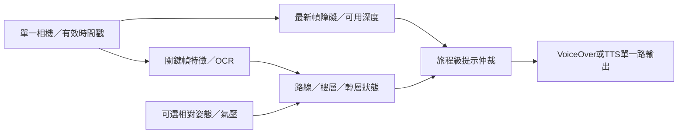
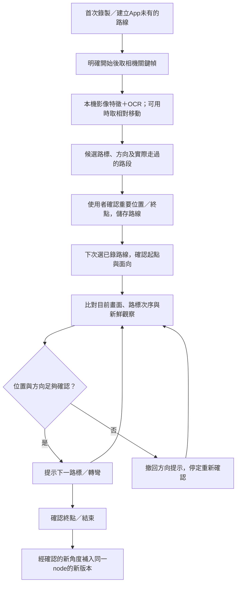

# Frontend：PathGuide 整體流程、規格與裝置端

更新：2026年11月10日。本輪只整理文件，未改程式、裝機、部署、額度或模型；歷史細節由Git及verification追溯。

## 最新狀態摘要（2026-11-10，依版本收據；非即時雲端查詢）

- 手機已交付 **1.11.0+29**，來源f2e13e3；不可變tag／prerelease先核遠端，再原位安裝、獨立核版本及正常啟動，未清資料。599項Flutter／7項略過、錄路相關53項及analyze通過；兩個模型及兩份manifest的SHA不變。見[交付收據](../verification/release-receipts/app-1.11.0+29.json)。
- 已有：六類錄路標記、三方向鍵取相／自動命名、復原、免打字保存草稿、captured schema4，以及單開關場景UI與固定內容拒絕分類。這些是工程及裝機證據，未代替實地／VoiceOver驗收。
- 未完成：更多標記、錄音／文字備註、重行使用已存方向、完整失敗歷史及無障礙焦點。系統截圖後即時辨識全頁無回應仍未定位；廚廁內容拒絕、實際起音及場景品質仍待新真人結果。
- 場景試驗最近已批准累計100次／估算US$0.50，至香港時間2026-11-14 03:22:40；不是保證可用100次或供應商帳單硬上限。已用／未知花費保留，未自動續期；歷史餘額不作現時餘額。見[許可證據](../verification/scene-100-five-days-20261109.json)。
- A十類品質gate=false，三個修正候選拒用；B11未完成發佈。Dataset採集／標註／新訓練仍暫停。錄路、雲端分析、回報及訓練用途分開。
- Codex負責實作／檢查及交付；真人決定內容與任務驗收。舊DSH派工、票據及預算不作現行指令。

規格快照及待定事項：[整體規格 #13](https://github.com/actiondarr/pathguide/issues/13)。既有導航P2–P5仍由[總票 #2](https://github.com/actiondarr/pathguide/issues/2)及其子票追蹤；本次重整不改寫其範圍或狀態。

| 文件 | 負責內容 |
|---|---|
| [完整產品介紹](APP-FEATURES.zh-HK.md) | 使用者可以完成甚麼、整體流程與主要工具；不記交付狀態 |
| [Frontend／整體規格](FRONTEND-DESIGN.zh-HK.md) | 產品問題、使用者故事、操作／導航、實作決策、驗收及裝置端證據 |
| [Backend](BACKEND-DESIGN.zh-HK.md) | 資料／同意／帳號、服務契約、覆核、模型交付及部署／回退 |
| [Dataset Review](DATASET-REVIEW.zh-HK.md) | 類別字典、資料來源、模型品質、獨立評估及B11交接 |

**狀態用語：**「已確認需求」是產品決定；「待定」是尚未有答案；「已有程式／工程已驗」不代表真機或產品驗收；「已交付」須有版本收據。研究／候選能力不因列入文件就成為本輪實作或付費授權。

閱讀順序：[產品目標](#problem-statement) → [使用者故事](#user-stories) → [流程與實作](#implementation-decisions) → [驗收](#testing-decisions) → [現況](#current-state) → [開發次序](#delivery-plan) → [待定事項](#out-of-scope)。歷史細節由第8節連到Git及verification。

<a id="problem-statement"></a>
## 1. 問題與產品目標（Problem Statement / Solution）

使用者需要從相機、文字及位置資訊理解環境並完成出行／閱讀任務。現行程式按能力分頁，完整目標、候選方案、已實作狀態與歷史工程紀錄原先混排，容易把「有模型輸出／有mock／有程式」誤解成可以完成真實任務。

解決方案（Solution）：以「開始協助」建立可暫停／結束的任務，使用者表達意圖，由App協調相機、定位、辨識、文字及語音。導航為現行優先主線，一般iPhone為基本目標；跨樓層、即時障礙資訊與統一語音共同驗收。完整產品亦包含閱讀、看圖、帳號及自願回報／改善，逐項依證據啟用。

### App 背景與用途

領路通（PathGuide）是一個以香港視障人士為主要服務對象的畢業專題（FYP）。專案希望利用使用者已有的手機，把相機所見的物件、設施及文字轉成可理解的粵語資訊，協助使用者掌握周邊環境、尋找設施及處理日常生活中的視覺資訊，增加自主操作的機會。

原始動機來自行路、乘車及餐廳用餐的資訊障礙：即使已有無障礙設施，通道中的物件、臨時圍欄、設施位置及指示牌仍可能不容易察覺；菜單中的分類、菜名、價格及供應時段，也主要透過視覺表達。App希望在現有設施及使用者既有定向工具之上，提供額外資訊，而不是取代白杖、導盲犬或定向行動技能。

介面可在設定頁右上角的語言按鈕切換繁體中文／English，並保存選擇；中文語音優先香港粵語，英文介面使用可用的英語TTS，並保留VoiceOver操作、大字、可重播及簡潔控制。基本物件辨識在手機端執行，訪客亦可使用；照片收集及私人學習須另外同意，不因開啟相機或登入而自動上傳。

| 原始使用情境 | App希望提供的幫助 | 現況與界線 |
|---|---|---|
| 街道、天橋及室內步行 | 了解前方行人、物件、樓梯等設施，逐步加入路線與近距離空間資訊 | 物件辨識及戶外步行導航已有程式；準星及框內表面LiDAR測距試驗已有，鳥瞰與短路徑待實作 |
| 尋找設施與理解指示 | 結合物件、牌內圖示、箭嘴及文字，協助理解設施資訊 | B圖示模型尚未完成發佈／App整合；文字／圖示配對、方向與通行判斷未完成 |
| 餐廳用餐及日常文字查詢 | 拍攝菜單，瀏覽分類並以文字或粵語查詢菜名與價格 | iPhone菜單OCR與查詢已有程式；不代表所有版面、店名或購物情境均已支援 |

原始構想有「出行時的環境／設施理解」及「用餐等日常文字／版面理解」兩條主線。**可量測的持續改善**是配套目標，當前實作以導航主線優先：先建立可信基準，把使用者同意提供的問題交管理員覆核，再以獨立場景驗證修正。共用模型改善先建立可重現證據；私人微調是否有額外效益仍是待驗證假設，對照方法見Dataset。目標是越用越準，每次更新均須有證據支持。

Tesla FSD是空間資訊呈現的參考，希望讓人、障礙、地面及短路徑更容易理解；它不代表App已具備自動駕駛等級的感知、避障或安全保證。室內目標為一般iPhone路線錄製與跨樓層步行導航；現有Pro Max可作首部驗證，無LiDAR一般iPhone另需實機。跨樓層與行走障礙／語音是主線，同樓層只屬首個工程案例；全場地自動建圖後續擴展。

以上背景沿用原始FYP及原專案背景稿的動機與服務對象；舊稿中的「導航／菜單尚未接入」等歷史狀態不再沿用。最新功能、驗收與限制以下文為準。

<a id="user-stories"></a>
## 2. 使用者故事（User Stories）

以下覆蓋完整目標；故事本身不代表已交付。現行優先及依賴見開發次序，研究候選須另行驗收。

### 開始協助與無障礙操作

1. 作為視障使用者，我希望明確按「開始協助」才啟動環境觀察，以便掌握相機何時使用。
2. 作為使用者，我希望用一句話或替代按鈕表達任務，以便毋須理解或選擇模型。
3. 作為使用者，我希望隨時暫停、繼續、重讀或結束，以便自行控制協助流程。
4. 作為讀屏使用者，我希望操作位置及焦點保持穩定，支援大字，以便完成任務時不因畫面更新失去控制。
5. 作為使用者，我希望選用繁體中文／粵語或英文及合適語速，以便聽懂提示。
6. 作為訪客，我希望使用本機基本辨識及已錄路線，以便毋須為基本協助登入。
### 環境理解與距離

7. 作為使用者，我希望聽取簡短且有效的物件及環境資訊，以便了解眼前可確認的情況。
8. 作為使用者，我希望主動拍攝或問眼前畫面的問題，以便取得物件清單以外的解釋。
9. 作為使用者，我希望在不確定或無法分析時收到可操作的說明，以便選擇重試、改用其他輸入或結束。
10. 作為使用者，我希望只在有效量測下取得目標距離，以便分辨可確認米數及未知距離。
### 戶外出行

11. 作為步行使用者，我希望搜尋及確認戶外目的地／路線，以便開始受控的步行導航。
12. 作為步行使用者，我希望在路線提示之間取得有效環境資訊，以便兼顧路線與當下觀察。
### 室內探索、錄製與重行

13. 作為使用者，我希望首次到某地方亦能開始錄製App未有的路線，以便建立之後可使用的私人路線資料。
14. 作為使用者，我希望只在重要位置、轉角或轉層時作必要確認，以便毋須逐張照片標註。
15. 作為使用者，我希望保存草稿、命名路線並重新開啟，以便分階段完成路線記錄。
16. 作為使用者，我希望選擇已錄路線並確認起點、樓層及面向，以便從正確狀態開始重行。
17. 作為使用者，我希望在升降機或樓梯入口及出口確認樓層，以便完成跨樓層行程。
18. 作為使用者，我希望在相似走廊、錯層或方向不明時重新確認，以便避免把候選位置當已定位。
19. 作為使用者，我希望在途中中斷後重新確認有效位置，以便恢復仍然有效的任務。
20. 作為使用者，我希望到達時確認實際入口或設施，以便分辨接近目的地與真正到達。
21. 作為首次到訪者，我希望在沒有既有路線時利用現場文字及方向線索逐段探索，以便逐步了解下一段可確認的方向。
22. 作為使用者，我希望探索及保存路線分開控制，以便知道何時會保留畫面與路標。
23. 作為使用者，我希望更新、回退及刪除私人路線，以便保留可用版本並移除不需要的資料。
24. 作為使用者，我希望平常重行不持續累積影片或照片，以便控制儲存量及資料保留。
### 行走感知與提示

25. 作為步行使用者，我希望收到仍有效的物件／障礙提示，過期時撤回，以便分辨目前資訊及已失效觀察。
26. 作為使用者，我希望只聽到一條協調後的提示，停止後不補播舊句，以便理解目前應處理的資訊。
### 閱讀及設施理解

27. 作為使用者，我希望拍攝菜單並按分類、菜名及價格查詢，以便閱讀用餐資訊。
28. 作為使用者，我希望拍攝指示牌並理解文字、圖示及箭嘴關係，以便取得有依據的設施方向資訊。
29. 作為使用者，我希望在菜名／價格／箭嘴配對不明時看到原文或重拍，以便保留判斷所需資訊。
### 能力、權限與同意

30. 作為使用者，我希望按裝置能力取得可用功能及明確限制，以便在沒有LiDAR或其他能力時仍能操作基本流程。
31. 作為使用者，我希望按用途授權相機、定位及按需收音，以便理解各項權限用途。
32. 作為使用者，我希望自行選擇是否使用雲端看圖，以便控制網絡處理及照片傳送。
33. 作為使用者，我希望分別同意雲端分析、問題回報及訓練用途，以便不因同意一項便授權全部用途。
### 帳號、回報與更新

34. 作為帳號使用者，我希望管理、登出及刪除帳號與選填聯絡資料，以便控制個人資料。
35. 作為使用者，我希望主動啟動緊急聯絡並交由系統撥號，以便確認後才聯絡指定人士。
36. 作為願意回報的使用者，我希望提交問題、查看處理狀態及撤回同意，以便知道回報目前進度。
37. 作為覆核人員，我希望依授權查看、修正、核准及追溯回報，以便形成可驗證的修正資料。
38. 作為使用者，我希望只收到經獨立比較及相容性檢查的模型更新，以便避免把訓練完成當改善。
39. 作為使用者，我希望在更新不合適時回退到先前版本，以便恢復已保存的體驗。
### 中斷及後續擴展

40. 作為使用者，我希望在背景、來電、斷網或權限改變後取得清楚狀態，以便重新確認或退出而不接收舊指令。
41. 作為使用者，我希望日後按獨立驗收加入空間音效、近距離引導及更多設施理解，以便逐項獲得有證據支持的延伸能力。

<a id="implementation-decisions"></a>
## 3. 使用流程與實作決策（Implementation Decisions）

| 決策 | 規格及狀態 |
|---|---|
| 任務入口 | 已確認：開始後基本觀察與簡短語音；問一下按意圖選能力，保留文字／按鈕及停止控制。現有分任務首頁尚未改成此流程 |
| 室內方式 | 已確認區分探索、首次錄製及重行；跨樓層是正式主線。陌生探索只接受產品方向，無可信線索時已定停定掃描／重掃／暫停／求助，具體搜尋方法待驗 |
| 定位依據 | 已錄影像／OCR、路標次序、方向與可用相對追蹤形成候選；候選未確認就保持未知，不從物件名稱推定位置 |
| 硬件分層 | 2026-11-06已確認：普通相機基本版先做物件名稱、畫面方位及路標重認，精確測距選填；ARKit相對追蹤及LiDAR深度分開評估，不作基本版前置。沒有可信量測不報米數 |
| 共用資源 | 同一旅程的定位及即時感知共用相機；取消／背景使舊觀察及提示失效，語音由單一路徑協調 |
| 保存及版本 | 路線與訓練照片分開；錄路／明確更新才保存必要關鍵幀，重行不持續累積；版本、刪除與回退可追溯 |
| 本機與雲端 | 基本辨識及已錄室內路線重行本機處理；複雜問答可選雲端，分析／回報／訓練分開同意 |
| 實作責任 | Codex直接實作／測試／交付；人工品質與任務驗收由使用者確認 |

### 場景模式：已確認規格與實作次序（2026-11-08，Q1–Q14）

使用者已確認Q1–Q14；1.11.0+29已交付即時辨識頁單一「場景模式」開關，移除該頁手動描述／取消鍵，保留診斷。首頁獨立單張描述任務仍在。房間曾有真人有聲結果；廚廁拒絕、走動品質、3–5秒起音及VoiceOver仍待驗，額度依最新摘要及Backend契約，不重複維護歷史餘額。

#### 領域用語

- **場景模式**：使用者開啟至關閉的持續環境描述狀態，包含首次概述及其後變化描述，不等於單次取相或播音。
- **場景描述**：一次對所見環境的文字或語音表達。
- **首次概述**：模式開啟後，用兩至三句建立眼前環境概念的描述。
- **變化描述**：首次概述之後，用一句優先表達當前最重要新資訊的更新。
- **重要變化**：新區域、新設施、布局或人流等帶來值得補充的新資訊；相似物件、手震或光暗變化本身不等於重要變化。
- **描述作廢**：某段內容已不再適用於當前觀察，需要撤回；不等於關閉場景模式。
- **等候更新**：模式仍開啟，暫時沒有新的有效描述，條件恢復後可在既定限制內自動繼續。
- **受限待處理**：模式保留開啟意圖，但新分析因額度、帳戶或結果／費用不確定等情況受阻，需要核對或處理。
- **短期環境脈絡**：本次模式中最近一次有效場景重點，用來理解哪些內容已講過；不代表永久地圖、物件身份或可靠定位。
- **變化反應時間**：畫面出現需要描述的新重點，至使用者開始聽到相關新描述的時間；狀態提示或單純收到回包不算已達成。
- **普通物件報名**：逐個讀出物件名稱的提示；場景模式以旁述為主聲時暫停此類播音。
- **本機語音測試**：以固定測試句確認聲音輸出的操作；有聲不等於真實環境描述成功。

#### 已確認行為

正式介面使用一個場景模式開關：開啟先概述相機當刻可見環境，隨走動補充重要變化；未觀察到的區域不作已知內容。正常向前行及小幅晃動可保留仍適用描述，明顯轉入另一方向則撤回舊方向內容，模式保持開啟並接續新方向。一般更新目標為約3–5秒開始講新重點，不是固定每3–5秒上傳。

場景旁述作主要聲音，普通物件逐項報名暫停，本機觀察可繼續。導航可插播／打斷場景；導航完成後只處理最新仍有效內容，不重播已過時的句子或累積隊列。必要額外提示須有各自可信來源及驗收，不由場景描述模型自行加入避障／通行判斷。

模糊、網絡中斷或暫時分析失敗時提示一次並等候更新。只有明確未送出的失敗容許有限重試；已送出但結果／費用不確定時進入受限待處理，不自動再傳相。鎖屏、背景或離開協助頁面則停止模式；返回由使用者重新開啟，不自動重開相機或續傳。

只在有新資訊時使用雲端，開關不重設已用額度，到限明確暫停。正式金額刻意延後至固定十分鐘實測後決定，並非默認無上限；目前房間試驗依後續明確授權採累計100次／五天許可／估算總額US$0.50，保留已用及未知花費歷史，不以開關重設；此非正式產品金額。

手機只在模式開啟期間暫存最近一次有效場景重點作比較，雲端每次只分析當前必要照片，不上傳舊照片或整段描述歷史；關閉清走描述脈絡。App及自家後端不長期保存相片／描述，不把模式資料加入訓練；安全測試數值另行保留，不包含照片或描述原文。本機清除不代表供應商同步刪除；供應商保留政策與使用目的仍須依實際服務核對，不能承諾零留存。

#### 已實作邊界與後續驗收

關閉／首次分析／觀察／更新／播音／等候／受限狀態、世代取消、v1／v2完整回覆驗證及導航優先已有來源與工程證據。本機畫面／姿態只篩候選，手機再比較有效觀察，不證明已可靠判斷重要變化。v1冷卻45秒、v2三秒；累計100次及五天許可不隨開關重設。

下一步先以目前已裝機版本核房間／廚廁拒絕分類、實際聲音、轉向作廢及停止；然後驗走廊／戶外／複雜人流。分報取相、往返、模型、交予語音及人耳開始聽音；不能用回包時間當3–5秒體驗達標。若需調整限流／總額／到期，須有另行明確授權及帳本審計。

#### 複雜場景修補與限制（2026-11-09）

1.10.2+26只對完整詞「米缸、米桶、米袋、米飯、玉米、粟米、米白色、層架、層板」中的米／層作例外，支援多層架等可見物件；數字、米數、樓層、目的地、安全通行及方向指令仍以完整原文檢查。句子及每項detail都須通過，不能只讀合法部分。廚廁物件用既有other，同位置多件合併；category、position、標點、欄位、重複或截斷仍可能拒絕，沒有從兩張截圖確認哪一項失敗。房間、廚房、廁所真人複測需保留requestId及固定rejectionDetail，不保存原圖／原始回答；第一次拒絕即複製測試資料，避免最近三項被覆蓋。

#### 首輪驗收表

固定房間十分鐘，至少十個明確、可重現的重要變化。由人工核對畫面重點及開始聽到相關內容的時間；原生TTS開始回調可供定位，但不能代替人耳確認。漏講、無聲、錯誤、重複及過時資訊均保留，不只挑成功樣本。

| 情境 | 應有結果 | 必須記錄 |
|---|---|---|
| 開啟／首次概述 | 兩至三句相符的相機可見環境概念 | 起動、文字、交予語音、實際聽音及內容核對 |
| 正常走動／新重點 | 以一句優先補充最重要資訊，正常手持可用 | 重要變化出現時間至相關內容起音；至少十例中九例五秒內 |
| 明顯轉向 | 撤回舊方向內容，模式仍開啟並接續新方向 | 舊內容停止、新內容起音及是否需重新按掣 |
| 相似物件／手震／光暗 | 不單獨引發重複旁述 | 誤觸發、重複內容、沒有新資訊的雲端請求 |
| 導航插播 | 導航優先，之後只處理最新有效重點 | 搶佔／取消／恢復及是否補讀過時隊列 |
| 刻意斷網／恢復 | 清楚提示及等候；結果／收費不確定時受限 | 是否重送、恢復依據、嘗試數及未知用量 |
| 鎖屏／背景／離頁 | 停止模式，返回需重新開啟 | 相機／請求／聲音停止及遲到結果處理 |
| 額度停止／重新開關 | 提示受限，不能以開關重設歷史 | count、已知／未知估算、request去重及停止原因 |

九成五秒內只是首輪延遲門檻，不抵銷內容錯誤；內容、漏講、重複及舊方向問題要列出未通過項並修正複測。刻意斷網、導航等邊界情境另表核對，不混入正常更新延遲樣本，也不能刪掉日常使用中的真實失敗。額度或樣本不足就記未完成／資料不足；正式費用由本輪實際請求與用量再定，不將估算當供應商帳單硬上限。

### 錄路標記按鍵：已確認設計（2026-11-10，1.11.0+29核心已裝機／待真人驗收）

已確認Q1：背景自動取樣繼續，使用者在重要位置額外按標記；不將記錄完整性全部依賴每個轉角都記得按鍵。已確認Q2：按一下標記即交由App取相，成功後給予可聽回饋、以類型及序號自動命名（例如門口1），提供復原；可稍後改名，當刻不要求輸入名稱、樓層或另按拍照。1.11.0+29已實作此主要補記入口，真人驗收仍待完成；舊表單不得繼續成為基本錄路的必經入口，自選事後編輯不影響免打字主流程。必要樓層及轉層確認另行設計，不逐點重問，未知仍保持未知，不以按鍵自動產生已核實路段。

已確認Q3：主畫面先放「一般路標、路口、門口、樓梯、升降機、廁所」六個大標記按鍵；不肯定類型可用一般路標，其他設施、錄音及文字放「更多標記」。標記選擇不必與YOLO現用類別相同，不自動擴模型taxonomy或表示模型已認出該設施。已確認Q4：在準備左轉的路口按「左轉」，記錄的是該位置沿這條錄製方向的重行動作，供之後重行提示；方向與標記位置及錄製方向一起保存，按鍵本身不表示App已定位。方向鍵採固定常用操作；沿錄製方向重行，反向需另錄或另做反向核實，位置證據仍須獨立驗收。

已確認Q5：固定「左轉、右轉、直行」方向鍵；按左轉即由App取相並記錄「路口＋左轉」，不必先按路口再選方向，其他方向放更多標記。已確認Q6：這次標記取相失敗、但其餘錄路功能正常時，短聲提示未能記錄並留失敗紀錄，繼續錄路；可當場再按，不彈填表或偷偷用走遠後的畫面補成原位置，失敗項不冒充可重認路標。已確認Q7：固定「復原上次標記」只撤銷最近一次手動標記及附帶方向並回饋已復原，其他標記與背景取樣保留；媒體如同時被其他有效記錄引用，不可因復原破壞它們。方向鍵、單項處理及復原核心已裝機；完整失敗標記歷史仍未接，不能把失敗提示當持久紀錄。

已確認Q8：同層行走不逐點重問樓層；只在開始及真正轉層時提供一次簡短、可讀出的確認，不知道就保留未知並繼續錄路／保存草稿，未知部分不當成已知樓層導航。按樓梯可只標記眼前設施，不能直接當成已轉層；已知樓層上下文、矛盾撤回及未確認不冒充完整路線的既有保護維持。已確認Q9：首版先支援沿錄製方向重行；反向需要另錄或另作反向核實，不以左右互換就認證整條反向路線。已確認Q10：錄音／文字只作選填備註，錄路時不用填；從更多標記加入，與指定標記一起保存，重行確認位置後可按需聽取。錄音不自動上傳辨識、不當成控制命令，資料沿用本機路線用途、加密及容量保護。新備註資料／媒體契約尚未實作。

已確認Q11：手動標記及錄製方向提示作為重行重點，背景取樣協助認路，不逐張讀成路標1／路標2。同一次取相可共用；無法確認同一位置時不強行合併兩個記錄，不能僅靠相近時間或外觀就認證同一位置。已確認Q12：同時間只處理一項標記；記錄中再按只短回饋記錄中，不建立第二個排隊拍攝，完成或失敗後才接受下一次。自動取樣不能令手動標記排到走遠後才取相；實作須保留一在途及新鮮度保護。Q13使用者明確澄清：不用沿路填表是「唔使打字，淨係撳掣」。基本開始／類型／方向／樓層選擇／必要確認／復原／結束保存均以按鍵完成，路標與路線名稱自動產生，可選事後改名；文字備註只在使用者主動選取時輸入，不得成為必填。沿用VoiceOver可讀標籤、固定按鍵位置與可聽結果的要求；結束保存讀出成功／失敗及草稿狀態，不把未知資料自動說成完整可重行。

領域用語：**自動取樣點**是App按錄路條件保留的候選觀察；**手動標記點**是使用者主動指出的重要錄路位置。**標記類型**表示使用者所選的分類，不等於模型辨識結果、已定位身份、已核實樓層或重行轉向指示。**錄製方向提示**是使用者為某個標記位置記下、適用於該次錄製方向的重行動作；它不等於手機即時方位或已確認位置。**失敗標記紀錄**表示使用者曾嘗試但未完成的標記，不是可用路標。**復原上次標記**只撤回最近一次手動標記的效果，不回退整段路線。**標記備註**是使用者為指定標記保存的選填文字或錄音，不是自動辨識結果或控制命令。**免打字錄路**是基本錄路只需按鍵選擇及確認、由App取相與自動命名；它不表示取消必要確認或禁止自選文字備註。本輪已對齊標記用途、免打字流程、失敗／復原及資料邊界；標記／方向已有schema4契約；備註媒體、工程參數及完整任務仍須驗證，不新增雲端或照片訓練用途。

實作與驗收狀態：1.11.0+29已交付六類／三方向一按標記、自動命名、單項處理、復原及直接草稿保存，captured schema4已接相容檢查；相關工程證據見最新摘要。更多標記、錄音／文字備註、重行方向播報、完整失敗歷史及焦點處理仍待完成。接著在手機驗取消、背景、連按、取相失敗、容量不足、保存／重開、樓層未知及VoiceOver；展示可稱核心已裝機，不能稱Q1–Q13全部通過。

#### VoiceOver作基本使用情境（2026-11-10）

使用者補充按鍵語音回饋（2026-11-10）：啟用類型按鍵時須聽到對應功能／類型名稱，例如按樓梯便有「樓梯」的可聽回饋，同時觸發該標記操作。這項是操作回饋，不可在取相未完成時宣稱已成功記錄；完成或失敗另有簡短、明確的結果。VoiceOver標籤、操作回饋與App TTS須沿用每事件單一路輸出，避免兩把聲重讀類型；結果可包含類型與狀態，但不能只讀名稱就當作保存成功。已有類型／結果公告或TTS單一路回饋來源，實際聽音及焦點仍待真人驗收；VoiceOver標準探索不會啟用控制或取相。

使用者已確認：日常使用時Apple旁白已開啟；App依系統讀屏狀態適配，保持未開讀屏時的基本操作能力。**一次標記操作**是一次語意控制啟用：旁白使用者可用系統選取／雙點等標準方式啟用。探索、取得焦點或讀出標籤均不取相，不將輕觸即標記或隱藏手勢設為基本操作。這延續Q13「免打字、按鍵完成」的定義。

現有能力與缺口：辨識頁已有讀屏狀態適配、supportsAnnounce與公告／TTS路由；錄路頁1.11.0+29已有標記／方向／復原及保存回饋、成功震動、固定可捲動操作區與標準按鍵語意。完整VoiceOver焦點保留、更多／確認面板返回及螢幕簾任務仍待驗，不以widget點擊與可讀標籤代替真人操作。

整合與驗收次序（核心已有，焦點與真人驗收待完成）：

1. 固定控制及語意：六個標記、方向、復原、暫停／繼續及保存有獨一名稱、角色、忙碌／可用狀態與穩定巡覽順序；狀態更新不重排控制。相機預覽、偵測框及技術數字不佔用核心巡覽順序，仍提供可讀的有效結果。
2. 焦點：一般標記／取相／狀態變化保留當前控制焦點；開更多／必要確認面板才進面板，關閉後回觸發控制。無障礙焦點與鍵盤FocusNode分開驗證，不把unfocus當成旁白焦點已還原。
3. 單一路任務回饋：每個成功、失敗、復原及保存事件只選語意狀態／公告／TTS其中適用的一路，禁止同事件多路重讀；支援能力先核對。成功讀具體類型／方向及自動名稱，失敗不假稱已記錄；震動只作補充。背景取樣及技術更新不逐項搶播。
4. 聲音仲裁：使用者探索控制時抑制普通環境旁述；必要導航／失效提示與標記結果按事件有效性處理，只提交最新有效事件。SpeechCoordinator只管理App輸出，不能聲稱能取消或控制系統VoiceOver整個佇列，公告呼叫完成亦不是人耳已聽到。不要把手機上的polite參數當作可靠優先級保證；錄音備註另驗音訊爭用。
5. 驗收：先驗Semantics名稱／角色／狀態、焦點與零探索取相、每事件零重複播報、旁白切換、取消／背景及保存重開；再以iPhone VoiceOver及螢幕簾完成開始→標記→方向→復原→必要樓層→結束保存，記操作次數、漏讀／重讀及恢復。加入旁白開啟時系統截圖後的焦點與按鍵回應複測；先前全頁無回應仍是未定位問題，不由這項規劃宣稱根治。

首輪沿用標準按鈕與VoiceOver操作；Magic Tap、自訂Rotor動作及其他捷徑列後續增強，不作完成基本錄路的唯一方法。

官方依據：[Apple支援VoiceOver](https://developer.apple.com/documentation/uikit/supporting-voiceover-in-your-app)、[Flutter讀屏支援](https://docs.flutter.dev/ui/accessibility/assistive-technologies)、[公告用途與限制](https://api.flutter.dev/flutter/semantics/SemanticsService/sendAnnouncement.html)。上述作整合與驗收依據；已實作子集以上方現況為準，未有真人結果的項目保持待驗。

### 導航、定位與環境感知的分工（2026-11-05程式核對）

**2026-11-06本輪綜合規格：** [自動錄路、導航物件提示與本機路線記憶 #16](https://github.com/actiondarr/pathguide/issues/16)補充#13，關聯導航總票#2及相機修正#15。ready-for-agent只適用已確認需求及規格準備，不將待定分支視為已批准。現有手動實作及工程／真人證據仍以下方現況為準。

**2026-11-07已確認交付與首輪驗收：** 使用者接受上一輪Q1／Q2建議，下一輪先完成自動錄路、減少填表及可靠保存／重開的完整體驗，模型比較獨立推進，不作錄路前置。沿途主要操作為開始、必要確認、暫停／繼續及結束；App負責取相、候選編號與整理。#17自動草稿及#18樓層上下文已有工程實作及1.8.0+15裝機證據，下一步在現有基礎作整體驗收及失敗修正，不重做已有片段或將工程完成當真人通過。

首輪固定一棟方便重複測試的大廈，包含同層與跨樓層路線；跨層例為大堂→升降機→另一層走廊→房門。錄製→明確保存→離頁重開→另趟再走核對重認，另驗錯樓層、相似出口及中途暫停／背景。沿用已確認的「使用者操作→狀態／提示／保存結果」及既有旅程整合、相機／分析／版本庫接縫，不新增跨多層框架。記錄各趟操作／確認／打字需求、VoiceOver回饋、需協助、等待、錯定位、拒答／恢復及完成情況；一次成功不作充分證據。限定三地內的具體路段待安排，不要求公開地址／私人照片，不以方便重測改成只支援熟路。

已確認的普通相機基本版、測距選填及未知樓層繼續未確認草稿不變。首輪錄路場景不再待決；模型清單／資料場景、選幀及轉角覆蓋、品質／性能門檻仍待評估。錄路標記核心的交付狀態以1.11.0+29收據為準；模型比較及完整真人結果仍未完成。

- 已確認問題及方向：導航物件提示需改善誤報／漏報，使用者需要持續觀察及按需問答；錄路應自動取相，減少逐點命名、填樓層與重複到達／核實剔號。路線照片／特徵／樓層保留本機，路線記憶與模型訓練分開。
- 2026-11-06追加確認：依使用者「根據你的建議做」，普通相機基本版優先完成物件名稱、畫面左／中／右及路標重認；精確測距保留選填增強，ARKit相對位移／轉向按效益另評，不作基本版前置。這是範圍確認，未代表新能力已完成，亦不刪既有站定測距試驗。
- 待選方案：輕量偵測器（含YOLO候選）加本地VLM是建議架構，未定型號、runtime、並行或性能。約5秒取樣是已有工程試驗設定，選幀／補取及容量仍需評估；未知樓層依既有確認繼續未確認草稿。錄路首輪場景已定，物件清單、模型比較資料場景、品質／延遲門檻及其他確認互動未凍結，不因本次規格更新啟動訓練、下載模型或新增App交付。
- 測試接縫：沿用先前已確認的「使用者操作→旅程狀態／提示／保存重開結果」，以現有錄路旅程widget／整合測試為主，注入既有相機、分析及版本庫；如需控制時間，只在旅程控制器提供排程接縫。驗自動取樣且不逐相填表、模糊／重複／轉角覆蓋、轉層未知、配額、取消／背景晚回覆及重開／刪除。未知樓層已確認可繼續未確認草稿，不另造跨層框架；VoiceOver、大字、原生及實地驗收分開。
- Section B按使用者轉述的導師指示沿用FYP，可共用獲授權Python模型實驗及分析；既有個人成果與新增小組貢獻分開，實驗數字不虛構，模型仍按導航需要選擇。

本文件的「定位」指確認使用者目前位置、樓層及面向；「路線導航」指依位置及目的地提供路線／轉向指示；「環境感知」指眼前物件及障礙的當下觀察；「看圖問答」指按問題解釋一張影像。辨識到「門」不等於確認是哪一道門、所在樓層或應轉方向。

| 功能 | 目前實際依據／狀態 | 現有YOLO不準的影響 |
|---|---|---|
| 戶外路線及轉彎指示 | NavigationPlugin以MapKit的MKDirections取得步行路線，Core Location位置交NavigationController更新路線進度及重算 | YOLO結果不直接決定路線；地圖／定位的可靠性仍須另行驗證 |
| 導航期間環境辨識 | NavigationPage另外啟動RecognitionSession，以environment語音通道播報現有十類模型結果 | 會誤認或漏認周邊物件；不能因此宣稱已具可靠障礙／可通行判斷 |
| 室內取相 | P2-D已有獨立RouteCameraPlugin及Flutter相機試驗入口，不要求YOLO偵測成功；該頁相片暫存不等於已錄成路線 | 取相不依賴十類模型，但取相成功不代表室內定位／導航已完成 |
| 室內定位及真實重行 | 真實影像／OCR重認及旅程接線已有工程流程；實地定位品質、方向播報與完整任務仍待驗 | 不能描述為現有室內導航全靠YOLO，亦不能把未完成的定位方案當已可用 |

程式依據：`app/ios/Runner/NavigationPlugin.swift`、`app/lib/navigation/navigation_controller.dart`、`app/lib/navigation/navigation_page.dart`、`app/ios/Runner/RouteCameraPlugin.swift`及`app/lib/route_memory/`。本地看圖模型仍待選型與實測；加入模型不自動完成定位或障礙驗收。

2026-11-05本輪需求澄清：使用者明確聚焦導航期間的物件提示，關注以其他本地模型替代現有十類YOLO後的辨識及速度。已確認的是改善此功能；尚未決定採用另一個輕量偵測器或生成式看圖模型，也未確認可接受的更新／播報延遲。候選比較須分別量測辨識漏報／誤報、有效更新率及相機捕捉至首次有用播報的延遲，並記錄持續運行的熱狀態。下方5–10次／秒及p95≤500ms仍為未經真機驗證的工程候選目標，並非現有性能或安全保證。

### 已確認：簡化介面與iOS輔助操作（2026-11-05）

以下是已確認的操作與無障礙要求；Codex負責實作，完成狀態依最新收據及真人結果。

| 範圍 | 固定要求及驗收結果 |
|---|---|
| 主流程 | 移除重複底部分頁；保留目前任務狀態、問一下、重讀、暫停／繼續及結束。基本功能不強迫登入 |
| 更多 | 日常帳號、教學及一般設定保留可發現入口；模型切換、信心門檻、取樣診斷與mock移到獨立進階／測試區 |
| 每個控制 | 選中可知名稱／角色／狀態；操作後可知結果與下一步。非同步工作說明收音、處理、完成或失敗，不為每次點擊加重複旁白 |
| 讀屏與輸出 | 介面由系統讀屏操作；App的任務播報及按需收音分開管理。同一事件一條語音，不同時公告／live region／TTS重讀同句 |
| 探索控制 | 暫緩一般環境描述，保持焦點；必要導航及有效急需事件依仲裁處理。恢復只使用新資訊，不補播歷史queue |
| 第一輪交付 | 先驗標準VoiceOver能完成開始、問一下、重讀、暫停與結束，及大字／焦點／背景。Magic Tap與自訂動作之後另驗，不以隱藏手勢取代按鈕 |
| 陌生室內無線索 | 先停定掃描；仍無可信下一段線索時說明未知，提供重掃、暫停或求助，不自行選走廊叫使用者試行。可用線索的探索定位方法仍需獨立驗證 |

### 導航介面參考與本輪範圍（2026-11-05確認）

使用者提供三張手機參考畫面，導航主頁採「搜尋目的地／我的路線／錄製新路線」三個大入口；每次只顯示當前任務需要的操作。搜尋提供最近目的地及可取消的選擇流程；選定後先看地圖、距離、預計時間與路線詳情，再明確開始步行導航。我的路線選擇已有路線重行，錄製新路線明示開始／路標補記／停止／命名保存。大按鈕、文字用途、固定取消／返回及VoiceOver／大字規格一起驗。真實錄路／選路接線已隨後續版本交付；導航頁完整三入口及P5交接仍須按實際UI驗收，合成樣例須明示。

使用者明確排除大眾運輸及叫車，不新增其入口或串接。戶外錄製用GPS軌跡及路標，室內跨樓層使用有界相片／特徵、路標及樓層確認，不用GPS推定室內樓層。既有開始協助／問一下仍為後續探索能力設計；本參考先固定導航子流程，未宣稱意圖調度已接通。參考截圖不加入共享repo。

### 本輪UI整理（#14，2026-11-05）

使用者確認將試驗集中在「設定 → 開發測試」，每個入口說明用途及結果，首次使用有可略過提示。現行程式首頁保留即時辨識、戶外路線導航、菜單三任務及一句用途說明；帳號與教學位於設定，刪除重複底部導航。日常辨識的「更多操作」保留重讀、播報及標籤控制，模型切換、信心／播報門檻、模擬來源及效能資料只在開發測試的「辨識與模型診斷」顯示。設定不再排列未提供功能及下載佔位；使用教學同步新入口及首次提示行為。

開發測試逐項列出：錄路相機只預覽／暫存一張照片；室內路線工具使用合成路標，包含跨樓層模擬及本機樣例庫；graph回放只播預設路標；深度測距需支援硬件且不出避障指令；模型診斷進入後開相機。相機試驗不再混在「不拍照、不定位」的合成頁內。首次提示可返回、略過或開始，各任務分別本機保存是否已閱讀；提示本身不啟動相機，略過後仍可從入口一句說明及使用教學了解用途。中英文、320×568兩倍文字、返回及相機釋放納入回歸。

本輪整理既有能力，沒有接通下一節的意圖式能力調度，也沒有把試驗當作真實室內導航。機器檢查與手機UI人工回饋分開記錄。見[UI證據](../verification/codex-ui-cleanup-20261105.json)及[工作票](https://github.com/actiondarr/pathguide/issues/14)。

### 簡潔操作與自動模型調度（目標設計，未實作）

使用者只表達任務，不需要選YOLO、B或Gemma。現有App仍為分任務首頁，導航辨識需手動開關；以下是後續整合規格，不代表現行交付版已有此能力。本地視覺語言模型及手機效能尚待選型／實測，不能預先承諾取代B。

#### 使用者操作

首頁以「開始協助」為主要入口，另留可讀屏的「更多」供設定、帳號、教學及進階診斷。首次相機／語音等權限按用途說明；開App不自動開鏡頭或麥克風。2026-11-05使用者接受：明確按開始後進入基本環境觀察及簡短語音，再以「問一下」表達導航、讀牌或菜單等意圖，不要求先選功能／模型。開始後固定保留「暫停／繼續」、「問一下」、「重讀」三個常用操作；問一下收音期間同位置明示取消，並提供文字／常用任務替代。結束入口清楚可達，不依賴隱藏手勢或語音辨識成功。VoiceOver焦點與操作位置固定，不能因模型切換重排。

使用者可說「前面有甚麼」、「讀這塊牌」、「幫我讀菜單」、「幾遠」或「帶我去……」。App按意圖及當前任務選能力；目的地有歧義才簡短確認，實際開始路線仍需確認。首版採按需收音，喚醒詞／常開收音另行研究，不因減少按鈕而默默錄音。

#### 自動調度規則

| 情境 | 內部選擇 | 使用者結果與界線 |
|---|---|---|
| 已啟動的環境觀察 | 已驗證的輕量物件偵測；有可靠深度才附距離 | 簡短描述最新觀察，無框不表示通道暢通 |
| 明確問「這是甚麼／前面有甚麼」 | 同一有效照片交可用本機模型，或另經同意的雲端多模態；按問題帶OCR證據 | 短回答，不要求選模型；取消／超時後不補播 |
| 主動要求讀牌／菜單 | OCR優先；有合格B才用圖示定位；本地模型可協助解釋 | 保留文字／價格／箭嘴配對不明；不自動改行走方向 |
| 問距離 | 用相符目標的有效深度，必要時提示站定／對準 | 沒有可信量測就說量不到，不讓語言模型猜米數 |
| 只是路過牌面或偵測分數低 | 可作輕量候選與穩定判斷，不每幀叫大型模型 | 不突然切菜單／查牌頁、不連續提問；無框亦不反覆觸發重分析 |
| 模型未下載、過熱、記憶體不足或超時 | 取消重任務，保留可用基本能力 | 一次說明目前限制；首次下載／雲端處理另行同意，不自動上傳 |

調度器以使用者意圖優先，結合session、觀測時間、能力、資源與冷卻。明確問題可直接分析原始照片，不要求A先認出或框出目標，避免十類模型限制通用理解。只容許一個重型查詢在執行；新查詢可取消舊查詢，防止佇列累積。自動切換運算能力不等於自動下載／更換權重版本，版本更新仍遵守既有同意與閒置切換規則。

2026-11-05處理位置決定：基本辨識及已錄室內路線重行以本機運作；複雜看圖問答可另經同意選用雲端。斷網時說明受影響能力，不暗中轉雲端；雲端分析、問題回報與訓練分開授權。此決定不承諾戶外搜尋／重新規劃或所有語音服務完全離線，亦不代表已實作雲端問答。

#### 與導航及資源交接

延用單相機／單語音／單收音原則，從同一相機來源取照片，不另開競爭相機。一般導航指示優先於描述；有效急需障礙／感知失效事件依室內旅程仲裁規則優先於續行提示；重型分析不能拖慢既定即時任務。若裝置負荷無法兼顧，明確暫停環境感知並告知，不能靜默停用。查詢結束只有在原任務仍有效、使用者未暫停、沒有背景／權限中斷時才回原任務；背景或手動暫停後不自動恢復。需切換AVCapture與ARSession時仍遵守資源釋放流程。

驗收：以視障／VoiceOver操作測試任務完成率、操作次數、誤觸、錯誤路由、無故切換、恢復成功、播報負擔及等待時間；模型運行時仍能立即操作停止。按鈕少只是介面目標，不能以減少可發現的控制換取較高操作負擔。先用mock驗調度與取消，再在真機接本地模型，最後才開自動觸發策略。

<a id="導航主線路線錄製跨樓層步行導航與即時障礙語音完整規劃真實整合待接"></a>
<a id="跨樓層步行導航完整方案2026-11-05p0p1本機已驗p2p6待實作"></a>
<a id="route-memory-plan"></a>
### 室內三種流程的名詞

| 名詞 | 輸入及操作 | 使用者取得甚麼 |
|---|---|---|
| 探索 | 沒有完整路線時讀取現場牌面／文字／方向線索，再確認下一段 | 已有依據的下一段候選；不承諾預先知道整條路。無線索時停定掃描，保留未知並提供重掃／暫停／求助 |
| 錄製 | 明確開始及同意保存後，記錄實際走過的路標、樓層與有向路段 | 草稿或經確認的私人路線版本；不因開啟錄製便知道目的地在哪 |
| 重行 | 選擇已錄路線或已核對場地資料，確認起點／樓層／面向 | 用新觀察比對位置後逐段導航；不明時撤回方向提示 |

首次到訪可以探索及錄路；同步保存另取確認。陌生探索屬新增產品方向，並未自動納入現有P2–P5票據。

<a id="首次錄製路線資料與導航"></a>
### 室內路線操作

| 情況 | 操作與結果 |
|---|---|
| App沒有該路線，第一次錄製 | 明確開始後隨實際行走建立路標、路段及轉層連接；可以是使用者第一次去的地方，App不需預先認識該路 |
| 使用已建立路線步行導航 | 選目的地／已錄路線，確認目前位置及面向；邊行邊定位、偵測障礙及播報，路線可跨樓層 |
| 尚無路線及可用場地地圖，直接要求指到室內目的地 | 缺少完整規劃依據；完整產品目標可轉入明示的逐段探索，依現場線索及確認尋找下一段，不能承諾已知整條路。現有錄路工程不代表已具備探索能力 |

例子：「地下入口→地下走廊→升降機→3樓出口→課室」。首次錄製建立整條跨樓層路線，下次才利用該資料重行。室外沿用步行路線，到大樓入口時明確確認室內起點／樓層後交接；GPS不直接決定室內樓層。回程保存為另一個經確認方向／視角的路線變體，不能只把edge倒轉就稱逆向定位已可靠。

### 錄製、轉層與重行操作

| 步驟 | 使用者／App操作 | 失敗時的結果 |
|---|---|---|
| R1 開始錄製 | 確認場地、起點及樓層；未知樓層可先存draft，明確開始後才取關鍵幀 | 不填假樓層、不把draft顯示為整段可導航 |
| R2 同層行走 | 保存清晰、有變化的關鍵幀；特徵／OCR及可用姿態輔助形成固定路標。轉角、路口／終點才按鈕或短語音確認，不逐張要求標註 | 重複／模糊／人物遮擋提示補拍，不增加虛假永久node |
| R3 到轉層入口 | 確認升降機／樓梯、來源樓層、入口路標、預計目標樓層及實際走向 | 門類、氣壓／高度、OCR單個數字只作候選；樓梯平台不按數量硬換算樓層 |
| R4 轉層途中 | 進入「轉層中」，撤回舊樓層轉彎／到達提示；保留有效即時障礙資訊，姿態／氣壓只作輔助 | AR座標重設不當作恢復原位置；不以固定秒數判斷電梯已到 |
| R5 出口確認 | 離開設備後取新鮮樓層牌／出口路標，結合路線次序及使用者確認，把入口／出口連成有向跨層edge | 預計3樓不等於現在3樓；同款出口、房號、電梯途中顯示數字不直接觸發續行 |
| R6 保存／重開 | 檢查樓層、路標、轉層兩端及方向是否齊備；未確認段留draft，原子保存版本並保留回退 | 穩定舊版保留；不跨未確認連接播後續指令；儲存失敗不能顯示成功 |
| N1 開始導航 | 選目的地／路線，確認起點、樓層及面向；同一相機啟動定位、障礙感知與語音 | 無法定位先停定重新確認，不把預期下一node強套畫面 |
| N2 到轉層點／出口 | 播報已核實連接及目標樓層，轉層中不沿用舊樓層指示；出口確認實際樓層、固定路標及面向後才續行 | 錯層／多解維持未知，提供讀樓層牌、確認、暫停與返回；不是從時間／氣壓自動核准 |
| N3 到達／中斷 | 終點確認實際入口；暫停、背景、來電、離頁作廢舊觀察及語音；重開可載入穩定路線 | 最後位置與聲音queue不是新定位，前景返回不自動恢復行走指示 |

樓層ID綁buildingId，顯示標籤可為G／UG／M／B1／3F，不按字串數字或固定層高推導。相似走廊在不同樓層是不同位置；同一層同位置的多視角仍是同一node。首版樓梯、升降機都要可表達，升降機可跳多層。扶手電梯可記設備與已走方向，但實時運行方向及踏入提示另需時序驗收，不能因舊路線或單張箭嘴就叫人踏上。

### 行走期間即時障礙感知

WalkingPerception與定位共用相機、採不同更新節奏：障礙狀態處理最新幀；路標／OCR按關鍵幀處理，慢的定位查詢不阻塞眼前物件事件。每5秒路標照片不是即時障礙感知，任何一支線都不逐幀呼叫LLM。

| 模式 | 資訊及工具 | 界線與降級 |
|---|---|---|
| 一般iPhone基本版 | 同幀TFLite偵測＋短時追蹤，提示已支援物件、畫面左／中／右及是否仍可見，與路線／樓層語音並行 | 無有效深度不報米數；中央框或框變大不單獨作碰撞真值。未覆蓋物件、玻璃、細物及落差另驗；無框不說前方安全 |
| 有效LiDAR加強 | ARFrame的影像、sceneDepth／confidence與pose對時，估有效表面及近身幾何 | 新行走補償／追蹤與失效規則必須獨立驗；不能只取消站定門檻就當能邊走邊測距 |
| 掉幀／過熱／感知不足 | 撤回過期距離／風險事件，降低OCR／特徵負荷，明示目前限制，保留停止 | 無法維持本機能力便停定重新確認，不靜默改稱可通行、不自動轉雲端 |

現有A十類gate=false，門／person誤認有既有證據，只可作工程原型輸入。P4須驗目標類別誤報／漏報、走動延遲及追蹤後才開放對應行走功能；不得自行改class ID、降低門檻、換權重或訓練。一般iPhone的精確米數／全類障礙覆蓋仍無證據。自動找空位繞障、局部A*及鳥瞰是另項幾何能力，不以它們的畫面取代即時障礙提醒＋路線語音的驗收。

### 單一相機、提示優先與失效規則



- 先停止／釋放舊相機再啟動新來源。回覆附journey／session／generation／sequence／單調捕捉時間／routeVersion，不把只含detections的VisionFrame冒充路線觀察格式。RGB／深度留Swift處理，Flutter收精簡狀態及按需的關鍵幀。
- 優先次序：有效的急需障礙／感知失效提示→當前轉層／轉彎指示→一般環境描述。急需事件可撤回繼續行走提示；解除後重新評估，不補播舊queue。證據不足的2D框只說可確認物件，不自動變碰撞判定。
- 每事件只走一條輸出，VoiceOver／TTS不雙播，不假設能知道系統讀屏何時完結。探索控制時抑制非必要描述，重讀只取現在。短語音操作按需收音；先停TTS，急需事件取消收音後再提示，不常開麥。
- 暫停／背景／離頁作廢取幀、辨識、轉層、語音及儲存舊回覆。重行樓層或方向不符就unknown。現有N0「回樣例起點」只屬舊mock；新跨層流程可在已確認的新樓層路標重定位，不能叫失去定位者盲目回地下。
- 初步工程候選目標：行走感知每秒5–10次有效更新、端到端p95≤500ms；按裝置實測凍結profile，未達標不開對應模式。提示有效期依行走／時延證據定，不照搬N0的15秒合成門檻。

### 操作與資料流



開App不自動拍攝；只有明確開始錄路／重行才啟用相機，按需收音，暫停／背景／離頁停止感知及舊提示。保存的是清晰、有變化的關鍵幀和路段次序，不預設全程錄影。轉彎／起終點可用短語音或按鈕確認，使用者不需逐張標註。基本記憶留本機、不需登入，可刪除；與既有個人模型照片同意、訓練集及共享地圖分開。

node代表同一個固定位置；多角度／光線是該node的觀察，不按照片數累加node。移動垃圾桶、單一「門／圍欄」類別或相似走廊外觀不單獨作定位根據；需結合門牌、固定結構、行走次序及方向。通路只記實際走過的有向連接，現有IndoorGraph的無向BFS最少連線不直接當精確、可通行或最短路線。

「越用越準」現分兩層：已核實的路標記憶補強，以及另行授權、經獨立驗證的真實路標模型訓練。2026-11-06使用者已接受先本人常用已錄路線、一個場地起步的建議；不是每趟重訓YOLO或LLM，也不將模型猜測、重複幀或行走次數當真值。現有Vision特徵比對沒有權重更新，普通重行亦不保存新畫面；新增改善模式及訓練仍待實作。衝突／錯層／未知仍撤回確定性，穩定路線可回退。

<a id="route-landmark-learning"></a>
### 已錄路標持續改善（2026-11-06，需求已確認／未實作）

2026-11-07 L1來源檢查點（#20，仍進行中）：新增獨立route_learning_v1加密候選儲存API及裝置專用金鑰／iOS受保護且排除備份的scope；候選保留route/version、trip、session/sequence、原結果、JPEG／特徵SHA及profile。支援pending／verified／needsInformation／rejected的版本化覆核紀錄、CAS衝突、同趟相片SHA去重、每趟12／全庫48及64MiB磁碟上限、七日到期讀取阻擋及明確cleanup。覆核只為本機操作者聲明，不是後端角色驗證／獨立真值。刪路線API先寫tombstone，取消在catalog切換前作廢寫入；候選失敗不碰穩定路線庫。

本片未接錄路控制器、選填收集／覆核UI、實際刪路線流程或自動到期排程，尚未產生真實候選；亦未接記憶補強、雲端、快照／訓練／更新。不得將API存在當成用戶可用／已學會；#19及#20保持未完成。

L1的8項候選儲存測試、analyze及Swift語法檢查有[工程證據](../verification/route-learning-store-20261107.json)；儲存核心其後隨App保留，完整收集流程及原生保護真機驗收仍待完成。

完整需求及測試接縫見[已錄路標持續改善規格](https://github.com/actiondarr/pathguide/issues/19)，為整體規格的子工作，延伸自動錄路而不改物件偵測或陌生探索的驗收範圍。目標是相機認返已錄路標，確認位置後給下一段；基本錄路／重行不依賴登入、網絡、LiDAR或新模型。

使用者另行啟用改善模式才可保存有上限的候選；普通重行仍只即時分析。新角度／光線、未知／歧義／誤認及有限正常例子經品質／去重後入獨立加密候選佇列，不直接改穩定路線。沿用單相機與取消世代；暫停、背景、停止、滿額及過期有明確結果，失敗不阻塞基本旅程。開發者／測試員行程後核實地標、樓層、方向及轉層出口，不要求視障用戶沿途填表；保留原預測與獨立答案。

本機記憶更新、雲端看圖、私人訓練及更新下載分開同意。已核實的新記憶經明確操作成新路線版本；僅必要且另獲授權資料可上傳作批次訓練。進度分待覆核／資料不足／待傳／訓練／評估／未通過／可更新，不能把收到照片或完成訓練顯示成已變準。新模型與其相容索引／profile須一起核對、閒置原子切換，保留完整舊版可回退，缺相容索引時仍用舊版。

驗收沿用使用者操作→旅程狀態／下一段輸出／保存重開接縫，再接核實→快照→訓練→評估→更新／回退整合。比較現版、只補強記憶及真實訓練；另一次未訓練行程驗錯樓層／出口、拒答／漏認、等待及資源，合格才更新。此輪只發布規格，沒有新增保存／上傳、訓練、模型、部署或真人驗收。

<a id="3-越用越準的使用流程待接通"></a>

### 越用越準的使用流程（待接通）

首個改善案例的規劃流程為：另行同意→回報問題→覆核真值→同源分組→加入開發資料→候選→獨立場景比較→手機重測。共用改善與私人微調的用途、授權及效益分開判定；私人微調先按Dataset的小型對照實驗證明額外效益，再考慮擴展自動服務。目前完整流程未接通。

回報規劃分「認錯／漏認／距離不對／文字配錯」，記為使用者主張，覆核後才定真值。現版只有generic manual_report、low_confidence及定時scene_sample，沒有四類介面或隨機抽樣；下一步詳見Dataset的抽樣規格。完全無框也可手動回報，不能要求先選一個框。距離／文字問題另訂對應資料與用途，不自動加入A物件訓練；不能把截圖或單張JPEG當量尺真值。

「我的模型」需顯示實際內置／私人版本、評估範圍、更新時間、是否使用試驗版及回退入口。進度區分收集中、待覆核、資料不足、排隊、訓練、評估、可更新、未通過及失敗；上傳成功不能顯示「已學會」。

照片同意、系統相機權限與自動更新同意分開。未預先同意者手動選擇；已同意者只在App前景、辨識／室內外導航等任務停止時下載、核對UID／雜湊／映射／相容性、試載入並原子切換，失敗保留舊版。登出／切帳號取消遲到工作、清理私人快取並回內置模型。

現行照片限制：單張2 MiB、本機50張或50 MB、七日到期；綁UID／project／epoch，加密待傳，Wi-Fi上傳。擷取JPEG與預測須同幀且無畫框／UI，不是App截圖。完整雲端規則見Backend。

#### 更新後體驗變差的回退（規劃，待私人更新服務）

「模型能載入」只通過完整性／相容性檢查，效果仍由獨立比較及手機任務判定。更新前顯示實際改動、評估範圍與已知限制；更新後可在「我的模型」選「回上一版」，另可選「使用內置模型」。回退在相機／導航等任務停止後原子切換，提供完成／失敗狀態；不在朗讀或推理中途換權重。這是模型回退，App程式回退仍依Backend「部署、設定與版本回退」重建／簽署。

使用者可選填「認錯增加／漏認增加／反應變慢／其他／不提供」；未填理由也能回退，理由不要求圖片。以owner scope＋模型SHA記拒用版本，登出立即回內置、私人偏好不跨UID；同一SHA換名字也不自動再提供／啟用，恢復需使用者明確選擇。服務端撤回版本另行失效，詳見Backend。

驗收涵蓋下載中斷／損壞、重開App、切帳號／登出、儲存空間不足、更新後主動回退與再次輪詢offer。保留最後可用版本，暫存不冒充已啟用；上次版本不可用時可回內置並明示結果。記App／模型／profile版本、回退結果及選填原因，不預設上傳私人影像；匿名診斷或偏好同步另定同意。

<a id="testing-decisions"></a>
## 4. 驗收規格（Testing Decisions）

以現有「使用者操作 → 旅程狀態／應播提示」為主要功能驗收介面；沿用現有Controller／整合測試及儲存、相機、語音adapter，不為文件重整新增測試抽象。**2026-11-05使用者已確認此安排。**

| 層次 | 驗證的外部行為 | 證據界線 |
|---|---|---|
| 文件一致性 | 章節／連結可到達、名詞一致、需求與狀態分開、既有證據未遺失 | 本次整理只驗文件，不重跑或宣稱App功能通過 |
| 旅程／UI | 開始、確認、轉層、未知、暫停、取消、到達及應播提示 | 注入合成觀察，只證明狀態及輸出規則 |
| 儲存及服務邊界 | 重開、完整性、回退、刪除晚到事件、權限／用途隔離、逾時／撤回 | 沿用本機store及Emulator／API行為測試，不能推定雲端已部署 |
| 原生／真機 | 相機互斥、時間／方向對齊、停止後不復活、實際播音及讀屏 | fake lease檢查不替代硬件與系統隊列驗收 |
| 實地／人工 | 目前位置／樓層、通路、障礙、任務完成及需協助 | 按一般iPhone／Pro Max、場地及獨立趟次分報；由人工核實 |

好測試檢查可觀察結果及反例，不只重述實作。既有路線／跨層Controller、路線庫、語音協調、菜單及權限回歸可重用；模型品質與導航任務分別驗收。陌生探索待定分支在確認前不標完成。

### 選填深度與同幀量測契約（試驗能力）

**2026-11-06已確認的基本版與選填測距：** 使用者已以「根據你的建議做」接受普通相機＋輕量偵測＋OCR／路標特徵作基本方向，先做物件名稱、畫面方位及路標重認；基本版不強制米數，精確測距保留選填增強。ARKit相對追蹤按需要／效益另評，不作基本版前置。現行錄路取相用普通相機，沒有運行ARSession；既有ARKit／LiDAR測距是獨立站定試驗，保留其程式及驗收，沒有因本次確認直接刪除或宣稱可行走測距。

「畫面方位」只指影像左／中／右，不等於世界座標、相對身體可靠方位或轉向指令；「米制測距」須有有效量測；「相對姿態追蹤」指手機位移／轉向，三者分開。不播米數不等於碰撞／急需障礙提醒可省略可靠空間及運動證據，不以中央框、框大小、VLM猜測或影像相似補成距離／可通行結論。既有P4幾何／障礙與P5實地評估不因此視為通過。

沿用既有錄路旅程、導航辨識／一般播報及深度session／UI驗收接縫：無ARKit／LiDAR或無有效深度時，基本取相、名稱提示及路標流程不因缺深度被阻擋，無米數不填零；選填深度失效撤回距離，仍有效且來源可用的基本資訊保留。普通相機與AR來源需互斥交接、停止／取消作廢晚回覆；背景／過期不補播舊距離。有／無LiDAR裝置與量尺測距分報，畫面方位及AR相對追蹤未有實測不宣稱已可靠。詳見[規格#16](https://github.com/actiondarr/pathguide/issues/16)，本輪只更新規格。

現有iPhone 15 Pro Max的LiDAR可經ARKit `sceneDepth`取得距相機平面的米制深度及`confidenceMap`。先執行`supportsFrameSemantics`能力檢查，**同一ARFrame**提供RGB、深度、內參、姿態與時間；本版先獨立量中央表面，後續物件融合才沿用現有模型分析同幀影像，不能讓ARSession與AVCaptureSession搶同一相機。[Apple ARDepthData](https://developer.apple.com/documentation/arkit/ardepthdata)、[sceneDepth支援檢查](https://developer.apple.com/documentation/arkit/arconfiguration/framesemantics-swift.struct/scenedepth)。

辨識框需先依影像方向／裁切對齊深度圖，採框內可信有效點的穩健統計，避免中心落空或背景混入；再用時序與追蹤驗證穩定性。深度值是相機平面的Z距離；若顯示鏡頭到點的直線距離或地面前向距離，要用內參反投影並明確定義，不把三種數字混用。玻璃、鏡面、吸光、邊界與動態人群需保留未知，沒有可信深度不填零、不補舊數字。

先用量尺／雷射測距器在固定走廊比對不同已知距離、角度、材質與光線，報偏差、絕對誤差分位數、有效讀數及未知率，門檻由場測再定。通過後才把有效三維位置交鳥瞰與空間音效；感測器有米制讀數不代表通行／避障已可靠。

1.3.0+4當時操作入口為「導航 → LiDAR 測距（試驗）」；1.5.1+10已統一由「設定 → 開發測試 → 物件與測距（試驗）」進入。進入頁面不自動開相機；使用者站定、準星對準實心表面後按開始。畫面顯示約米數，可按「朗讀目前距離」，TTS與VoiceOver擇一路，沒有自動連續播報。背景／離開／暫停／追蹤中斷會撤回距離與停止相機／語音；返回前景須手動開始。畫面、深度、姿態不保存／上傳。Android／非LiDAR顯示不支援，不產生模擬距離。

原生每約120ms最多處理一次：以同幀displayTransform反算預覽中央位置，在depth圖取5×5點，只接受高confidence及0.2–4m的相機平面Z，至少70%有效；中位數附近至少80%屬同一群，分散度超門檻拒答。用內參分別計Z及徑向距離，UI只顯示徑向米數。相鄰樣本位移>2.5cm或轉角>0.04rad先等待穩定；Flutter需3筆跨至少0.2s且在0.7s內的一致讀數。原生／通道收到時資料>350ms拒用，800ms無新結果撤回。這些是**試驗工程門檻**，未經場測校準；中位數可減少背景污染，不能保證玻璃或誤對準時正確，亦不是整個物件最近距離／地面路徑。

1.3.0+4當時未把A框接到深度；1.4.0+5已加入以下框內表面試驗，graph、空間音效及鳥瞰仍未接。下一步先量尺核對0.5／1／2／3米實心牆，分材質／角度／光線記讀數、未知與延遲；再測透明、鏡面、細邊、移動及暫停恢復。取得獨立真值後才決定可接受誤差及開啟後續三維物件輸出。

#### 同幀物件與距離（1.4.1+6取樣，1.4.2+7恢復提示）

現行入口「設定 → 開發測試 → 物件與測距（試驗）」，不再列在日常戶外導航頁。預設物件模式，使用者站定後按開始；畫面以編號框及清單顯示最多5個可見物件、畫面左／中／右及框內表面的估算米數。這個方向只指畫面位置，並非世界方位。按「朗讀目前物件」最多讀3個，沒有自動連續播報；名稱與未知距離也可朗讀。暫停後關閉「辨識物件並配對距離」可使用1.3.0+4原本準星模式。大字說明／清單可捲動，開始／暫停及朗讀固定在底部，預覽不因捲動而被懶載入清走。

模型僅用App內置預設mixed10權重與manifest，物件門檻沿用設定的播報門檻；不是沿用獨立辨識頁臨時選擇的HK9或私人模型。Dart校驗manifest、位元組數與SHA，核實／修復本機唯讀來源的權重快取，原生再驗SHA、輸入及輸出形狀／映射；不符就停物件模式，不猜類別。讀取／權限尚未完成時離開會作廢後續啟動；背景、暫停與離開停止AR相機並丟棄舊推理結果，不保存影像、深度或pose。

幾何規則：模型的轉正框先回到未旋轉影像／深度座標。1.4.0+5原本跨中央半區分散取25點，1.4.1+6改為中心優先、最多9個候選連續5×5局部區塊，整塊須在物件框內且不碰其他框；第一個通過原有深度門檻的區塊才配米數，沒有合格區塊保留未知。預覽至少可見60%且中心可見才列出。這些是保守的試驗門檻，未由場測校準。只顯示經高信心深度與3筆短時穩定支持的代表表面徑向距離；不是整個物件的最近邊緣或地面距離。

時序規則：取樣點相對框內位置改變超過0.12時重新確認，不把不同區塊的舊距離混合。只對同類別且IoU≥0.45的唯一前後框延續短時記錄；多對一／一對多、類別變動、消失或太久未見均重新穩定。距離突變、未知、移動、過期或畫面大小／方向改變撤回米數；保留1.3版350ms資料年齡、800ms無新資料撤回等門檻。這不是實體身份或三維追蹤；相同位置突然換成另一個相似物件仍需實景驗收。語音只讀當前結果，朗讀中的物件消失／失效不補排舊結果，VoiceOver與TTS擇一路。

接續驗收要分開記「認啱物件」與「框內表面距離正確」：A模型門／行人限制仍在，透明／鏡面／混合框可能誤配。先以實心垃圾桶等目標做0.5／1／2／3m量尺與框對位，再驗雙物件、人物交叉、框重疊、背景／模式切換及讀屏。三維世界座標、地面／通路、空間音效、FSD及真實graph定位仍未完成。


### 跨平台無障礙驗收（未完成項保留）

以系統讀屏及標準操作為底層，App提供可信任務結果。模型切換保持同頁、同焦點與同操作；不要為每項能力增加入口，也不以隱藏手勢取代可發現控制。系統無障礙由使用者啟用，不要求Android AccessibilityService權限來操作自己的App。

#### 現有程式核對

已有Semantics、標題／按鈕描述、部分liveRegion、依textScaler的大字、相機／地圖視覺區排除語意並提供文字，以及TTS／讀屏選一路輸出。來源為app/lib/ui/task_home_page.dart、demo_page.dart、menu/menu_page.dart、navigation/navigation_page.dart、depth/depth_page.dart。導航SpeechCoordinator協調App輸出，並不代表已控制系統讀屏佇列。

具體缺口：多頁沿用accessibleNavigation判斷後sendAnnouncement；辨識頁已有supportsAnnounce檢查，但其他頁未統一。Android公告事件可能清掉TalkBack語音佇列；polite參數在手機不提供優先級保證。未找到統一的無障礙焦點互動抑制、自訂語意動作、Magic Tap或全App減少動態效果處理；不能把已有Semantics列為完整無障礙驗收。首次教學中英文已分清基本辨識與獨立測距試驗，可靠深度不足時保留「距離未知」；原離線widget／語言檢查是工程證據。未宣稱VoiceOver真機驗收或改變辨識／測距邏輯。

#### 平台功能如何融入

| 優先／功能 | iOS | Android | PathGuide做法／驗收 |
|---|---|---|---|
| P0 讀屏與焦點 | VoiceOver | TalkBack | Flutter Semantics提供名稱、角色、值、啟用／選取狀態；順序為任務狀態→固定控制→結果→更多。開面板進面板、關閉回觸發處；框與模型更新不搬焦點。盲操作能開始、問、重讀、暫停、退出 |
| P0 輸出協調 | 需要時用公告，先核能力 | 優先語意值／狀態變更，避免高頻強制公告 | 建統一AccessibilityOutput adapter，區分使用者回答、導航、環境與錯誤；同一事件不重複liveRegion＋公告＋TTS。環境去重／冷卻，使用者探索控制時抑制非必要播報；不假設可以可靠知道讀屏何時讀完 |
| P0 大字與視覺替代 | Dynamic Type、Zoom、對比／減少動態 | 字體／顯示縮放、放大、對比設定 | textScaler跟系統，不截斷主要控制；兩倍及裝置最大字／顯示縮放測試。主控制採至少48 Flutter邏輯像素並留間距；光暗兩色測對比。顏色、框、聲音均不是唯一訊息；辨識狀態有持續文字 |
| P0 語音操作相容 | Voice Control | Voice Access | 控制用短而獨一的可見名稱，語意名稱含可見文字，避免多個「開始」。系統語音控制與App收音分開；App仍保留按需粵語查詢及文字／讀屏替代，測麥克風爭用 |
| P1 次要操作收納 | VoiceOver Actions rotor | TalkBack動作選單 | CustomSemanticsAction為結果提供「重讀／詳細資料／回報問題」，減少每張卡的按鈕。保留更多選單替代；暫停／取消等主要控制不只放自訂動作 |
| P1 快速暫停與返回 | Magic Tap、Escape | 標準啟動／返回及自訂動作 | 評估iOS原生橋接Magic Tap只做當前任務暫停／繼續，收音中可停止收音；Escape關閉面板並取消所屬查詢。Android不模仿或攔截讀屏手勢。所有捷徑另有明確按鈕 |
| P1 替代輸入 | Switch Control、Full Keyboard Access | Switch Access、鍵盤 | 可掃描標準按鈕與明確焦點順序；不要求拖曳、長按或限時完成。人工測掃描到停止的步數及返回；不能用測試鍵盤焦點代替讀屏焦點驗收 |
| P1 觸覺與音訊替代 | 系統觸覺／輔助音訊設定 | 系統觸覺／音訊設定 | 短震只提示收音開始、完成或失敗，尊重裝置／使用者設定；與簡短語音／持續文字配對。不把震動次數當唯一導航碼；單聲道／左右平衡改變時仍可由文字方位理解 |
| P2 點字與系統捷徑 | 點字顯示器／鍵盤、Shortcuts候選 | TalkBack點字輸入／顯示器、系統捷徑候選 | 結果維持可聚焦文字及標準輸入框；另測可用點字設備。捷徑只到明確任務入口，仍經解鎖／前景／權限，不承諾鎖屏相機或背景感知 |

語音辨識、系統語音控制、App TTS及VoiceOver各自核對目標手機的語言與實際輸出，不以平台宣傳表代替裝置驗收。

#### 實作與驗收順序

1. 先整頓語意樹、固定控制、模態返回焦點與教學；檢查誤用ExcludeSemantics而沒有等價文字的地方。模型運行／相機預覽不插入大量可聚焦框。
2. 建共用輸出adapter並以平台分支處理公告；保留導航優先，但系統讀屏焦點／播音不是App完全可控制的資源。焦點事件用來減少打擾，不能把失去焦點當讀屏已結束；實際恢復策略由真機測試決定。
3. 接自訂動作、大字／對比／動態設定與簡短觸覺；主流程先達可獨立完成，再研究Magic Tap／外接輸入捷徑。
4. Flutter guideline檢查label、對比與44／48目標尺寸；用iOS Accessibility Inspector、Android Accessibility Scanner輔助。最後在兩平台真機用讀屏、語音控制及替代輸入完成任務，工具通過不等於使用者驗收。

首輪真機腳本：首次拒絕權限→恢復；開始觀察→探索停止控制時環境更新；問一下→取消／超時→返回；菜單長文字／價格不明；導航新指示遇上讀屏；大字／放大操作；來電、耳機斷線、前後景、讀屏中途開關。記獨立完成、誤啟動、焦點遺失、過期／重複播報、停止可達及恢復時間；缺Android裝置／功能或點字設備就標未測。

系統VoiceOver／Magnifier或TalkBack提供的圖片描述屬系統產品能力；公開產品介紹不能當成PathGuide可調用的模型API，也不能代替自身看圖／偵測評估。本輪研究未操作裝置設定或修改程式。

#### 官方來源（查閱：2026-10-29）

- [Apple無障礙設計](https://developer.apple.com/design/human-interface-guidelines/accessibility)：系統偏好、簡單操作及替代方式。
- [Apple自訂動作](https://developer.apple.com/documentation/uikit/uiaccessibilitycustomaction)、[Magic Tap／Escape](https://developer.apple.com/library/archive/featuredarticles/ViewControllerPGforiPhoneOS/SupportingAccessibility.html)：快捷操作的原生行為。
- [Apple功能與語言](https://www.apple.com/ios/feature-availability/)、[Voice Control使用方式](https://support.apple.com/en-gb/guide/iphone/iph2c21a3c88/ios)：語言／裝置限制需另查。
- [Android無障礙原則](https://developer.android.com/guide/topics/ui/accessibility/principles)、[實測方法／Switch Access](https://developer.android.com/guide/topics/ui/accessibility/testing)：語意與替代輸入。
- [TalkBack語言](https://support.google.com/accessibility/android/answer/11101402)、[Voice Access語言與指令](https://support.google.com/accessibility/android/answer/6151854)：朗讀與語音控制支援不同。
- [Flutter公告API限制](https://api.flutter.dev/flutter/semantics/SemanticsService/sendAnnouncement.html)、[焦點回呼](https://api.flutter.dev/flutter/semantics/SemanticsProperties/onDidGainAccessibilityFocus.html)、[無障礙測試](https://docs.flutter.dev/ui/accessibility/accessibility-testing)：按本機Flutter版本核API，再做平台實測。


### 交付與驗收

2026-11-05使用者已確認以下保存及實測節點，由Codex直接執行。每張工作票檢查及程式覆核通過後，將相關程式、文件及驗證紀錄一同commit／push到現有開發分支，核對遠端後才更新完成狀態；先保存現有P2-A～C及其App依賴。這是原始碼檢查點，沒有裝機就不因此增加App版本或建立Release。

| 手機測試版節點 | 使用者實測範圍 |
|---|---|
| P2-D相機入口完成 | 開始、預覽、取相、停止、拒權／重試、背景返回、辨識／菜單／測距交接及VoiceOver；首輪約10–15分鐘 |
| P3-C錄路及重行完成 | 錄路、保存、關App重開、選路、起點／方向確認、跨樓層及刪除 |
| P4-B感知及語音完成 | 提示時效、語音／讀屏單一路、耳機、打斷及恢復 |
| P5整趟旅程完成 | 室外→入口→跨樓層→目的地，含斷網／中斷恢復；裝置及人工驗收分報 |

P3-A儲存層另先做工程真機檢查，涵蓋Keychain、檔案保護／備份排除、重開及刪除。每次裝機前均完成版本／build、來源與文件提交、不可變tag／prerelease及遠端核對，再安裝及記錄裝置結果；工程測試與使用者手機驗收分開記。相關功能未獲真機結果前保留待驗，未通過項目修正後以新build重測。

1. 已有N0作不接硬件／帳戶的可讀屏mock基線；錄路、保存、選路、確認起點／方向、重行、未知／歧義、暫停／恢復、終點及刪除皆可測。模擬資料明示，無真相機／AR／網絡副作用。
2. P2–P5接本機觀察及整合：測清晰／模糊、重複畫面、相似路口、錯方向、反向、過期回覆、環境改變與中斷；拒絕無法對照的特徵版本，不把未知變成零距離。
3. 同樓層先作工程案例；完整驗收再含樓梯及升降機跨樓層路線，記起終點／轉彎實際位置、錯誤確認與拒答、錯過轉彎、需協助／重新確認次數、取消／恢復、延遲、熱及耗電；同一段相鄰幀不當獨立趟次。
4. Pro Max與無LiDAR一般iPhone分開記證據；缺少第二部實機就明列未驗收。視障使用者及陪同實地驗收由人工完成；只有mock或健視者關屏測試不構成通過，未達標維持試驗／關閉。

後續由Codex直接實作及檢查，先處理錄路餘項與阻擋操作的問題，再推P4／P5。Dataset維持暫停；真人驗收與工程測試分開。

### 下一版任務與恢復驗收（部分已有程式，待完整實測）

2026-11-03起本節是既有辨識／測距／菜單的保留回歸清單；新版本主線與先後以本文件「開發次序」及P0–P5為準，不再以完成全部三任務或模型訓練作錄路mock的前置。

本節固定下一版的使用者結果；目前各Controller已有部分流程，以下完整任務驗收尚未通過。三任務均以繁中／英文、TTS／VoiceOver分別檢查；使用者可只靠語音與讀屏完成操作，框、取樣點及顏色只作補充。完整驗收包含成功與失敗恢復，不以build或單元測試代替。

| 任務／入口 | 完整操作與完成結果 | 失敗出口 | 必須保存的驗收證據 |
|---|---|---|---|
| 辨識／首頁「即時辨識」 | 開始觀察→取得當前物件摘要→重播／暫停／停止；重播只用仍有效結果，讀到物件不表示路線暢通 | 無偵測仍可繼續觀察、重讀狀態或退出；來源故障可重新開始或返回首頁 | 已知物件／無框／高分認錯／離頁情境的逐次真值、實際播報、誤播／漏播、等待時間及恢復結果 |
| 測距／導航「物件與測距（試驗）」 | 站定→對準→開始→聽取指定物件框內代表表面距離或可理解的未知→重試／暫停／退出 | 只辨識到名稱也可朗讀；未知保留下一步，不能要求看圓點才懂；裝置不支援直接退出 | 先單人／實心物件0.5／1／2／3m，再多人原故障場景；記量尺、名稱、取樣點／拒答原因、未知率、延遲及重試結果 |
| 菜單／首頁「菜單」 | 拍攝／選圖→確認已讀到內容→文字或語音查菜名／價格→聽取可確認配對→重讀／結束 | 未讀到字可重拍／選圖；多價或配對不明明示不確定並提供重拍／瀏覽原文；取消收音後仍可文字查詢 | 不同版面與已知價格、缺價／多價／OCR失敗、取消及重拍；記錯配／漏答、等待、獨立完成及恢復結果 |

戶外導航保留現行功能，回歸搜尋→確認→預覽→開始→暫停／繼續→結束；GPS不足／偏離／背景／入口不符及與辨識共用語音須逐項記錄。graph回放仍是樣例；拍牌與私人更新不列本輪三任務的功能完成承諾。帳號、權限與設定作核心操作回歸。

#### 未知與失敗後的下一步

產品提示與診斷分層：主畫面／讀屏先給可確認狀態及可執行操作；reason、取樣圓點、8/25等放可展開診斷區，點數不當正確率。1.4.2+7已在測距頁實作主提示／進階診斷分層與無結果狀態重讀；其他任務的完整提示與真機驗收仍待補。不能從low_depth推斷一定低光、從空框推斷沒有物件，亦不因量不到就叫使用者走近。

| 可確認狀態 | 使用者提示範例（待產品驗收） | 下一步與必須清除的舊結果 |
|---|---|---|
| 成功推理但沒有支援物件 | 「暫未辨識到支援的物件。可繼續觀察或停止。」 | 不當相機失敗；清掉舊框／過期名稱，保留重讀狀態與停止 |
| 名稱已辨識、表面距離未知 | 「辨識到〔物件〕，暫時量不到距離。可站定並重新對準，或停止。」 | 只對有效名稱說明；清米數。若明確框重疊／太細則補「物件重疊／畫面中的物件太小」，原因不明不猜材質或光線；不保證重試會成功 |
| 正在穩定／手機移動／取樣位置改變 | 「正在確認，請站定並保持對準。也可停止。」 | 撤回未穩定米數，等新證據；不讀三筆、IoU等工程門檻 |
| 深度持續缺失或來源錯誤 | 「目前無法取得可靠距離。可暫停後重新開始，或返回。」 | 清米數並提供退出；不可只循環要求重新對準；再次失敗維持可退出狀態 |
| 資料過期／追蹤失效 | 「結果已過期，正在重新取得。可重新開始或停止。」 | 即時清舊框／名稱／距離及未完成語音；導航同時撤回過期指示，不補播舊方向 |
| 權限拒絕／被撤銷 | 「未有相機／麥克風／定位權限。」只列本次缺項 | 可開系統設定或退出；收音不可用保留文字查詢；停相關資源，不反覆彈權限要求 |
| 裝置不支援／模型不可用 | 「此裝置不支援測距」或「目前無法載入辨識模型」 | 停用相應開始操作，保留返回及可用的基本功能；不輸出模擬結果 |
| 菜單無字／價格配對不明 | 「未讀到菜單文字，可重拍」或「這個價格未能確認，可重拍或瀏覽文字」 | 新拍攝立即作廢舊query／價格語音；同一份菜單可保留原文，不能將警告價格當確定答案 |

同一狀態連續多幀只在進入時公告一次，不逐幀重複；再提示由使用者按重讀，或經可觀察的新狀態轉換觸發。狀態回復、暫停、取消、背景及離頁立即取消等待中的提示。權限／不支援等不可自行恢復的狀態須停止自動重試。每項驗收記「能否自行恢復／選擇退出」、嘗試次數及完成時間，不只檢查錯誤文字有出現。

#### 跨任務資源交接與恢復

規劃以idle／preparing／running／listening／paused／recoverableError／unavailable／stopping表達任務狀態；這是共用設計語意，現有Controller各自實作，統一協調層尚未完成。每次切換作廢舊session／generation，等舊相機停止才交予新任務；同時最多一個相機擁有者、一條TTS或VoiceOver輸出、一個收音任務。導航＋辨識是已定義的同一複合任務。現有一般語音通道是導航先於環境；目標旅程仲裁則為有效急需障礙／感知失效→轉彎／樓層→一般描述，真機整合未完成。

| 切換／中斷情境 | 相機、播音及收音交接 | 返回／驗收預期 |
|---|---|---|
| 辨識↔菜單↔測距 | 取消舊推理／語音，釋放AVCapture或ARSession後才啟動新來源 | 不自動重開前一任務；保留可恢復的菜單文字也須明示「上次結果」，不當即時觀測 |
| 戶外導航→測距／graph | 導航進行中入口保持不可開始；先由使用者暫停／結束，釋放導航辨識相機 | 返回不默默續播路線，依現行入口重新搜尋／確認；未接的拍牌亦須先定交接才開放 |
| 導航或菜單語音查詢 | 停／取消環境TTS及舊回覆後才開麥克風；收音期間不插播物件 | 取消後回當前可操作狀態；不用過期辨識補播，不自動重試收音 |
| 背景／來電／音訊中斷 | 停本次相機、定位、收音及等待語音，依各任務現行生命週期作廢結果 | 導航／測距需明確繼續；辨識保留現行前景恢復及手動暫停語意，但重新取新幀；菜單已取得文字與即時觀察分開 |
| 耳機斷線／VoiceOver切換 | 取消尚未播放的舊句，重新確認當前輸出路徑；不自動啟動麥克風 | 不重播整個歷史queue；使用者可重讀當前結果或停止 |
| 快速連按切頁／延遲權限／遲到推理 | 只接受最後有效任務的回覆；舊stop完成後不得重啟舊來源 | 記相機owner、音訊owner及有效session，無雙相機／重疊語音／幽靈啟動；停止控制始終可達 |

整合驗收以以上情境組合三任務及戶外回歸，保存轉移前後狀態、使用者操作、資源釋放、實際語音與遲到事件結果；尚未接通的拍牌／私人下載用mock驗規則，結果不得列作真機功能通過。

<a id="5-安裝與驗收"></a>

### 安裝與驗收

Mac先準備Xcode、相容Flutter／Dart（以pubspec與lockfile為準）、必要iOS元件與依賴；真機解鎖、信任電腦並依系統要求啟用開發者模式。最低iOS15，bundle ID為hk.pathguide.pathguide；需有效簽署。

在app目錄執行：

```sh
flutter pub get
flutter analyze
flutter test
./tool/run_iphone.sh
```

安裝入口保留本機Firebase設定；首次設定由Backend說明。無簽署build只能驗證編譯，不能安裝。完成版本須先按Backend的GitHub備份規則推送並核對，再安裝交付。

當前裝機、來源及檢查以第5節1.11.0+29收據為準，逐版測試數與舊裝機歷史回看verification／Git，不在本節另建狀態表。真人回歸需包含旁白、大字、拒權／恢復、背景／來電／耳機、系統截圖及戶外偏離；室內分報轉角、行人、玻璃、暗光、觀測失效及停止可達。性能門檻待先導後固定，不用舊工程候選數字當現版達標。

<a id="1-目標目前-app-與原計劃差距"></a>
<a id="1427-前端恢復修正github已保存iphone已安裝啟動"></a>
<a id="1438-相機前處理修正github已保存iphone已安裝啟動"></a>
<a id="2-現行操作與裝置生命週期"></a>
<a id="4-室內目標與現行試驗幾何引導待實作"></a>
<a id="current-state"></a>
## 5. 現況、限制與交付證據

| 能力 | 目前可確認 | 尚未完成／下一依賴 |
|---|---|---|
| 手機版 | 1.11.0+29已原位裝機及正常啟動 | 不等於真人錄路／旁白或場景內容通過 |
| 錄路標記 | 六類、三方向鍵取相、自動名稱、復原及免打字草稿保存；schema4可保存重開 | 更多標記／文字錄音備註、重行方向播報、完整失敗歷史及焦點真機驗收 |
| 自動錄路／樓層 | 每五秒嘗試候選，品質／去重、同層上下文、未知草稿及必要轉層確認已有 | 參數未校準；部分進階樓層表單仍有選填文字；完整免打字及實地路線未驗 |
| 場景模式 | 即時辨識頁單開關、同相機當前JPEG、首次2–3句／更新1句、導航優先與安全診斷 | 廚廁拒絕實際詞未知、內容／起音／VoiceOver待真人新結果；導航內入口未交付 |
| 獨立單張描述 | 首頁仍有單張描述任務，與即時辨識模式分開 | 不具完整轉向偵測，仍按頁面限制使用；Android未驗 |
| 系統截圖 | 使用者回報即時辨識頁截圖後所有按鈕無反應 | 尚未取得當刻執行緒，不把inactive候選或本版當已修根因 |
| YOLO／測距 | 原十類與九類歷史比較版仍在；前處理parity已有 | gate=false、三候選拒用；測距只屬選填試驗，走動／避障與幾何未驗 |
| 本機學習／雲端訓練 | L1候選加密儲存核心已有 | 收集／覆核UI、真人案例、權重訓練與下載回退閉環未接 |

### 現行裝置與保存邊界

- 單一相機lease，停止確認後才交接；背景／離頁／取消作廢舊結果。場景來源另有網格／姿態訊號，不能以偵測框有無當場景新鮮度。
- 路線Keychain金鑰、AES-GCM、版本CAS、刪除tombstone及媒體SHA保持；本機資料不等於雲端備份。App回退前核schema相容，舊App不能讀新schema4路線。
- 錄路必要JPEG／Vision特徵／OCR及容量、檔案保護、備份排除的正式邊界見[Backend](BACKEND-DESIGN.zh-HK.md#data-contracts)；模型品質見[Dataset](DATASET-REVIEW.zh-HK.md#quality-state)。原生／合成／真人結果分開記。

### 可追溯證據

| 證據 | 用途 |
|---|---|
| [1.11.0+29收據](../verification/release-receipts/app-1.11.0+29.json) | 當前來源、簽章、兩個模型及兩份manifest的SHA、裝機及未完事項 |
| [標記核心](../verification/route-mark-core-20261110.json)／[已確認設計](../verification/route-mark-design-q12-20261110.json) | 已實作子集與Q1–Q13目標分開 |
| [場景內容診斷](../verification/scene-content-detail-20261109.json)／[100次五天許可](../verification/scene-100-five-days-20261109.json) | 部署來源與許可審計，不是即時剩餘額 |
| [樓層來源](../verification/floor-context-20261106.json)／[P3-B](../verification/codex-p3b-landmarks-20261105.json)／[P3-C](../verification/codex-p3c-journey-20261106.json) | 舊工程證據仍有效，舊裝機等待狀態不沿用 |
| [P2相機](../verification/codex-p2c-route-camera-20261105.json)／[生命週期](../verification/codex-camera-lifecycle-20261105.json) | 來源及相機互斥契約，不代替截圖卡死或實地驗收 |


<a id="delivery-plan"></a>
## 6. 開發次序與逐功能計劃

### 開發階段與目前進度

三份文件共用S0–S7階段編號。狀態只表示可追溯證據：**已有程式**不等於已部署；**待實測**不等於通過；**受阻**需先解依賴；**未開始／未來研究**不是現有功能。沒有足夠工作量與驗收資料前不編造完成百分比或日期。

S5的圖示訓練可與S2、S4並行準備；私人訓練必須先有S0品質基準及S2核准資料，S6對本次納入能力的整合驗收通過後才擴大S7範圍。當前主線為一般iPhone路線錄製、跨樓層步行導航及即時障礙／語音整合；Dataset／訓練工作仍暫停。S4包含基本跨樓層路線，S7才擴更多場地／複雜網絡與平台；ARKit追蹤與LiDAR深度分開，物件、定位及實地任務品質各自驗收。

| 階段 | 工作 | 證據支持的現況 | 完成標準 | 下一步／依賴 |
|---|---|---|---|---|
| S0 工程基線與版本保存 | 來源、模型、版本及回退 | 1.11.0+29已原位裝機／核版本／啟動；599項Flutter通過、7項略過；模型未換 | tag、來源、模型及相容資料可追溯；文件整理不是新App版本 | 保留收據與舊版；schema4舊App拒讀 |
| S1 現有App核心功能 | 辨識、菜單、戶外導航、場景描述及讀屏 | 有程式／部分真人結果；場景拒絕、VoiceOver與系統截圖卡住仍待驗 | 逐任務真機、取消／恢復及內容品質驗收 | 先修阻擋及收集可定位診斷 |
| S2 照片收集與人工覆核 | 同意、私人資料、標註及清理 | API／本機工作台及合成驗證已有；預設關閉，部署／真人閉環未驗 | 權限、撤回、全圖coverage、修訂及獨立覆核可追溯 | 明確用途及角色後才接真實案例 |
| S3 私人訓練與模型更新 | 快照、worker、比較、registry及回退 | L1只有本機候選儲存核心；UI／真實訓練未接，效益未驗 | 與共用／記憶補強比較有額外效益，配額及回退可驗 | 資料及預算未具備前不提交付費GPU |
| S4 室內錄路與引導 | 普通相機、樓層／轉層、重認、障礙及語音 | 錄路／儲存／影像分析及1.11.0標記核心已有；方向播報／備註／完整實地驗收未完 | 錄製→保存重開→另趟重行，分報未知／錯層／漏報／恢復 | 完成標記餘項、VoiceOver及同層／跨層驗收；測距選填 |
| S5 圖示／文字與設施理解 | B11、牌面OCR及箭嘴配對 | B11最後記錄epoch22後中斷；未重新查活躍程序，未完成發佈／入App | 正式run、獨立留集、格式及手機任務通過 | 先核既有run與checkpoint，不Run all或盲目重訓 |
| S6 限定場地整合驗收 | 三地路線、讀屏、資源與版本 | 完整任務及學習閉環未驗；不編完成百分比 | 按獨立趟次記內容、操作、時效、拒答與恢復 | 彩明／調景嶺非付費區／HKDI及選定接駁分驗 |
| S7 場地與平台擴充 | 更多場地、複雜網絡及Android | 完整擴充未實作；不把基本跨層排除出S4 | 每項有資料、相容及獨立任務證據 | S6通過後逐項擴展 |

### 工作包及完成順序

1. P0／P1合成契約、本機儲存及P2相機來源已有工程基礎，不重做舊mock或派工。
2. P3錄路標記核心已交付；完成備註、失敗歷史、方向重行接線、VoiceOver／保存重開及實地同層／跨層驗收。
3. P4整合最新感知及語音，先驗誤報／漏報、有效性及資源交接，再談行走提示；不以YOLO框代替可靠距離或避障。
4. P5整趟任務及室外／入口／室內交接；固定場地與獨立趟次記錄未知、錯層、恢復及完成。
5. 效能／耗電調校在功能可驗後按量測進行；必要停止、取消、容量及完整性不延後。付費／訓練另依授權。

### 功能計劃索引（按依賴取用，不代表同時開工）

以下是實作路線；「新增」接口／模組仍待寫程式。現有功能列維護方法及未完成項目，未開始功能列首版做法與完成條件。

| 功能／階段 | 目前狀態 | 實現方法與資料流 | 依賴與驗收 |
|---|---|---|---|
| F01 首頁、設定與教學／S1 | 已有程式 | 沿用AppShell／TaskHomePage分任務管理資源；AppSettings保存語速、播報門檻、中英文選擇及逐任務首次提示狀態；日常任務／設定與開發測試分開，不再重複底部入口；AppLanguageScope／AppText套用產品文案及參數化狀態，Material本地化跟隨語言。使用者開任務才申請所需權限；大字下保留固定操作與可捲動說明 | 所有核心操作可VoiceOver完成，關閉面板回原焦點；加入新任務時不令舊相機留在背景 |
| F02 即時物件辨識／S0–S1 | 十類試驗／九類歷史比較；1.4.3+8前處理已核，品質與任務恢復待驗 | VisionSource接原生相機，TFLite前處理→推理→解碼／NMS→manifest映射→框及有效摘要；顯示／播報分開，無框不當通道安全。依「下一版任務與恢復驗收」提供重讀／停止及可理解狀態 | Dataset D01／D04／D08；轉正、類別、載入失敗及同條件比較，另驗誤播／漏播、等待與自行恢復 |
| F03 粵語／英文播報、讀屏與方向表達／S1–S4 | 導航與辨識已共用App語音；空間提示未有 | 導航頁以SpeechCoordinator共用一個Speaker，導航打斷環境句，環境不能打斷導航且不補排舊框。VoiceOver公告與TTS擇一路輸出，世代取消等待中的舊語音；獨立辨識沿用Announcer／EnvironmentSpeaker。將來方位只來自同一有效空間幀，距離不可靠就不讀米數 | 重播、暫停、來電／耳機、收音與背景無重疊或過期補播；不由二維框猜碰撞風險 |
| F04 Google帳號與緊急聯絡／S1 | 已有程式，細項待實測 | AccountController協調Google身分、profile初始化、恢復與重新驗證刪除；本人聯絡人放獨立私人資料與安全快取，使用者按鈕才交系統撥號 | Backend B01／B10；切帳號不顯示他人資料，撥號只說交系統處理，不宣稱自動求助或已接通 |
| F05 問題回報與自動抽樣／S2 | 同幀擷取已有，服務未啟用；四類回報／隨機抽樣待實作 | 沿用PhotoController同意／epoch→JPEG＋預測→品質／去重／額度→加密佇列；規劃四類reportKind與trigger分開，無框可回報，隨機場景獨立於score排程。距離／文字證據另訂用途及契約 | Backend B02–B03、Dataset D02；拒絕／撤回不拍不傳，無框／高分錯誤可進覆核，分層報抽樣偏差，不將截圖或問題分類當真值 |
| F06 戶外搜尋與步行導航／S1 | iPhone已接；Android未驗證 | 共用NavigationController／RouteProgress；iPhone由MapKit搜尋及步行路線、Core Location供定位，Android由Places／Location與Routes代理適配。投影到路線後連續定位支持才推步驟，偏離再重算；收藏／最近使用在本機。導航頁開關啟用RecognitionSession，使用同一內置模型；相機資源依序開關，暫停／失效／離開不保留過期框 | Backend B11僅Android代理；補真機轉彎、模糊／過期定位、偏離、語音搜尋、背景及入口確認。室內不用GPS步行精度替代定位 |
| F07 菜單OCR與語音查價／S1 | iPhone已有程式 | MenuReader呼叫iOS本機OCR→保留文字框／行列→MenuDocument整理類別、菜名與價格→文字／粵語查詢→單一語音讀可確認價格。多價／配對不明保留警告，可重拍或重讀 | Dataset D06的獨立菜單真值；驗證欄位錯配、缺價、不同版面、粵語同音及取消。Android OCR另適配，不聲稱目前已支援 |
| F08 我的模型、訓練進度、自動更新與回退／S3 | 未接通；私人效益待對照 | 先私人／共用對照，再新增本人工作／offer；閒置下載、驗UID／SHA／映射／相容性、試載入及原子切換。顯示改動／限制，支援回上一版／內置及選填原因；按scope＋SHA阻止再提供已拒用版本；新增路標訓練分支見持續改善節；模型與特徵索引須配套回退，未實作 | Backend B04–B09、Dataset D07–D08；mock覆蓋斷網、重開、空間不足、登出競爭、效果退化主動回退及重複offer；載入成功不作變準證據 |
| F09 室內相機與深度來源／S4 | 1.4.1+6同幀相機／辨識／深度程式已有，真機待驗 | 單一ARSession／ARSCNView；同ARFrame的capturedImage送現有TFLite，sceneDepth／confidence及內參供測距。辨識框經反向旋轉回raw，再用displayTransform配合預覽裁切；420f／420v與601／709矩陣明確處理，未知矩陣拒用。AVCapture與ARKit互斥，推理在單一工作佇列，忙時丟幀 | 場景深度支援與權限檢查；量尺、真實框／深度對位及低光／反光／方向切換待實測，不以編譯成功判定位正確 |
| F10 三維物件與幾何障礙／S4 | 已有框內表面距離試驗；世界座標追蹤／地面未開始 | 1.4.1+6在框內中央附近依次試最多9個連續5×5局部區塊，避開其他框覆蓋；沿用可信度／混合表面拒答與徑向換算。太細、遮擋或失效保留名稱及未知距離，主提示提供可執行下一步，進階診斷才顯示原因／有效點數，預覽保留實際取樣圓點。DepthObjects以同類別／唯一IoU對照作短時穩定，不繼承消失／歧義物件舊米數。未來才投影局部空間、估地面與追蹤幾何障礙 | Dataset D09的辨識＋量尺聯合真值；目前只是框內代表表面，非最近物件邊緣／可通行判斷。人物交叉、玻璃、舊框及姿態失效須場測 |
| F11 FSD式鳥瞰畫面／S4 | 未開始 | 原生端整理精簡IndoorSceneFrame，Flutter CustomPainter做固定斜俯視投影；使用者在下方，顯示地面、物件、障礙、未知與候選線。繪圖可插值，指引只採有效觀測；原始深度不逐幀跨通道 | F09–F10；物件比例與方位一致、未知有明顯區分，切回相機與大字／讀屏不影響停止操作 |
| F12 眼前短路徑與停下掃描／S4 | 未開始 | 將可靠地面／障礙投影為局部佔用格，未知／落差／遮擋不開通；按通行寬度與障礙膨脹參數，於已觀測區做局部A*候選路徑。穩定多幀才發前進／左右候選；失效立刻撤線並提示停下，轉角重新掃描 | F09–F11與Dataset D09；參數先以HKDI量測校準，不能以無框或舊地面推出通路；不繞過未知區到不可見目的地 |
| F13 拍牌、圖示、文字及箭嘴配對／S5 | B待恢復／評估；查牌未接 | 首版由使用者主動拍牌／框選原始解析度ROI，B找牌內圖示／箭嘴，系統OCR找文字，依同牌空間關係產生候選配對；模糊或多解只讀可確認內容。A目前沒有指示牌類，不能先假設能自動找牌；後續擴A需另訓練 | Dataset D05–D06合格B及配對測試；與A共用影像／推理排程，收音時不插播；向上箭嘴不直接變成向上樓層 |
| F14 個人路標重行、場地graph與跨樓層／S4–S7 | 12-node／10情境／47觀察樣例已回放；P3-C真實路標重認已有工程流程，實地定位品質未驗，現升為主線 | 先對照私人已錄路線的固定node、多觀察與有向路段，確認起點／方向再重行；既有無向BFS只保留樣例用途。圖片／OCR、路線次序與可用追蹤產生候選，歧義保留未知；跨樓層連接列P0–P3，全場地自動建圖後續 | B14／D09；P0–P5見導航主線，首次錄製可為App尚未有的新路線；不由一張門／欄杆照片確認位置或推導未走通路 |
| F15 扶手電梯方向與門推拉／S7 | 研究，未開始 | 扶手電梯以同設備追蹤、上下端幾何、入口標誌及補償手機移動的梯級光流交叉判斷，衝突拒答；門推拉只在可確認文字／標示證據時描述，不能只看門把或門框 | Dataset D11時間序列與文字真值；上／下端、相鄰設備、啟停、反射及持機移動均測，不叫使用者試踏設備驗證 |
| F16 懸空障礙與近身提醒／S7 | 研究，未開始 | 在地面／重力校準及使用者通行範圍設定後，檢查深度佔用是否侵入身體／頭部高度；動態碰撞風險需可靠距離、相對運動及時序證據。初版只描述觀測，不把物件在中央當碰撞預警 | Dataset D09／D11的高度、細物與時序資料；不能由未標註或稀疏深度聲稱全面覆蓋 |
| F17 路線錄製、路標記憶與場景理解／S1–S4 | 1.11.0+29已交付自動取樣、樓層上下文、六類／三方向標記、復原及schema4；保存／重認有工程證據，實地任務未通過 | 明確開始→有界本機JPEG／特徵→自動編號或類型命名→樓層來源／有向連接→加密版本保存重開；平常重行不落新照片。方向先保存，備註與完整失敗歷史待接 | B15；完成更多標記、方向重行、焦點與VoiceOver，再驗同層／跨層及保存重開；訓練用途另授權 |
| F18 一般iPhone、Android與更多登入方式／S1–S7 | 一般iPhone列首輪目標；無LiDAR真機與Android新導航未驗證 | 基本路標流程不要求LiDAR／登入；按能力選普通相機或ARKit觀察來源，追蹤不足降為路標確認而非假米數。Android保留adapter後續驗證，帳戶連結仍保留UID | B16；至少一部無LiDAR一般iPhone另測；A9／iOS版本門檻不等於效能驗收，不承諾Android同步交付 |
| F19 空間音效／S4–S7 | 參考產品引出的候選，未實作 | 在F09–F10提供有效方位／距離後，原生AVAudioEngine搭配AVAudioEnvironmentNode產生單聲道定位提示音，設定listener／source座標；與TTS／VoiceOver共同排程。先校準左／右／前後與近遠，未知不合成假距離 | 先幾何可信再做聲音，耳機／揚聲器／讀屏及外界聲音負擔均測；不把現有普通TTS標作空間音效 |
| F20 路口燈號與斑馬線／S7 | 新研究候選，不列現有十類能力 | 先定行人燈／車燈、斑馬線與對應路口／方向的真值，另建資料與相容模型；時序檢查遮擋與狀態變化，只描述可確認觀測，不由單一框發可過路指令 | Dataset D13；陌生路口、錯燈、反光、閃爍與未知要測，未通過維持關閉 |
| F21 電梯樓層資訊／S5–S7 | 新候選，未實作 | 主動拍攝顯示器／按鈕，分開定位區域、OCR數字／字母與亮燈狀態；用多幀保留穩定結果、允許未知。讀到樓層文字不自動更改全局樓層定位 | Dataset D13；測B1／G／數字、反光、LED抽樣／閃爍與相鄰按鈕，不把牌上數字當目前樓層 |
| F22 耳機頭部手勢／S7 | 選填候選，未實作 | 先加入NSMotionUsageDescription與權限說明、做能力檢查，再由CMHeadphoneMotionManager取得頭部運動，校準中立姿態、短動作門檻與冷卻，用於開始／停止場景查詢等可取消操作；保留按鈕／VoiceOver替代 | Dataset D14；轉頭聽路況不能誤觸重要操作，耳機斷線／不支援即停用；不因本機手勢而收集動作資料 |
| F23 鎖屏語音導航／S7 | 新候選；現版只前景 | 先獨立設計導航的背景定位／音訊session與暫停／恢復、權限說明及耗電驗收；鎖屏時鏡頭感知停止或不可用要明示，不沿用畫面仍在看路的假狀態 | Backend B12／Dataset D14；原功能在背景停止的現行行為不在本輪改動，先驗證服務與平台限制再排開發 |
| F24 場景描述／S1 | 1.11.0+29單開關及固定拒絕診斷已裝機；房間曾有聲，廚廁與VoiceOver待複驗 | 同一相機→當前JPEG→首次2–3句／更新1句→完整驗證→手機比較／最新語音；指定米／層名詞例外，其餘禁限保留 | B17；100次／估算US$0.50、2026-11-14 03:22:40香港時間到期；不列歷史餘額作現值。下一步驗拒絕分類、內容、起音、轉向及讀屏 |

#### 共用接口與任務資源（新增部分待實作）

現有`Detection`為已轉正的二維正規化框；新增`IndoorSceneFrame`另有schemaVersion、session、單調時間、追蹤狀態、姿態／座標定義、物件／障礙、地面摘要及候選路徑，不無聲改寫舊Detection契約。公尺與畫面像素分開，ARKit原始座標到Flutter投影只轉換一次，缺值保留未知。

現有辨識、菜單與導航各有Controller；新室內與牌面任務需共用相機／推理／語音資源調度。新任務開始先取消舊任務與遲到回應，下載切換模型只能在任務停止時做。個人模型offer另有ownerUid、job／snapshot、版本／雜湊、taxonomy與App相容性，由Backend管理。

Apple接口依據：[sceneDepth](https://developer.apple.com/documentation/arkit/arframe/scenedepth)、[深度能力檢查](https://developer.apple.com/documentation/arkit/arconfiguration/supportsframesemantics%28_%3A%29)；這些API提供觀測能力，局部規劃與驗收是本專案待實作的部分。

<a id="dsh-functional-execution-plan"></a>
### 現行工作追蹤及責任

[導航總票#2](https://github.com/actiondarr/pathguide/issues/2)及其十張子票記錄P2–P5範圍／阻擋關係；首包為[P2-A #3](https://github.com/actiondarr/pathguide/issues/3)。Issue狀態不由本次文件重整改寫；實作次序以上方工作包及F項目為準，舊派工只作歷史證據。

<a id="out-of-scope"></a>
## 7. 範圍限制與待定事項（Out of Scope / Further Notes）

**2026-11-07三地及接駁範圍已確認（[規格#16](https://github.com/actiondarr/pathguide/issues/16)）：** 使用者限定彩明商場、調景嶺站及HKDI，並以「根據你建議做」接受站內首輪只測出入口／非付費大堂，以及三地間步行接駁納入。首輪不含付費區、月台、乘車／轉車，不因官方資料包含月台而擴張。保留同層／跨樓層、保存重開、另趟再走、錯層／相似出口／暫停驗收；具體入口／店舖／校園樓層與接駁路段留待安排，結果只支持限定場地，不推全港泛化。

CSDI作可選地圖／路網來源的方向已確認，優先驗證調景嶺站，彩明商場及HKDI先用本機錄路或獲准場地資料；具體API接線、provider、坐標／樓層映射及快取仍待評估，現行MapKit及本機流程不變。錄路完整流程仍優先，API研究不成前置。地圖／路網、當下位置／樓層／方向及物件觀察分開；無覆蓋、斷網或超時明示限制，保留可用本機功能，不虛構缺失室內路段。

測試沿用現有「操作→旅程狀態／提示／保存重開結果」與導航控制器可注入搜尋／路線／定位服務、錄路相機／分析／版本庫接縫。驗場地與非付費區資料對照、室外路線→入口確認→室內起點及反向交接、無資料／錯層／坐標錯誤、取消晚回覆、斷網／空結果及不傳私人影像；往返分驗，不以API有地圖等同目前已定位或道路即時可通行。新增功能仍未因規格發布而完成。

2026-11-07查詢快照：CSDI官方室內樓宇場地目錄成功返回689／689個場地，按彩明／Choi Ming、知專／HKDI／Design Institute及別稱核對，未找到彩明商場或HKDI對應venue；這只代表尚未確認該目錄的室內覆蓋，不等於所有政府圖資均沒有兩地資料，也不能用相鄰學校或建築外形代替室內路網。兩地暫以本機錄路／獲准場地資料規劃。專用MTR目錄查到調景嶺站（venue_id 2212e1f9-9c77-429e-837d-67b918f34d03，venue_network=True），樓層查詢有C大堂、L1及L2月台層；這證明有資料可評估，未驗實際路線或手機定位。官方查詢及圖層依[樓宇API](https://portal.csdi.gov.hk/csdi-webpage/apidoc/3d-indoor-map-api)及[MTR API](https://portal.csdi.gov.hk/csdi-webpage/apidoc/3d-indoor-mtr-station-map)。CSDI仍是未決定接入的候選，不取代目前位置／樓層確認及當下物件觀察。

**2026-11-07 CSDI資料研究（可選來源方向已確認，具體接入未完成）：** 香港空間數據共享平台提供[室內樓宇地圖API](https://portal.csdi.gov.hk/csdi-webpage/apidoc/3d-indoor-map-api)的樓層／單位／設施資料，以及[室內外三維步行路線API](https://portal.csdi.gov.hk/csdi-webpage/apidoc/3d-pedestrian-route-search)。先核對調景嶺站venue、樓層／入口、非付費區及路網，不假設覆蓋所有大廈或資料反映即時通行。現行MapKit與本機私人路線保持原狀，未新增API／後端或替換provider。

本文件將「外部地圖／路網」與「當下位置／樓層／方向證據」分開：取得官方地圖及路線不等於手機已知道目前位置，也不修正YOLO誤認、取代鏡頭障礙觀察或證明電梯／通路此刻可用。官方路線模式需查實，無障礙模式不直接等同視障使用者可安全完成。候選接入應保留本機錄路用途，網絡／涵蓋不足時清楚表達能力限制；具體整合、資料更新／快取、授權署名及坐標／樓層映射仍待評估。此研究未擴大大眾運輸功能或改動已確認交付順序。

已錄路標持續改善範圍已依[已錄路標持續改善規格](https://github.com/actiondarr/pathguide/issues/19)確認；不擴成任意陌生場地尋路。採集保留政策、可訓練元件／runtime、充分性及手機數值profile須先導後凍結；未驗證不發布。本次規格確認不啟動實際採集／雲端／訓練或付費。

| 項目 | 已確認部分 | 尚未確認／不能自行補成需求 |
|---|---|---|
| 統一入口 | 開始後基本環境觀察／簡短語音；問一下按意圖選能力，保留替代操作 | 首次教學、語音失敗及多意圖的具體互動細節 |
| 陌生室內探索 | 完整產品包含依現場線索逐段探索，與錄製／重行分開 | 已確認無可信線索時停定掃描、保留未知及重掃／暫停／求助；具體線索檢索、定位與有效性profile待驗 |
| 本機／雲端 | 基本辨識及已錄室內路線重行以本機運作；雲端問答另取同意 | 現有場景Qwen／試驗額已定，其他擴展及供應商保留另核；不承諾所有戶外／語音服務離線 |
| 語音仲裁 | 已定導航主線要求有效急需障礙／感知失效先於轉彎／樓層指示，再到一般描述 | 真機讀屏／收音干擾及各事件profile仍須驗證，不能說已完成 |
| 品質與交付 | 沿用既有工程、真機、場地／人工分層驗收 | 未有實測數字的定位、漏報、延遲及任務門檻，須先導後凍結 |
| 自動錄路／減少操作（#16） | 自動取相、六類／三方向按鍵、免打字草稿保存；未知樓層可繼續草稿 | 5秒候選間隔及選幀未校準；更多標記、備註、方向重行及焦點／完整實地驗收未完 |
| 導航物件提示選模（#16） | 持續觀察及按需問答，App按任務選能力；私人路線不自動作訓練資料 | 輕量YOLO／其他偵測器及VLM組合、類別／場景／runtime／性能待比較；沒有新訓練或換權重授權 |

當前由Codex直接實作及檢查，真人驗收另記。完整陌生探索、任意場地全自動建圖、未驗證捷徑／反向路線、鳥瞰／自動繞障、私人訓練及新模型服務均不能因本次重整自動啟動。沿用既有Dataset暫停、B11獨立交接、付費預算及版本交付規則。

## 8. 維護與追溯

2026-11-10：依當前程式及1.11.0+29收據重整四份文件。移除已取代的DSH／W／N0派工、逐版安裝等待及重複維護日誌；不刪原圖、標註、模型、verification或Git版本。原先未提交的四份文件已在repo外備份；有效場地／硬件／資料用途補充納回相應章節。

歷史版本以[Release收據目錄](../verification/release-receipts/)及Git查閱；清理明細見[文件整理證據](../verification/docs-current-cleanup-20261110.json)。
