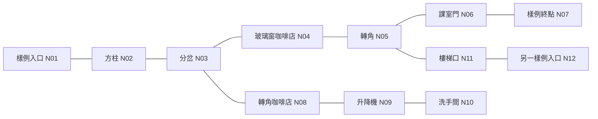

# Frontend：領路通 App 與裝置端

更新：2026年10月30日。唯一前端文件；[Backend](BACKEND-DESIGN.zh-HK.md)管理雲端與版本，[Dataset Review](DATASET-REVIEW.zh-HK.md)管理資料與模型品質。每次功能改動在同一提交更新本文件的現況、操作與驗收；不另建交接或比較稿。

目前交付：**[1.4.2+7 核心任務恢復與相機交接試驗版](https://github.com/actiondarr/pathguide/releases/tag/v1.4.2%2B7)** 已先備份GitHub並核對，再安裝／啟動iPhone 15 Pro Max。測距加入可理解的下一步、狀態重讀與收合診斷，辨識過期撤回舊結果及語音，修正菜單取消與晚到相機權限交接。沿用1.4.1+6模型／取樣；多人原場景、量尺精度及真機VoiceOver／跨任務驗收待補，不宣稱測距問題已完全解決。真實graph、三維追蹤、空間音效與鳥瞰仍未完成。

## 1.4.3+8 相機前處理修正（工程驗證完成，待保存與交付）

使用者回報對門會誤認行人／圍欄，物件及測距較嚴重、普通辨識亦差。本輪針對F02／同幀測距共用的`IOSFramePreprocessor`：NV12依full／video range與601／709轉RGB，轉正後改用半像素中心雙線性縮圖，letterbox尺寸取最近整數（恰半取偶數），保留114填色，再依模型shape排NCHW／NHWC。舊實作取左上最近鄰像素並截斷尺寸，與參考縮圖不同；兩條相機路徑共用修正，並拒絕非直角轉向。

14項原生XCTest通過，新增回歸覆蓋兩種range、四種轉向、插值像素、填色與尺寸；328項Flutter、33項Swift數值檢查、analyze及iOS簽署建置／包內版本與模型核對通過。14張既有公開門驗證圖製成兩種NV12輸入，共28個格式案例，修正前後各跑一次前處理／真實內置TFLite推理；與獨立OpenCV浮點RGB參考的平均像素差由0.015123降至0.000000195。這是合成相機格式驗證，不是28個獨立場景或真機拍攝。

**前處理修好不等於十類權重修好。** 在conf0.7／NMS0.45下，兩種格式都仍只找到18個門標註中的2個；無人房間的床鋪仍被認作行人約0.72。SHA、十類映射及品質gate維持原值，九類只作歷史比較，沒有轉成預設／回退方案。原checkpoint下載尚未成功，權重修正與原場景真機驗收仍未完成。詳見[本輪工程／自然圖證據](../verification/app-1.4.3+8.json)及Dataset同版節；簽署建置、GitHub保存與裝機狀態須依證據／交付收據分別確認。

## 1.4.2+7 前端恢復修正（GitHub已保存，iPhone已安裝／啟動）

本輪版本沿用1.4.1+6的十類權重／映射；328項Flutter測試、12項iOS原生XCTest、33項Swift數值檢查、analyze、iOS簽署建置及包內版本／模型核對通過。中英文兩倍字體的合成UI預覽已目視檢查。見[工程證據](../verification/app-1.4.2+7.json)；真機任務／VoiceOver及多人量尺覆驗尚未通過，本輪不宣稱辨識或測距變準。

- 測距主提示改為可確認狀態及重試／暫停／返回等下一步；未知物件可讀名稱及恢復提示，無物件、未開始或過期時可按「重讀目前狀態」。取樣原因與有效點數改放預設收合的「測距診斷（進階）」，點數不是正確率。
- 狀態讀屏使用穩定文字的live region；按鈕朗讀以VoiceOver公告／TTS擇一路。失效或原因改變取消舊朗讀，不逐幀自動TTS。裝置不支援停用開始；相機權限拒絕可開系統設定，返回後只允許手動重試。模型不可用時須關閉物件模式才可試準星。
- 獨立辨識與導航辨識在三秒無新幀時撤回舊框及環境語音；新幀可恢復，重播不讀舊物件。暫停／離頁立即要求釋放相機，不等待尚未返回的權限；已釋放的PlatformVision不再啟用舊模型。
- iOS原生辨識以generation作廢晚到權限及交接回覆；菜單相機先等AVCapture釋放，辨識／ARKit先等舊菜單picker取消及關閉。菜單取消收音會更新為可用文字搜尋的狀態，新拍攝清除舊查詢／語音結果；等待停止語音時離頁不再啟動拍攝，語音停止故障不阻塞操作。

這是現有Controller／原生相機交接修正；統一任務協調層、簡潔「開始協助」入口、自動意圖調度、本地視覺語言模型及完整三任務實地驗收仍未完成。原多人未知問題沒有新增物理場景證據，深度取樣門檻與模型不變。GitHub分支／不可變tag／prerelease已核對，其後iPhone 15 Pro Max安裝／啟動成功，見[交付收據](../verification/release-receipts/app-1.4.2+7.json)。


## App 背景與用途

領路通（PathGuide）是一個以香港視障人士為主要服務對象的畢業專題（FYP）。專案希望利用使用者已有的手機，把相機所見的物件、設施及文字轉成可理解的粵語資訊，協助使用者掌握周邊環境、尋找設施及處理日常生活中的視覺資訊，增加自主操作的機會。

原始動機來自行路、乘車及餐廳用餐的資訊障礙：即使已有無障礙設施，通道中的物件、臨時圍欄、設施位置及指示牌仍可能不容易察覺；菜單中的分類、菜名、價格及供應時段，也主要透過視覺表達。App希望在現有設施及使用者既有定向工具之上，提供額外資訊，而不是取代白杖、導盲犬或定向行動技能。

介面可在設定頁右上角的語言按鈕切換繁體中文／English，並保存選擇；中文語音優先香港粵語，英文介面使用可用的英語TTS，並保留VoiceOver操作、大字、可重播及簡潔控制。基本物件辨識在手機端執行，訪客亦可使用；照片收集及私人學習須另外同意，不因開啟相機或登入而自動上傳。

| 原始使用情境 | App希望提供的幫助 | 現況與界線 |
|---|---|---|
| 街道、天橋及室內步行 | 了解前方行人、物件、樓梯等設施，逐步加入路線與近距離空間資訊 | 物件辨識及戶外步行導航已有程式；準星及框內表面LiDAR測距試驗已有，鳥瞰與短路徑待實作 |
| 尋找設施與理解指示 | 結合物件、牌內圖示、箭嘴及文字，協助理解設施資訊 | B圖示模型仍在訓練流程；文字／圖示配對、方向與通行判斷未完成 |
| 餐廳用餐及日常文字查詢 | 拍攝菜單，瀏覽分類並以文字或粵語查詢菜名與價格 | iPhone菜單OCR與查詢已有程式；不代表所有版面、店名或購物情境均已支援 |

原始構想有「出行時的環境／設施理解」及「用餐等日常文字／版面理解」兩條主線。現在進一步聚焦於**可量測的持續改善**：把使用者同意提供的認錯、漏認及不同場景，交管理員覆核，再以私人批次訓練及獨立評估決定是否更新。目標是越用越準，但每次改善都需要證據，不能只憑資料增加或訓練完成宣稱效果。

Tesla FSD是空間資訊呈現的參考，希望讓人、障礙、地面及短路徑更容易理解；它不代表App已具備自動駕駛等級的感知、避障或安全保證。首輪室內範圍限現有Pro Max及HKDI固定路段；完整課室導航與跨樓層定位留待後續。

以上背景沿用原始FYP及原專案背景稿的動機與服務對象；舊稿中的「導航／菜單尚未接入」等歷史狀態不再沿用。最新功能、驗收與限制以下文為準。

## 1. 目標、目前 App 與原計劃差距

**主目標是讓辨識在獨立評估支持下越用越準。** FSD式畫面用來呈現周邊空間；畫面、照片數或類別數增加不等於準確度提升。

| 功能 | 目前程式／已有證據 | 距離目標還缺甚麼 |
|---|---|---|
| 即時辨識 | 相機、二維框、繁體標籤、粵語播報；預設十類試驗版，可切九類 | 門仍弱；新增框內表面距離試驗未經量尺／辨識聯合驗收，無三維追蹤或可通行判斷 |
| 首頁與設定 | 任務首頁、更多操作、信心／播報設定及教學；中英文介面切換／保存 | 保持讀屏、大字與最少操作；新功能不能搶焦點 |
| 帳號／聯絡人 | Google登入、恢復、登出、刪除與選填聯絡人已有程式；使用者曾回報基本真機完成 | 個別VoiceOver、刪除及雙平台驗收仍須記錄 |
| 照片回報 | iPhone同幀JPEG、低分候選、抽樣、加密待傳與上傳已有程式 | 本機PHOTO_UPLOAD_ENABLED=false；服務部署及端到端驗收未確認 |
| 戶外導航 | iPhone MapKit搜尋、預覽、步行、重播、位置、暫停／繼續及收藏；導航中可開本機辨識，共用語音輸出 | 有安裝與基本步行回報；新版逐項戶外驗收未齊。Android配置／建置未驗證 |
| 菜單 | iPhone拍照／選圖、本機OCR、分類、文字／粵語搜尋與讀價 | 真機逐項回歸；不代表室內牌面OCR或箭嘴配對已完成 |
| 私人學習 | 目前只有內置模型選擇及照片進度 | 欠訓練狀態、私人下載、閒置自動更新與回退 |
| 室內graph／FSD式引導 | 已有手動graph回放；1.4.0+5加入同幀物件與框內表面距離試驗，未接真實定位 | 測距／辨識聯合驗收、地面、鳥瞰、三維追蹤與短路徑 |

原計劃的短訊登入已改Google優先；九類只作歷史比較，十類仍是試驗；「導航未接入」只適用舊稿，現在戶外已接入，室內尚未完成。模型指標與B訓練進度只在Dataset Review維護。

## 開發階段與目前進度

三份文件共用S0–S7階段編號。狀態只表示可追溯證據：**已有程式**不等於已部署；**待實測**不等於通過；**受阻**需先解依賴；**未開始／未來研究**不是現有功能。沒有足夠工作量與驗收資料前不編造完成百分比或日期。

S5的圖示訓練可與S2、S4並行準備；私人訓練必須先有S0品質基準及S2核准資料，S6整合驗收通過後才擴大S7範圍。當前主線仍是改善準確度，室內畫面不可取代品質驗收。

| 階段 | 本階段前端工作 | 目前進度 | 完成標準 | 下一步／依賴 |
|---|---|---|---|---|
| S0 工程基線與版本保存 | 固定App／模型版本、設定及回退方式 | 1.4.2+7相同模型，分支／不可變tag／prerelease已核對；先保存再安裝／啟動iPhone成功，故障場景覆驗及聯合場測未齊 | 同一版本能以相符模型重建，GitHub備份後才安裝 | 與Backend完成共用版本；Dataset提供品質與雜湊 |
| S1 現有App核心功能 | 辨識、語音、首頁、Google帳號、聯絡、菜單、戶外導航 | 1.4.2+7已補測距提示／狀態重讀、過期撤回、菜單取消及原生相機交接；328項Flutter、12項原生XCTest、33項數值檢查、analyze與簽署建置通過，GitHub核對後已安裝／啟動iPhone。三任務／戶外／VoiceOver真機驗收待補 | VoiceOver／大字／權限／背景與實際操作逐項通過 | 補HKDI及戶外真機清單，不把測試替身當實走 |
| S2 照片收集與管理員覆核 | 同意、回報、抽樣、待傳及覆核狀態 | iPhone擷取／加密佇列已有程式；照片開關關閉，雲端未接通 | 本人同幀照片可到覆核佇列；拒絕、撤回、斷網及切帳號正確 | Backend部署／App Check與Dataset覆核流程 |
| S3 私人訓練與模型更新 | 我的模型、學習進度、更新同意及回退 | 尚未接通；付費GPU預算未定 | 收集到更新可完整演練；不合格不更新，閒置切換可回退 | 先接模擬worker及registry，再按預算開真實GPU |
| S4 室內近距離感知與引導 | ARKit、深度融合、鳥瞰、眼前短路徑及語音 | 1.4.0+5已有同幀辨識框內表面測距試驗；地面／三維追蹤／指引未開始，聯合真機驗收待補 | 未知區不畫通路，失效撤回；固定場景與效能測試通過 | 先同幀影像／深度，再幾何、追蹤、畫面及路徑 |
| S5 圖示／文字與設施理解 | 主動拍牌、B圖示、OCR及箭嘴關係 | 菜單OCR已有；B正式run曾到22輪後中斷，未完成／未入App | 合格B可手機查牌，配對不明拒答，不把箭嘴當樓層方向 | Dataset恢復／評估B；首版不依賴A自動找牌 |
| S6 HKDI整合驗收與試用發佈 | 同一任務的資源／語音協調、實地測試及版本說明 | 完整室內＋學習閉環未驗收 | 陪同實測、退化／回退／耗電與版本備份均有紀錄 | 匯合S1–S5；未通過功能保持試驗標示或關閉 |
| S7 多場地、多樓層與平台擴充 | 指定課室、樓層、Android、方向研究及其他場景 | 單層手動graph樣例回放已有；真實指定地點／跨樓層仍未開始 | 每項新增任務有場地資料、相容性及獨立驗收 | 先完成限定場景，再逐項擴，不一次承諾任意室內 |

## 各功能計劃如何實現

以下是實作路線；「新增」接口／模組仍待寫程式。現有功能列維護方法及未完成項目，未開始功能列首版做法與完成條件。

| 功能／階段 | 目前狀態 | 實現方法與資料流 | 依賴與驗收 |
|---|---|---|---|
| F01 首頁、設定與教學／S1 | 已有程式 | 沿用AppShell／TaskHomePage分任務管理資源；AppSettings保存語速、播報門檻與中英文選擇；AppLanguageScope／AppText套用產品文案及參數化狀態，Material本地化跟隨語言。使用者開任務才申請所需權限；大字下保留固定操作與可捲動說明 | 所有核心操作可VoiceOver完成，關閉面板回原焦點；加入新任務時不令舊相機留在背景 |
| F02 即時物件辨識／S0–S1 | 十類試驗／九類歷史比較；1.4.3+8前處理已核，品質與任務恢復待驗 | VisionSource接原生相機，TFLite前處理→推理→解碼／NMS→依manifest把本地索引映射至專案ID→Flutter畫框。顯示與播報門檻分開；失敗顯示原因，無框不當通道安全 | Dataset D01／D04／D08提供相符權重及映射；轉正、縮放、類別、載入失敗及新舊比較有驗證 |
| F03 粵語／英文播報、讀屏與方向表達／S1–S4 | 導航與辨識已共用App語音；空間提示未有 | 導航頁以SpeechCoordinator共用一個Speaker，導航打斷環境句，環境不能打斷導航且不補排舊框。VoiceOver公告與TTS擇一路輸出，世代取消等待中的舊語音；獨立辨識沿用Announcer／EnvironmentSpeaker。將來方位只來自同一有效空間幀，距離不可靠就不讀米數 | 重播、暫停、來電／耳機、收音與背景無重疊或過期補播；不由二維框猜碰撞風險 |
| F04 Google帳號與緊急聯絡／S1 | 已有程式，細項待實測 | AccountController協調Google身分、profile初始化、恢復與重新驗證刪除；本人聯絡人放獨立私人資料與安全快取，使用者按鈕才交系統撥號 | Backend B01／B10；切帳號不顯示他人資料，撥號只說交系統處理，不宣稱自動求助或已接通 |
| F05 認錯／漏認回報與自動抽樣／S2 | iPhone程式已有，服務未啟用 | PhotoController檢查同意與epoch→原生下一個成功推理幀同時產生JPEG／預測→亮度／重複／額度檢查→加密UID佇列→Wi-Fi提交。手動回報和抽樣分開，不用UI截圖 | Backend B02–B03、Dataset D02；拒絕／撤回不拍不傳，斷網不影響辨識，重試不重複，待覆核不顯示已學會 |
| F06 戶外搜尋與步行導航／S1 | iPhone已接；Android未驗證 | 共用NavigationController／RouteProgress；iPhone由MapKit搜尋及步行路線、Core Location供定位，Android由Places／Location與Routes代理適配。投影到路線後連續定位支持才推步驟，偏離再重算；收藏／最近使用在本機。導航頁開關啟用RecognitionSession，使用同一內置模型；相機資源依序開關，暫停／失效／離開不保留過期框 | Backend B11僅Android代理；補真機轉彎、模糊／過期定位、偏離、語音搜尋、背景及入口確認。室內不用GPS步行精度替代定位 |
| F07 菜單OCR與語音查價／S1 | iPhone已有程式 | MenuReader呼叫iOS本機OCR→保留文字框／行列→MenuDocument整理類別、菜名與價格→文字／粵語查詢→單一語音讀可確認價格。多價／配對不明保留警告，可重拍或重讀 | Dataset D06的獨立菜單真值；驗證欄位錯配、缺價、不同版面、粵語同音及取消。Android OCR另適配，不聲稱目前已支援 |
| F08 我的模型、訓練進度、自動更新與回退／S3 | 未接通 | 新增私人模型服務讀Backend的本人工作／offer；畫面分收集、覆核、資料不足、排隊、訓練、評估與可更新。另行同意後在任務停止時下載暫存、驗UID／SHA／映射／相容性、試載入及原子切換；保留舊版和內置版 | Backend B04–B09、Dataset D07–D08；模擬失敗、損壞下載、登出競爭及回退。進度只顯示伺服器證據，不自行推算已變準 |
| F09 室內相機與深度來源／S4 | 1.4.0+5同幀相機／辨識／深度程式已有，真機待驗 | 單一ARSession／ARSCNView；同ARFrame的capturedImage送現有TFLite，sceneDepth／confidence及內參供測距。辨識框經反向旋轉回raw，再用displayTransform配合預覽裁切；420f／420v與601／709矩陣明確處理，未知矩陣拒用。AVCapture與ARKit互斥，推理在單一工作佇列，忙時丟幀 | 場景深度支援與權限檢查；量尺、真實框／深度對位及低光／反光／方向切換待實測，不以編譯成功判定位正確 |
| F10 三維物件與幾何障礙／S4 | 已有框內表面距離試驗；世界座標追蹤／地面未開始 | 1.4.1+6在框內中央附近依次試最多9個連續5×5局部區塊，避開其他框覆蓋；沿用可信度／混合表面拒答與徑向換算。太細、遮擋或失效保留名稱及未知距離，主提示提供可執行下一步，進階診斷才顯示原因／有效點數，預覽保留實際取樣圓點。DepthObjects以同類別／唯一IoU對照作短時穩定，不繼承消失／歧義物件舊米數。未來才投影局部空間、估地面與追蹤幾何障礙 | Dataset D09的辨識＋量尺聯合真值；目前只是框內代表表面，非最近物件邊緣／可通行判斷。人物交叉、玻璃、舊框及姿態失效須場測 |
| F11 FSD式鳥瞰畫面／S4 | 未開始 | 原生端整理精簡IndoorSceneFrame，Flutter CustomPainter做固定斜俯視投影；使用者在下方，顯示地面、物件、障礙、未知與候選線。繪圖可插值，指引只採有效觀測；原始深度不逐幀跨通道 | F09–F10；物件比例與方位一致、未知有明顯區分，切回相機與大字／讀屏不影響停止操作 |
| F12 眼前短路徑與停下掃描／S4 | 未開始 | 將可靠地面／障礙投影為局部佔用格，未知／落差／遮擋不開通；按通行寬度與障礙膨脹參數，於已觀測區做局部A*候選路徑。穩定多幀才發前進／左右候選；失效立刻撤線並提示停下，轉角重新掃描 | F09–F11與Dataset D09；參數先以HKDI量測校準，不能以無框或舊地面推出通路；不繞過未知區到不可見目的地 |
| F13 拍牌、圖示、文字及箭嘴配對／S5 | B待恢復／評估；查牌未接 | 首版由使用者主動拍牌／框選原始解析度ROI，B找牌內圖示／箭嘴，系統OCR找文字，依同牌空間關係產生候選配對；模糊或多解只讀可確認內容。A目前沒有指示牌類，不能先假設能自動找牌；後續擴A需另訓練 | Dataset D05–D06合格B及配對測試；與A共用影像／推理排程，收音時不插播；向上箭嘴不直接變成向上樓層 |
| F14 拓撲graph、指定課室與跨樓層／S7 | 本機12-node樣例／10情境／47筆觀察已回放；真實導航未開始 | IndoorGraph分固定node、內容版本與開放／封閉edge；GraphReplaySession按兩個獨立路標、候選歧義、scope／時序及5-hop鄰域對照；BFS只輸出最少連線路線。回放頁可逐筆／自動、改終點、重設與朗讀。通過規則驗證後才接圖片／OCR特徵與自動定位。有量測座標及校準後再結合AR姿態與F12；樓層連接另驗證 | Backend B14、Dataset D09；須場地許可與獨立入口／樓層真值，首版短路徑不宣稱已包含此功能 |
| F15 扶手電梯方向與門推拉／S7 | 研究，未開始 | 扶手電梯以同設備追蹤、上下端幾何、入口標誌及補償手機移動的梯級光流交叉判斷，衝突拒答；門推拉只在可確認文字／標示證據時描述，不能只看門把或門框 | Dataset D11時間序列與文字真值；上／下端、相鄰設備、啟停、反射及持機移動均測，不叫使用者試踏設備驗證 |
| F16 懸空障礙與近身提醒／S7 | 研究，未開始 | 在地面／重力校準及使用者通行範圍設定後，檢查深度佔用是否侵入身體／頭部高度；動態碰撞風險需可靠距離、相對運動及時序證據。初版只描述觀測，不把物件在中央當碰撞預警 | Dataset D09／D11的高度、細物與時序資料；不能由未標註或稀疏深度聲稱全面覆蓋 |
| F17 場景摘要與路線錄製／S7 | 後續構想，未開始 | 場景摘要先用本機有效物件／設施／空間證據組合短句，不臆測看不到的店名或通路；路線錄製先做使用者明確開始／停止的本機路標序列及版本，再評估自願同步。錄製另行定義用途與刪除，不沿用照片同意 | Backend B15、Dataset D06／D09；完整路線回放前測起點／方向／地標混淆，不默認開GPS軌跡或影片上傳 |
| F18 Android、普通iPhone與更多登入方式／S7 | 基本辨識／帳號有適配；新能力待驗證 | 先保留共用Controller與能力查詢，逐平台補相機／OCR／定位／語音adapter及真機測試。無可靠深度的手機先保留辨識，室內引導需另評估；Apple／電話以連結流程保留UID，不用相同電郵猜合併 | Backend B16；iOS／Android兩類權限與簽署配置分開；沒有服務時明確不可用，不用模擬代替真功能 |
| F19 空間音效／S4–S7 | 參考產品引出的候選，未實作 | 在F09–F10提供有效方位／距離後，原生AVAudioEngine搭配AVAudioEnvironmentNode產生單聲道定位提示音，設定listener／source座標；與TTS／VoiceOver共同排程。先校準左／右／前後與近遠，未知不合成假距離 | 先幾何可信再做聲音，耳機／揚聲器／讀屏及外界聲音負擔均測；不把現有普通TTS標作空間音效 |
| F20 路口燈號與斑馬線／S7 | 新研究候選，不列現有十類能力 | 先定行人燈／車燈、斑馬線與對應路口／方向的真值，另建資料與相容模型；時序檢查遮擋與狀態變化，只描述可確認觀測，不由單一框發可過路指令 | Dataset D13；陌生路口、錯燈、反光、閃爍與未知要測，未通過維持關閉 |
| F21 電梯樓層資訊／S5–S7 | 新候選，未實作 | 主動拍攝顯示器／按鈕，分開定位區域、OCR數字／字母與亮燈狀態；用多幀保留穩定結果、允許未知。讀到樓層文字不自動更改全局樓層定位 | Dataset D13；測B1／G／數字、反光、LED抽樣／閃爍與相鄰按鈕，不把牌上數字當目前樓層 |
| F22 耳機頭部手勢／S7 | 選填候選，未實作 | 先加入NSMotionUsageDescription與權限說明、做能力檢查，再由CMHeadphoneMotionManager取得頭部運動，校準中立姿態、短動作門檻與冷卻，用於開始／停止場景查詢等可取消操作；保留按鈕／VoiceOver替代 | Dataset D14；轉頭聽路況不能誤觸重要操作，耳機斷線／不支援即停用；不因本機手勢而收集動作資料 |
| F23 鎖屏語音導航／S7 | 新候選；現版只前景 | 先獨立設計導航的背景定位／音訊session與暫停／恢復、權限說明及耗電驗收；鎖屏時鏡頭感知停止或不可用要明示，不沿用畫面仍在看路的假狀態 | Backend B12／Dataset D14；原功能在背景停止的現行行為不在本輪改動，先驗證服務與平台限制再排開發 |

### 共用接口與任務資源（新增部分待實作）

現有`Detection`為已轉正的二維正規化框；新增`IndoorSceneFrame`另有schemaVersion、session、單調時間、追蹤狀態、姿態／座標定義、物件／障礙、地面摘要及候選路徑，不無聲改寫舊Detection契約。公尺與畫面像素分開，ARKit原始座標到Flutter投影只轉換一次，缺值保留未知。

現有辨識、菜單與導航各有Controller；新室內與牌面任務需共用相機／推理／語音資源調度。新任務開始先取消舊任務與遲到回應，下載切換模型只能在任務停止時做。個人模型offer另有ownerUid、job／snapshot、版本／雜湊、taxonomy與App相容性，由Backend管理。

Apple接口依據：[sceneDepth](https://developer.apple.com/documentation/arkit/arframe/scenedepth)、[深度能力檢查](https://developer.apple.com/documentation/arkit/arconfiguration/supportsframesemantics%28_%3A%29)；這些API提供觀測能力，局部規劃與驗收是本專案待實作的部分。

## 2. 現行操作與裝置生命週期

- 首頁不啟動相機，提供即時辨識、路線導航、菜單、設定及帳號。訪客可用基本辨識，不因拒絕登入或照片同意而停用。
- 進入辨識後啟動相機與播報；主畫面保留暫停／繼續與更多操作。重播、播報開關及設定放面板，面板關閉返回原焦點。
- 辨識離頁／背景停止來源、結果及語音；原先運作中的任務回前景恢復，手動暫停保持暫停。導航背景返回則需明確繼續。
- 物件語音與VoiceOver共用一條輸出，不補讀過期畫面。錄音、帳號頁或操作面板需協調停止環境播報；語音故障不阻塞其他操作。
- 戶外導航核對目的地後預覽／開始；暫停立即停定位與語音，繼續從新位置重算，結束需確認。有效定位門檻為年齡≤10秒、水平誤差≤25米；模糊定位不發精確指示。
- 戶外接近終點仍需確認入口，沒有室內樓層、鎖屏導航、相機同步避障、過路時機或錄製軌跡。收藏在本機，不隨帳號切換。
- 菜單只讀可確認的菜名與價格，缺價／多價／配對不明須保留不確定性。線上粵語辨識先取本次同意，拒絕仍可文字查詢。

主要操作保留大觸控目標、兩倍文字與可捲動內容；地圖與視覺框不是唯一操作入口。讀屏順序為標題、狀態、操作、結果、其他設定，不隨每幀更新搶焦點。

## 3. 越用越準的使用流程（待接通）

使用者另行同意照片用途 → 回報認錯／漏認及少量抽樣 → 管理員核准 → 私人批次訓練 → 獨立比較 → 合格才提供更新。不是手機每看一次便立即訓練，也不承諾一張照片就學會新物件。

「我的模型」需顯示實際內置／私人版本、評估範圍、更新時間、是否使用試驗版及回退入口。進度區分收集中、待覆核、資料不足、排隊、訓練、評估、可更新、未通過及失敗；上傳成功不能顯示「已學會」。

照片同意、系統相機權限與自動更新同意分開。未預先同意者手動選擇；已同意者只在App前景、辨識／室內外導航等任務停止時下載、核對UID／雜湊／映射／相容性、試載入並原子切換，失敗保留舊版。登出／切帳號取消遲到工作、清理私人快取並回內置模型。

現行照片限制：單張2 MiB、本機50張或50 MB、七日到期；綁UID／project／epoch，加密待傳，Wi-Fi上傳。擷取JPEG與預測須同幀且無畫框／UI，不是App截圖。完整雲端規則見Backend。

## 參考產品分析：瞰見聆境（公開資料，未實機驗證）

2026-10-27依[官方App Store介紹與版本紀錄](https://apps.apple.com/tw/app/%E7%9E%B0%E8%A6%8B%E8%81%86%E5%A2%83-%E7%A9%BA%E9%96%93%E9%9F%B3%E8%A8%8A%E5%B0%8E%E7%9B%B2%E5%8A%A9%E6%89%8B/id6754217576)整理。開發者網站未能正常讀取；本輪沒有操作該App、量測精度、聽取實際音效或驗證香港／粵語支援。下列第三方能力只是官方列項，PathGuide的狀態與做法由本地程式／方案核對。

| 官方列項 | PathGuide目前差距 | 對應計劃／應先驗證 |
|---|---|---|
| 導航＋感知 | 1.1.0+2可在戶外導航開本機2D辨識並共用語音；真機驗收待補 | F06已整合；F09–F10已有同幀框內表面距離試驗；鳥瞰、地面及短程引導待實作 |
| 空間音效 | 只有一般TTS／VoiceOver | F03／F19；方位／距離需可信，再做聲音提示 |
| 路書／路標修正 | 收藏不等於路線錄製或內容版本 | F14／F17；先手動graph及node註記／重走驗證 |
| 臨時場景描述 | 菜單OCR與物件摘要不等於場景理解 | F17；先本機證據短句及可取消的回到導航流程 |
| 懸空／通路提示 | 尚無可信深度與身體通行範圍判斷 | F10／F12／F16；固定路段量測與失效撤回 |
| 燈號／斑馬線 | 現有十類未涵蓋 | F20；另建定義／時序資料及拒答驗收 |
| 耳機頭勢 | 無感應／手勢模組 | F22；可選輸入與斷線／誤觸測試 |
| 鎖屏語音 | 現版背景停止導航 | F23；背景路線提示與鏡頭能力分開驗收 |
| 電梯樓層 | 未有顯示器／亮燈按鈕讀取 | F21；不直接當樓層定位 |
| 本機／雲端選項 | 現行辨識在本機；無場景模型服務 | 比較用途／離線／下載設計；不自動新增雲端上傳 |

**產品判讀：** 官方對路書改善的描述包含使用者修改路線／路標，公開資料未證明私人權重會自動再訓練，也未披露node graph、VPS、深度模型或定位精度。因此參考的是使用流程，不能把推測演算法寫成事實。

**對PathGuide的建議（尚未改寫首版範圍）：** 先把目前辨識／導航的資源及語音協調做好，再驗證手動graph與路標內容回放，接同幀深度／短路徑；空間音效、場景查詢及其他候選按各自依賴驗收。路線內容變好與A／B模型變好保留兩套成效指標。S7候選不因競品列出便視為本版承諾。

下一輪實機觀察要記錄：首頁與設定→探索／導航切換→補記路標與重走→場景查詢及返回→相機朝向偏離／低光→VoiceOver／耳機／鎖屏。每項保存可觀察操作、語音、失效與恢復；看不到的資料儲存、模型與安全性標未知。

平台實現參考（只支持我們的候選做法，不證明競品採用）：[Apple三維音訊](https://developer.apple.com/documentation/avfaudio/avaudioenvironmentnode)、[耳機運動服務](https://developer.apple.com/documentation/coremotion/cmheadphonemotionmanager)。

## 室內graph樣例回放（1.2.0+3已有本機原型）

本版先驗證「固定node.object＋連線＋觀察序列」的處理規則：12個虛構位置、12條連線（1條封閉）、10個手動標註情境、47筆觀察。不是HKDI或任何真實商場地圖，沒有相片／AI定位或米制坐標，不代表S4避障或S7完整導航已完成。程式：app/lib/indoor/indoor_graph.dart、replay_scenarios.dart與graph_replay_page.dart。

**node代表一個固定地點／地標位置**，例如轉角、店面前或升降機大堂；店名、牌、門與圖片是該node的objects／內容。同一位置換店名保持node ID，更新有版本的內容；行人、可搬垃圾桶及臨時告示不能單獨作永久定位錨點。



連線表示實際走得通；兩張相片相似不代表兩node可直接連通。首版無向graph只用在已核實可雙向行走的同層通道，之後另加單向、封閉、樓梯／升降機及無障礙限制。

本版使用上述12個手動node，包含直路、轉角、分岔及重複外觀，以預先標註的路標輸入驗證邏輯；N04與N08之間另有封閉連線，路線不可穿過。node不必先有x,y；沒有量測尺度時只顯示拓撲位置，不輸出精確米數或把AR箭頭貼地。最少節點路線可先用BFS；有實際邊長後用Dijkstra，校準座標後才考慮有幾何啟發式的A*。

### 每5秒一張與queue的角色

- 5秒是可測試的定位取樣起點，observations queue按拍攝時間／序號保存本次行程，與永久graph分開。停留可多次對應同node，走快可跳過node，倒行要允許反向。
- 每次根據上一個可信node、路線、候選圖片／文字與最近觀察序列做配對。直線段可查前後5個node；分岔應查graph內可達的鄰域，不能只用array索引±5。
- 不吻合先列定位不確定／新觀察，再擴大搜尋。沒有證據時不自動新增永久node、不改路線，也不斷言店舖已改名；後續觀察及覆核才決定。
- 5秒照片可用來校正路線位置；兩次照片之間的眼前障礙與停下提示仍需手機即時感知。例：若步速為每秒1米，5秒已移動5米，不能靠下一張上傳才處理近身障礙。

第一輪手動樣例已驗證：已知路線可表達，重複／漏拍／倒行／分岔／已核准別名、歧義、未知、錯樓層、遲到及過期觀察能對照或拒答；下一輪才評估真實影像定位準確度。詳細資料分層見Backend，測試真值見Dataset Review。

### 手機操作及本輪規則

1. 在「導航」頁、未開始戶外導航時按「室內路標回放（樣例）」。切入會釋放戶外導航頁；返回後重新搜尋，回放不與戶外任務並行。
2. 選情境及樣例終點；按「下一筆觀察」看目前node、候選、下一個graph路標與排序佇列，或按「自動回放」每秒顯示一筆。樣例拍攝時間相隔5秒，不代表手機正在拍照／上傳。
3. 「朗讀結果」讀當前樣例對照；與VoiceOver擇一路輸出，不自動逐筆搶播。重設、換情境／終點、背景或離頁會停止回放與朗讀。返回前景需手動再播放。
4. 黃點為目前對照、紫點為終點、紅叉為封閉連線；沒有目前位置時清掉路線，僅保留候選／上次確認的明確標籤。示意layout與地理坐標分開，沒有米數、轉向、可通行或真實到達指令。FSD鳥瞰仍保留在F11空間輸出計劃。

規則是可測試的原型參數：至少兩個**不同路標object**匹配，不能用同一店名的三個別名當三份證據；全圖最佳候選同分就拒答，不讓預期路線壓過歧義。最多5條開放edge內可對照停留、跳點或倒行；離開此鄰域或失去既有定位後，需連續兩筆、不同拍攝時間的新觀察確認。收到時已超過15秒、未來時間或倒序拍攝時間的觀察會失效，30秒以上的舊錨點不作近鄰依據。參數未經場測校準，不能當安全門檻。

觀察附session／場地／地圖版本／樓層／拍攝序號／時間；佇列最多50筆並按拍攝序號保存，重複或遲到回覆不改目前位置。未知觀察不新增node、不改連線、不自行核准店名；N08的新舊別名是預先人手核准的contentVersion=2示例，不是自動學習。

本輪274項Flutter測試通過（新增21項graph規則及6項UI／入口測試），analyze無問題，iOS簽署建置通過。可用 `dart tool/verify_graph_replay.dart ../verification/graph-replay-1.2.0+3.json`（在app目錄）重現10情境trace；這不是圖片準確率報告。真機互動及真實場地資料仍需另外驗收。

## 4. 室內首版（待實作）

範圍：目前iPhone 15 Pro Max、HKDI一層固定走廊，鳥瞰場景與眼前數米引導。指定課室／跨樓層導航另需地圖與定位，不列首版完成條件。

- 同一ARKit session提供相機、深度、姿態及地面給推理與繪圖；先檢查硬件支援，避免與另一AVCapture來源搶相機。
- 原生端融合相符時間／座標的物件與幾何；Flutter顯示追蹤物件、未分類障礙、已觀測地面、可信度及候選短路徑，可切相機預覽。
- 無物件框不等於暢通。未知、遮擋、深度不足及疑似落差不可作可通行區；路徑只延伸至已觀測範圍，轉角先掃描。
- 前向以手機朝向定義；教學要求朝向行進方向。深度／地面／追蹤失效立即撤回路徑，提示停下掃描。
- 提供停止、重讀及重新掃描；不逐幀朗讀。背景、離頁與暫停停相機及語音，返回需明確繼續。

扶手電梯運行方向、門的推拉與過路時機仍未實作；單張箭嘴、物件名或框不能證明方向或安全。方向研究需設備追蹤、上下端、相機運動補償及時序驗證，未知時拒答，不發「可以踏上」指令。

### 1.1.0+2：中英文與導航＋辨識＋單一語音

- 設定頁右上角地球按鈕選「繁體中文（香港）」或「English」，即時切換並跨重開保存；任務頁不因語言重建而重啟相機。產品按鈕、設定、導航狀態及辨識名稱切換語言。地點／地址、菜單原文、供應商路線及原生系統視窗保留來源語言；部分底層診斷仍是原文。**語音搜尋仍是粵語**，英文按鈕有明示，介面英文不等於新增英文收音。
- 開始戶外導航後，在可捲動內容打開「導航時辨識」。只有導航中／接近終點、前景且無收音／確認視窗時才開相機；導航暫停、背景或離頁立即作廢舊回覆並依序釋放來源。回前景不自動恢復導航，需按繼續。
- 一個TTS／VoiceOver輸出入口：導航優先；環境只使用最新有效框，冷卻／不排隊，導航期間不搶播。結束或離開確認期間先靜音；慢速原生停止不阻塞確認視窗。VoiceOver實際公告／中斷時機仍須真機驗收，單元測試不代表系統讀屏時序已通過。
- 本輪導航辨識不儲存或上傳影像，也不沿用訓練照片同意。無新雲端接口。停止、來源錯誤或超過3秒無新幀會清掉結果；沒有偵測不代表前方安全。
- 現在仍是2D辨識，不能由框大小推斷米數、身體朝向或可走路線。FSD鳥瞰保留為之後的空間視覺輸出，未用假距離補成成品。

接續順序：①獨立真機驗收這個整合點；②先以8–12個手動node及路標序列驗證graph回放（停留、漏拍、倒行、分岔、改名、未知），再接圖片特徵；③同幀ARKit深度及空間音效。此句為1.1.0+2的當時狀態：該版未有graph回放或深度；1.2.0+3已加入上述手動樣例回放，真實定位仍未完成；1.3.0+4再加入以下獨立測距試驗，空間音效仍未開始。

### 距離量測的實現與驗收（1.3.0+4準星試驗）

現有iPhone 15 Pro Max的LiDAR可經ARKit `sceneDepth`取得距相機平面的米制深度及`confidenceMap`。先執行`supportsFrameSemantics`能力檢查，**同一ARFrame**提供RGB、深度、內參、姿態與時間；本版先獨立量中央表面，後續物件融合才沿用現有模型分析同幀影像，不能讓ARSession與AVCaptureSession搶同一相機。[Apple ARDepthData](https://developer.apple.com/documentation/arkit/ardepthdata)、[sceneDepth支援檢查](https://developer.apple.com/documentation/arkit/arconfiguration/framesemantics-swift.struct/scenedepth)。

辨識框需先依影像方向／裁切對齊深度圖，採框內可信有效點的穩健統計，避免中心落空或背景混入；再用時序與追蹤驗證穩定性。深度值是相機平面的Z距離；若顯示鏡頭到點的直線距離或地面前向距離，要用內參反投影並明確定義，不把三種數字混用。玻璃、鏡面、吸光、邊界與動態人群需保留未知，沒有可信深度不填零、不補舊數字。

先用量尺／雷射測距器在固定走廊比對不同已知距離、角度、材質與光線，報偏差、絕對誤差分位數、有效讀數及未知率，門檻由場測再定。通過後才把有效三維位置交鳥瞰與空間音效；感測器有米制讀數不代表通行／避障已可靠。

1.3.0+4操作入口為「導航 → LiDAR 測距（試驗）」，只在沒有進行中戶外導航時顯示。進入頁面不自動開相機；使用者站定、準星對準實心表面後按開始。畫面顯示約米數，可按「朗讀目前距離」，TTS與VoiceOver擇一路，沒有自動連續播報。背景／離開／暫停／追蹤中斷會撤回距離與停止相機／語音；返回前景須手動開始。畫面、深度、姿態不保存／上傳。Android／非LiDAR顯示不支援，不產生模擬距離。

原生每約120ms最多處理一次：以同幀displayTransform反算預覽中央位置，在depth圖取5×5點，只接受高confidence及0.2–4m的相機平面Z，至少70%有效；中位數附近至少80%屬同一群，分散度超門檻拒答。用內參分別計Z及徑向距離，UI只顯示徑向米數。相鄰樣本位移>2.5cm或轉角>0.04rad先等待穩定；Flutter需3筆跨至少0.2s且在0.7s內的一致讀數。原生／通道收到時資料>350ms拒用，800ms無新結果撤回。這些是**試驗工程門檻**，未經場測校準；中位數可減少背景污染，不能保證玻璃或誤對準時正確，亦不是整個物件最近距離／地面路徑。

1.3.0+4當時未把A框接到深度；1.4.0+5已加入以下框內表面試驗，graph、空間音效及鳥瞰仍未接。下一步先量尺核對0.5／1／2／3米實心牆，分材質／角度／光線記讀數、未知與延遲；再測透明、鏡面、細邊、移動及暫停恢復。取得獨立真值後才決定可接受誤差及開啟後續三維物件輸出。

### 同幀物件與距離（1.4.0+5試驗）

新入口「導航 → 物件與測距（試驗）」，只在沒有進行中戶外導航時顯示。預設物件模式，使用者站定後按開始；畫面以編號框及清單顯示最多5個可見物件、畫面左／中／右及框內表面的估算米數。這個方向只指畫面位置，並非世界方位。按「朗讀目前物件」最多讀3個，沒有自動連續播報；名稱與未知距離也可朗讀。暫停後關閉「辨識物件並配對距離」可使用1.3.0+4原本準星模式。大字說明／清單可捲動，開始／暫停及朗讀固定在底部，預覽不因捲動而被懶載入清走。

模型僅用App內置預設mixed10權重與manifest，物件門檻沿用設定的播報門檻；不是沿用獨立辨識頁臨時選擇的HK9或私人模型。Dart校驗manifest、位元組數與SHA，核實／修復本機唯讀來源的權重快取，原生再驗SHA、輸入及輸出形狀／映射；不符就停物件模式，不猜類別。讀取／權限尚未完成時離開會作廢後續啟動；背景、暫停與離開停止AR相機並丟棄舊推理結果，不保存影像、深度或pose。

幾何規則：模型的轉正框先回到未旋轉影像／深度座標。1.4.0+5原本跨中央半區分散取25點，1.4.1+6改為中心優先、最多9個候選連續5×5局部區塊，整塊須在物件框內且不碰其他框；第一個通過原有深度門檻的區塊才配米數，沒有合格區塊保留未知。預覽至少可見60%且中心可見才列出。這些是保守的試驗門檻，未由場測校準。只顯示經高信心深度與3筆短時穩定支持的代表表面徑向距離；不是整個物件的最近邊緣或地面距離。

時序規則：取樣點相對框內位置改變超過0.12時重新確認，不把不同區塊的舊距離混合。只對同類別且IoU≥0.45的唯一前後框延續短時記錄；多對一／一對多、類別變動、消失或太久未見均重新穩定。距離突變、未知、移動、過期或畫面大小／方向改變撤回米數；保留1.3版350ms資料年齡、800ms無新資料撤回等門檻。這不是實體身份或三維追蹤；相同位置突然換成另一個相似物件仍需實景驗收。語音只讀當前結果，朗讀中的物件消失／失效不補排舊結果，VoiceOver與TTS擇一路。

接續驗收要分開記「認啱物件」與「框內表面距離正確」：A模型門／行人限制仍在，透明／鏡面／混合框可能誤配。先以實心垃圾桶等目標做0.5／1／2／3m量尺與框對位，再驗雙物件、人物交叉、框重疊、背景／模式切換及讀屏。三維世界座標、地面／通路、空間音效、FSD及真實graph定位仍未完成。

## 5. 安裝與驗收

Mac先準備Xcode、相容Flutter／Dart（以pubspec與lockfile為準）、必要iOS元件與依賴；真機解鎖、信任電腦並依系統要求啟用開發者模式。最低iOS15，bundle ID為hk.pathguide.pathguide；需有效簽署。

在app目錄執行：

```sh
flutter pub get
flutter analyze
flutter test
./tool/run_iphone.sh
```

安裝入口保留本機Firebase設定；首次設定由Backend說明。無簽署build只能驗證編譯，不能安裝。完成版本須先按Backend的GitHub備份規則推送並核對，再安裝交付。

| 證據 | 已知結果與限制 |
|---|---|
| 2026-10-28 1.4.1+6局部取樣修正 | 318項Flutter、33項數值檢查、analyze、簽署建置、簽章與包內模型通過；GitHub核對後安裝／啟動成功。真機原場景覆驗待補，未將合成通過當已修復 |
| 2026-10-28 1.4.0+5物件距離試驗 | 314項Flutter、11項原生XCTest、25項數值檢查、analyze、簽署建置、簽章與包內版本／模型通過；GitHub備份核對後已安裝／啟動iPhone。尚未完成辨識與距離聯合實地驗收 |
| 2026-10-28 1.3.0+4測距試驗 | 294項Flutter測試、12項原生數值檢查、analyze、iOS簽署建置、系統簽章及包內版本／模型核對通過；GitHub分支／tag／prerelease核對後，iPhone安裝及啟動成功。尚未量尺、實地定位或相機交接真機驗收 |
| 2026-10-28 1.2.0+3 graph版 | 274項測試、analyze、iOS簽署建置、系統簽章與包內模型核對通過；GitHub分支／tag／prerelease已保存。手機解鎖後安裝及啟動成功；尚未完成真機互動／真實定位驗收 |
| 2026-10-27 1.1.0+2 Flutter | analyze無問題；247項測試通過，包括語言保存、英文TTS、語音優先、延遲權限與導航相機暫停／背景；不是準確率或實走 |
| 同版iPhone編譯 | `flutter build ios --release --no-codesign --no-pub --dart-define-from-file=config/firebase.local.json`通過；其後以現有開發簽署建置、系統簽章核對、iPhone 15 Pro Max安裝及啟動亦通過；語音／相機同時運作仍須真機驗收 |
| 同日既有導航工程紀錄 | 6項導航原生測試、analyze及簽署建置／安裝有通過紀錄；本次文件整併未重跑 |
| 手機／實地 | 使用者曾回報基本戶外步行正常；新版逐項VoiceOver、定位恢復、背景、收藏、偏離及終點驗收仍待 |
| 發佈／回退 | 1.1.0+2分支、不可變tag及試用Release已保存／核對；另有整合前還原點；遠端核對後已安裝／啟動iPhone 15 Pro Max。見Backend第7節及發佈核對紀錄 |

下一輪需記錄：VoiceOver與兩倍文字、拒絕權限、五次粵語查詢、背景／來電／耳機、GPS不足／斷網／偏離；HKDI不同路況各三次及三十分鐘耗電。室內另測行人橫過、轉角、玻璃、暗光、持機偏轉及失效撤回；工程目標場景≥10 Hz、p95延遲≤500 ms，尚未實測。

## 6. 維護紀錄

2026-10-30 相機前處理修正：1.4.3+8對齊雙線性縮圖與letterbox取整，兩條iOS相機路徑共用；原生四向／range回歸及自然圖NV12對照通過。十類自然圖仍有漏門與床鋪誤認行人，權重／映射未改，不能標記使用者問題已修復。發佈／裝機與權重後續依本版證據及Dataset維護。

2026-10-27：刪除分散舊稿，將App現況、差距、操作、安裝與驗收合併於此；本檔是唯一Frontend依據。之後每次更新，修改相關段落並在此記錄日期、行為、驗證及限制。

2026-10-27補充：恢復整併時遺漏的App背景，加入FYP動機、香港視障使用者、粵語與無障礙設計、出行／設施／菜單情境及持續改善方向；歷史構想與目前能力分開，不恢復第四份文件。本次只修訂文件，沒有更改App或重新驗收功能。


2026-10-27階段化補充：加入S0–S7階段表與F01–F18逐功能實現方法、依賴、驗收及未來邊界；保留App背景。B11狀態按17:10本機交接修正為中斷／Drive連接受阻，不宣稱本輪直接讀取新checkpoint。下一輪依次補現有真機驗收、S2閉環及S4同幀感知；不在本次文件更新中實作功能。

2026-10-27 graph討論補充：記錄先手動拓撲圖、後特徵抽取的概念驗證；區分固定node、內容版本與觀察queue，列出5秒取樣、分岔／倒行與座標限制。本輪沒有建立導航程式或承諾定位精度。

2026-10-27參考產品補充：以官方公開資料比較瞰見聆境，清楚標示未實測／未知實現；新增F19–F23候選方法、依賴與驗收，不改現有功能狀態或將研究自動升格首版範圍。本輪未安裝／操作第三方App、未新增App功能。

2026-10-27整合版：1.1.0+2新增中英文介面／保存與英語TTS，導航頁可開本機辨識並經SpeechCoordinator共用語音；相機及語音按權限／收音／確認／背景世代取消，結果3秒失效。247項測試與未簽署iOS編譯通過，真機／graph回放／ARKit深度／空間音效未驗收；補距離量測定義與實測方法。共用十類試驗權重按原有試用要求保存，沒有重新訓練或提升品質宣稱。

2026-10-27安裝核對：先完成GitHub分支／tag／prerelease及模型核對，才以現有設定簽署1.1.0+2；正常系統信任服務下codesign驗證通過，安裝及啟動iPhone 15 Pro Max成功。安裝曾遇一次CoreDevice連線重設，重查裝置後重試成功。這只證明交付／啟動，未實測步行、同時播報、耗電、graph或深度。

2026-10-28 graph版：1.2.0+3加入導航頁樣例入口、12-node圖、封閉連線BFS、10情境／47筆觀察、時序與scope拒答、兩筆重新確認、固定控制／中英文／朗讀及背景暫停。274項測試、analyze與iOS簽署建置通過。沒有相片特徵、真實HKDI地圖、米數、深度或空間音效；沿用同一試驗模型，發佈依Backend程序先GitHub再安裝。

2026-10-28 graph版發佈核對：源碼 `95d7cda`、不可變 `v1.2.0+3` 與[試用Release](https://github.com/actiondarr/pathguide/releases/tag/v1.2.0%2B3)已保存並核對，舊版保留。正常系統簽章及包內版本／模型相符。首次CoreDevice安裝回報手機太久未解鎖；使用者確認解鎖後重試，1.2.0+3安裝及啟動成功；收據見verification/release-receipts/app-1.2.0+3.json。

2026-10-28 graph版裝機完成：使用已備份且模型核對相符的1.2.0+3包，CoreDevice安裝iPhone 15 Pro Max並啟動成功。入口為「導航 → 室內路標回放（樣例）」。只確認交付／啟動，未把手動樣例測試或程序啟動當成真實圖像定位、步行或VoiceOver驗收。

2026-10-28 測距試驗版：1.3.0+4新增上述獨立ARKit中央表面測距、本機短時穩定／拒答、手動中英文朗讀及相機交接；未接物件框或圖像定位，未做量尺／步行驗收。工程及發佈證據見verification/app-1.3.0+4.json與發佈收據；沿用相同mixed10試驗模型，不宣稱辨識準確度改善。

同輪工程核對：完整Flutter共294項通過（新增20項測距／平台／中英文大字／生命週期測試），analyze無問題；12項原生DepthSampling合成數值檢查、1.3.0+4最終簽署建置與系統簽章／模型包核對通過。這些不是iPhone量尺精度或真實相機切換結果；真機操作待獨立驗收。

同日1.3.0+4交付完成：源碼6a0e652、不可變v1.3.0+4及試用Release已遠端核對，之後才安裝。首次手機太久未解鎖，使用者確認解鎖後CoreDevice安裝及啟動成功；收據為verification/release-receipts/app-1.3.0+4.json。沒有觀察手機內實際測距畫面或量尺／VoiceOver操作，仍待實測；舊tag保留。

2026-10-28 物件距離版：1.4.0+5加入同幀ARKit RGB→既有模型→框內深度→短時配對／未知撤回／中英文手動朗讀，保留準星模式。修正共享iOS前處理明確區分full／video range與601／709矩陣；原生模型shape測試依實際manifest核對，未換權重／改品質gate。工程、發佈及裝機證據見verification；實景／量尺／VoiceOver仍待。

同輪1.4.0+5工程核對：完整314項Flutter、11項iOS原生XCTest、25項距離／座標／色彩數值檢查通過，analyze無問題，最終iOS簽署建置、系統簽章及包內版本／模型相符。verification/app-1.4.0+5.json記錄構建快照；發佈／裝機由收據更新。不是實地辨識、量尺精度或VoiceOver驗收。

同日1.4.0+5交付：源碼26fa41e、不可變v1.4.0+5及試用Release已遠端核對；之後CoreDevice安裝及啟動iPhone 15 Pro Max成功，使用者已可在手機試「導航 → 物件與測距（試驗）」。尚未觀察手機內真實辨識／測距畫面或量尺驗收，不能把啟動當功能精度通過；最新收據verification/release-receipts/app-1.4.0+5.json，舊版保留。

2026-10-28 1.4.1+6修正版：使用者回報對住多人時全為「距離未知」，同場景關閉物件模式的準星測距能顯示米數。這是使用者回報，沒有RGB-D原始數據或量尺真值，不能單憑截圖確定全部原因。核對發現舊版跨大面積分散取樣及整個中央區重疊拒答，容易把衣服／椅背／背景當成單一表面而拒答。修正為中心優先的局部連續區塊及局部遮擋檢查，維持高confidence、70%有效點、80%同群、量程與時序門檻；沒有為顯示數字降低可信度。

修正版在框內標示所選局部區塊的中心圓點，卡片顯示拒答／等待原因與量程內高信心點數（例如8/25，不是正確率）。可區分缺深度／格式、框太細、全部候選被遮擋、可信點不足、混合表面、超量程、取樣點改變、對照歧義與等待三筆觀察。取樣圓點仍可能落在框內非目標表面；它只表達目前量哪一處，未證明整個人或物件的最近距離。請在原場景先一個靜止人／實心物件，再多人，核對圓點、原因及量尺；新版真機效果待覆驗。

工程證據：完整318項Flutter與33項原生數值檢查通過，包括同一曲面舊分散取樣拒答／新局部取樣通過、局部遮擋避讓、全部遮擋及小框拒答、原因／點數與取樣位置變更重新確認。這是合成回歸，不是使用者場景已重現或量尺通過。模型、graph、訓練與雲端服務不變；使用者截圖沒有加入GitHub或訓練。

同輪1.4.1+6最終核對：318項Flutter、33項原生數值檢查、analyze、簽署建置、系統簽章及包內版本／原模型SHA通過。先保存GitHub分支／tag／prerelease，再交付；最新裝機狀態由verification/release-receipts/app-1.4.1+6.json記錄，未將合成回歸當真機問題已解決。

同日1.4.1+6交付：源碼79681b9、不可變v1.4.1+6及prerelease已遠端核對；安裝首輪連線中斷，裝置清單確認可用後重試安裝及啟動成功。入口不變，請先單人／實心物件，再多人，記錄取樣圓點、未知原因及有效點數。收據verification/release-receipts/app-1.4.1+6.json；實地效果與量尺精度仍待使用者覆測，未把程序啟動當驗收。
