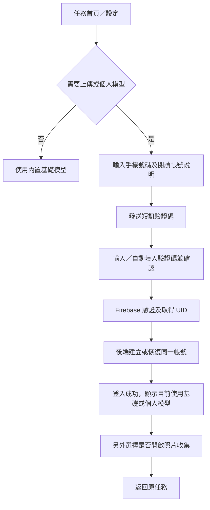

> 歷史快照，第三階段更新前版本。現行流程請見 [第三階段實作](../../PHASE3-IMPLEMENTATION.zh-HK.md)。

# 領路通 PathGuide 帳號註冊與個人模型流程

規劃日期：2026 年 10 月 22 日

目標是用經驗證的帳號，把使用者上傳的照片、核准資料集、訓練工作及個人模型綁定到同一身分。每個人先使用共用基礎模型，之後由自己的核准資料與既有基礎資料微調，產生該帳號專用的模型。

已確認採用手機短訊驗證碼登入，毋須密碼；基本離線辨識可直接使用，開啟照片收集、上傳或存取個人模型前才要求登入。本文件是流程及工程規劃，尚未實作註冊、私人訓練或模型下載。

配套文件：[前端方案](../../FRONTEND-DESIGN.zh-HK.md)、[Dataset 方案](../../DATASET-TRAINING.zh-HK.md)、[後端方案](../../BACKEND-DESIGN.zh-HK.md)。本次個人模型決定取代舊方案「所有模型只隨 App 發佈」的限制：共用基礎模型仍隨 App 提供，個人模型另經帳號授權下載。

## 1. 帳號與模型的基本規則

| 項目 | 規則 |
|---|---|
| 唯一身分 | Firebase Authentication 的 UID，不使用電話號碼、裝置 ID 或客戶端自報 UID 作擁有者 |
| 電話號碼 | 用於驗證及登入；經正式變更流程後，UID 與原有資料歸屬不變 |
| 共用基礎模型 | 內置、可離線使用；新帳號或無個人模型時的預設 |
| 個人 Dataset | 該 UID 的已核准照片與標註，混合獲授權的既有基礎資料 |
| 個人模型 | 由該資料集微調，權重、清單、評估及下載權限綁定同一 UID |
| 他人資料 | 不混入其他帳號的照片或私人模型；共用基礎模型亦不自動吸收私人照片 |
| 人工覆核 | 只限獲授權工作人員；「屬於帳號」指資料歸屬與存取範圍，不是只有本人能看到待覆核資料 |
| 註冊完成 | 只代表帳號可用，不代表有足夠資料、已訓練或模型更準確 |

手機應用使用 Firebase 原生電話認證流程，包括發送驗證碼及以憑證登入；伺服器透過驗證 Firebase ID token 取得 UID。[Firebase Flutter 電話認證](https://firebase.google.com/docs/auth/flutter/phone-auth)、[Firebase ID token 驗證](https://firebase.google.com/docs/auth/admin/verify-id-tokens)

## 2. 註冊與登入的使用者流程

### 2.1 入口與訪客模式

首次開 App 顯示任務首頁，可直接以內置模型進行辨識。設定頁提供「登入／註冊」；訪客按「開啟照片收集」或「我的個人模型」時，先解釋用途，再進入帳號流程，完成後返回原任務。

訪客不建立匿名照片歸屬、不自動擷取待上傳照片，也不先替使用者開啟訓練同意。沒有網絡時可返回基本辨識，不以登入錯誤阻塞所有功能。



### 2.2 手機號碼頁

必填資料只有國家／地區碼與手機號碼，預設 `+852` 並允許修改。伺服器與 SDK 使用標準化的完整號碼，不只以本地八位數查找。暱稱可在登入後選填，不收集必填真實姓名、性別、生日或緊急聯絡人。

頁面提供用途及私隱說明、所需的帳號條款確認、「發送驗證碼」「已有驗證碼／返回」等明確操作。帳號條款與個人模型照片用途分開，不能以完成註冊代表已同意擷取照片。

電話認證說明須包括 Google／Firebase 對電話號碼的認證及防濫用處理，並在使用前取得適當同意；不能把這項用途混入訓練照片同意。電話驗證代表對該號碼的控制，並非真人身分核實，須說明號碼轉讓／回收的限制。[Firebase Apple 平台電話認證說明](https://firebase.google.com/docs/auth/ios/phone-auth)

發送期間停用重複提交並顯示「正在發送」；只有收到 SDK 的已發送回應後才進入驗證頁，不宣稱短訊已送到手機。錯誤在欄位附近以文字及一次讀屏提示說明，焦點留在可修正的操作。

### 2.3 驗證碼頁

```text
驗證手機號碼
驗證碼已發送至剛才輸入的號碼
[驗證碼：單一輸入欄]
[驗證並繼續]
[重新發送驗證碼] [更改手機號碼]
[返回基本辨識]
```

使用單一驗證碼欄，支援貼上、系統自動填入及 VoiceOver；不要用六個分散且各自搶焦點的輸入框。iPhone 保留使用者確認操作；Android 若 SDK 已完成自動驗證，須走相同的單次帳號初始化流程，避免自動及手動回應各自建立帳號。

重發按鈕的介面冷卻先設六十秒，不逐秒朗讀倒數；這不是驗證碼有效期，也不能越過 Firebase 的實際限制。iOS 不依賴 Android 才有的 resend token。錯碼、逾期、發送配額、驗證取消及網絡中斷各有可重試或返回的狀態；更改號碼後不接受上一輪的延遲回應。

### 2.4 登入後完成設定

登入成功後後端以 Firebase UID 建立或讀取 `users/{uid}`。首次初始化失敗時顯示「帳號已驗證，設定未完成」及重試，不要求重新建立另一個帳號。重試必須保留原 UID 並避免重複初始化。

完成頁只顯示需要的資料：登入狀態、已遮罩手機號碼，以及「目前使用共用基礎模型」或已核准個人模型版本。沒有個人模型時顯示「尚未建立個人模型」，不建立虛構版本或假照片。

之後另外說明「協助建立我的個人模型」：開啟後會收集哪些照片、誰可覆核、Wi-Fi 上傳及保留設定。預設關閉，使用者可選「開啟收集」或「稍後設定」；開啟只改變同意狀態，仍須進入即時辨識並明確開始才擷取。

## 3. 前端、後端與 Dataset 的工程分工

### 3.1 前端

新增 Firebase Authentication 狀態管理，區分訪客、驗證中、身分已驗證但帳號設定未完成、帳號可用及刪除中。由 SDK 管理登入狀態與 token 更新，不自行在一般偏好儲存明文驗證碼、長效密鑰或以舊 token 當永久帳號。

相機、物件播報與基本辨識不因註冊面板而失去可恢復狀態；輸入號碼及驗證碼期間停止 App 自動物件播報，讓讀屏及短訊處理不互相干擾。狀態改變不逐幀搶焦點，所有重試及返回均有可讀按鈕。

本機佇列及個人模型按 UID 分隔，照片在擷取時固定擁有者。登出前告知會清除本機待傳照片與個人模型快取；確認後停止擷取、取消上傳及下載、卸載個人模型並回到內置模型。切換帳號或離開後才完成的網絡回應，不得把舊帳號照片上傳成新帳號或啟用舊模型。

### 3.2 後端身分初始化

以 Firebase Phone Auth 取代原型的自管手機密碼認證。所有帳號初始化、同意、照片及模型請求從已驗證 token 取得 UID，忽略客戶端指定的擁有者；手機是否經驗證依認證結果及伺服器核對，不由前端傳 `true`。

最低限度資料包括 UID、經驗證電話、選填暱稱、帳號狀態、伺服器時間、條款版本及個人模型資料用途同意。角色與帳號狀態由後端管理，預設一般使用者；電話等聯絡資料不混入訓練樣本輸出。

初始化為可重試且不重置資料的操作；只有第一次建立時設定收集預設關閉，不在每次登入清除已選偏好、舊照片或模型。伺服器確認帳號可用及用途同意後才簽發上傳權限，不能只靠前端開關。

最少服務能力如下，具體 URL 可沿部署慣例命名：

| 能力 | 身分與回傳重點 |
|---|---|
| 初始化／恢復帳號 | token UID 為唯一身分，回傳帳號可用狀態及個人模型摘要 |
| 更新資料用途同意 | 綁定 UID、用途版本及伺服器時間，支援關閉 |
| 簽發上傳與完成照片記錄 | 核對 UID、帳號、同意、配額及照片擁有者 |
| 查詢我的模型／授權下載 | 僅該 UID 可取得已核准、相容的私人版本 |
| 刪除帳號 | 近期重新驗證、停止工作及可重試清理，不只是刪除 profile |

### 3.3 個人 Dataset 與模型

照片維持 `unconfirmed_photos/{uid}/{photoId}.jpg`，所有標註、個人資料集、訓練工作、評估及模型紀錄均包含 `ownerUid`。路徑、記錄及驗證 token 必須一致；管理員／覆核人員僅在工作授權範圍處理。

每次訓練從指定版本的共用基礎模型開始，使用相同版本的基礎資料及該 UID 的核准資料。訓練工作固定資料集快照，不能在跑到一半時把其他帳號或未覆核照片加入。資料不足、切分或評估不合格時保留基礎模型或上一個已核准的個人版本。

第一版個人微調限於 App 已支援的類別集合。新物件候選仍可收集，但需先完成類別定義、標註及 App 相容性更新，再納入個人訓練；註冊或上傳不會即時令手機認得新類別。

| 模型狀態 | 使用者理解 |
|---|---|
| 尚未建立 | 使用內置基礎模型，尚無個人權重 |
| 收集中／待覆核 | 有資料，但尚未可訓練或啟用新模型 |
| 訓練／評估中 | 現有模型繼續使用，不切到未驗證版本 |
| 有核准版本可下載 | 使用者可選擇取得自己的版本 |
| 已啟用個人模型 | 顯示該帳號及版本，可切回基礎模型 |
| 訓練或下載失敗 | 保留可用版本，提供重試及狀態說明 |

個人模型採私有路徑 `personal_models/{uid}/{modelVersion}/`，包含權重、清單及評估記錄。下載前後均核對目前帳號及工作是否仍有效，再驗證擁有者、雜湊、大小、模型／類別映射及 App 相容性；暫存包驗證成功後才在辨識暫停時切換。未通過就保留原模型，不部分替換檔案。

第一版不在背景自動切換模型：頁面提供「下載並使用」及「使用基礎模型」。共用基礎模型仍隨 App 發佈；個人模型經授權下載，這項必要擴充須另作真機測試，不能把既有資產載入流程視作已完成。

## 4. 自動登入、換機與帳號管理

再次開 App 時由 Firebase SDK 恢復身分，連線後同步帳號狀態；同一已驗證帳號在另一部手機使用同一 UID。沒有網絡仍可用內置模型；只有同一已恢復 UID 才可使用其本機已驗證快取，離線不能新增雲端權限或取得其他人的模型。

更改號碼需近期重新驗證及驗證新號碼，更新同一個 Firebase 使用者而不是另建 UID；新號碼已屬其他帳號時停止並說明，不自動合併資料。失去舊號碼、無法完成所需驗證時，第一版不提供僅憑自報號碼恢復舊資料的捷徑；額外復原方式另行設計。

設定提供登出、更改電話及刪除帳號。刪除前重新驗證及說明範圍，後端先標記刪除中、停止簽發新上傳權限與啟動訓練，再以可重試工作清除該 UID 的照片、標註、個人匯出資料、訓練產物及私人模型，最後移除身分及 profile；延遲工作不可重新建立已刪帳號資料。既有限時上傳網址可能尚未到期，檔案完成處理須重驗帳號狀態並丟棄資料，在網址到期後再作最終清理。

Roboflow／Colab 的私人資料副本亦需列入來源清單及清理，不可只刪 Firebase 原圖。私人照片不曾混入共用模型，故不把刪除帳號描述成修改共用權重；其他離線裝置的快取只能在再次連線得知失效後清除，不能承諾遠端立即抹除。

App 內應可發起刪除帳號；Apple 的帳號建立指引亦包含此要求。[Apple 帳號登入與刪除指引](https://developer.apple.com/app-store/review/guidelines/#data-collection-and-storage)

## 5. 現有程式需調整之處

現有原型不宜直接接入正式註冊，原因包括：

- 註冊把電話與密碼放在 `contact.phone`、`system.password`，登入卻讀根層 `phone`、`password`，自動登入亦讀舊根層欄位。
- `registerUser.js`、登入及自動登入的實際 export 名稱與 `index.js` 引用不一致，`forgetPassword.js` 為空。
- 註冊自行產生 UUID、未完成電話驗證便標為已驗證，亦建立不存在照片的假記錄。
- App 尚未接入 Firebase Auth，模型目前仍由內置 assets 載入，未有按 UID 的模型下載與切換。

新流程直接使用 Firebase Phone Auth 的 UID，不再自管密碼、生成另一套帳號 ID、預設已驗證或建立假照片。舊試驗記錄不直接按電話字串合併；工程接入前先盤點是否有已部署帳號，任何遷移都須保留可驗證的身分對應。

## 6. 實作次序與驗收

先完成 Firebase 電話登入、帳號初始化及訪客分流，再接登入與同意後的照片歸屬；之後建立每人資料集及訓練工作，最後實作私人模型下載與切換。整個流程保持「研究及規劃」與「已實作」分開記錄。

- [ ] 訪客可完成基本辨識，註冊取消或離線不把使用者困在登入頁。
- [ ] 真機 VoiceOver 可完成輸入號碼、填碼、重發、修正號碼及返回；自動填入與貼上不搶焦點。
- [ ] SDK 測試號碼與實際短訊均測試；Phone provider、短訊地區及配額完成設定；iOS APNs／必要的 reCAPTCHA 亦通過驗證，不依賴 Android 專用回應。
- [ ] 錯碼、逾期、重複提交、舊驗證回應與部分初始化失敗不建立第二個帳號或重置原資料。
- [ ] 註冊完成仍預設收集關閉；伺服器檢查同意後才允許上傳。
- [ ] A 帳號不能讀取、覆核、匯出、訓練或下載 B 的私人資料與模型；已授權覆核角色另測。
- [ ] 訓練及資料集來源只有該 UID 與核准基礎資料，沒有把私人資料加入共用基礎模型。
- [ ] 登出或切換時的延遲上傳、下載及訓練回寫不跨帳號；同帳號換機不建立新的模型擁有者。
- [ ] 無模型、資料不足、評估失敗、下載中斷、錯誤雜湊及不相容類別均保留可用基礎／舊版本。
- [ ] 刪除中會阻止新工作，重試可清理雲端與匯出副本，不因延遲回應恢復已刪資料。

本輪只完成規劃與文件同步，沒有部署 Firebase、發送短訊、建立帳號、上傳私人資料或訓練模型。
